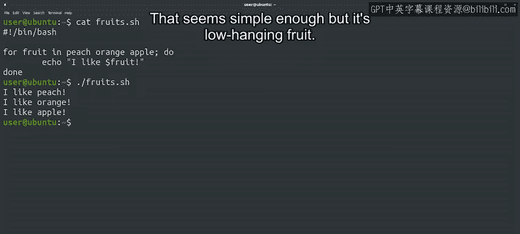
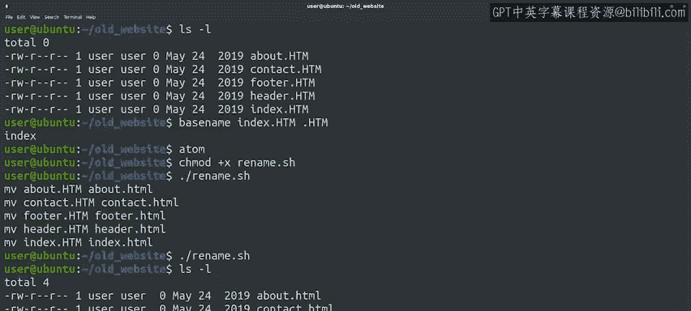

# 谷歌《用Python进行IT自动化办公1、2课（Python、控制操作系统）｜Google IT Automation with Python》中英字幕 - P153：79_Bash 脚本中的 for 循环.zh_en - GPT中英字幕课程资源 - BV1gw411E7E1

Both in Python and bash， four loops are used to iterate over a sequence of elements。

You may remember that the key to four loops is that they let us perform an operation on each of the elements in a sequence。

In Python， the sequences are data structures like a list， a tuple， or a string。In bash。

 we construct these sequences just by listing the elements with spaces in between。

Let's check this out using a very simple example。In this case。

 we're iterating over three different elements that have the names of fruits。

See how the for loop uses the same do Dun structure that the while loop used before。Now。

 let's execute this script and check that it does what we expect it to do。All right。

 that seems simple enough， but it's low hanging fruit。

Tasty for sure， but not that useful。 We called out in an earlier video that in bash。

 we can use gloves like star and questiontion mark to create list of files。😊。

These lists are separated by spaces， and so we can use them in our loops to iterate over a list of files that match a criteria。

 like all the files that end in dot Pf， all the files that start with IMG or whatever it is that we need。

Let's use a practical example to see this in action。

Imagine that you're migrating your company's website from one web server or software to another。

Your web content is stored in a bunch of files that all end in uppercase H。

 and the new software requires that they all end in lowercase HTML disasteraster。

 you can manually rename them one by one using the MV command， but that could get really old。

 really fast。You'd likely end up making mistakes after the first few commands。Instead。

 you could do the same thing with a short bash script。First， let's check out our files。

Okay， looks like we have five files that we need to rename。

So how can we extract the part before the extension？

There's a command called base name that can help us with that。

This command takes a file name and an extension and then returns the name without the extension。

Just like that， we're ready to write our script and rename the files。

We'll start as usual by including the bash Shabang line。

Our script will iterate with a for loop through all the files that end with dot HM so。Now。

 for each file， we want to call base name to keep the part of the file that we care about。

We'll store that in a variable called name。Easy enough。

 and now we'll use dollar sign parentheses to call the command and keep the output。

We're surrounding our file variable with double quotes to allow the command to work。

 even if the file has spaces in its name。This is a good practice in batchsh scripts when dealing with file names or any variables that could include spaces。

Now we'll call the MV command with the old and new names。In this case。

 we use double quotes for both parameters。Again， we want to make sure that it works correctly for file names with spaces。

And that's all that our loop needs to do。We'll finish our loop with the Dun key word。

And we're done almost。We still need to run our script to see if it does what it should。Now。

 let me share a trick with you that might save you a few headaches。

Whenever you're going to run a script like this that modifies the files in your file system。

 it's a really good idea to first run it without actually modifying the file system。

This would catch any possible bugs that the script might have。

So instead of just running it as it is right now， we'll add an echo in front of the MV command。

This means that instead of actually renaming， our script will print the renaming that it plans to do。

Now， let's save the script， make it executable and run it。Excellent。

Our script printed the actions that it would take， and it looks like it's going to do the right thing。

So let's remove the echo and make it actually rename the files。😡，This time， it didn't print anything。

 That's expected because these commands don't print anything when they succeed。

 Let's check that our rename work by listing the contents of our directory。Yes。

 we managed to rename all of our files successfully， and they all lived happily ever after。

Hopefully by now， you're starting to see how you can benefit from using Bsh scripts when dealing with files and system commands。

 especially to complement your Python scripts。Up next。

 we'll use all this batchsh scripting knowledge to solve an interesting system administration challenge。

 Stay tuned。