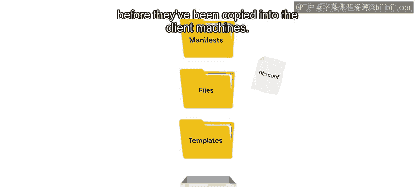
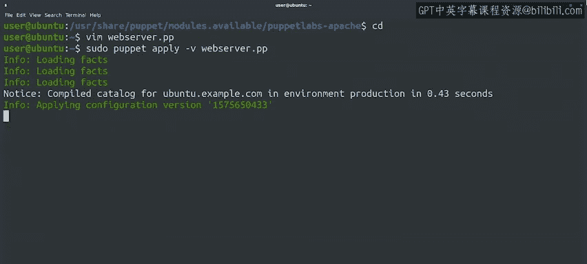

# 谷歌《用Python进行IT自动化办公3、4、5、6课（Git、debug、云端、实践）Google IT Automation with Python》中英字 - P154：37_组织 Puppet 模块.zh_en - GPT中英字幕课程资源 - BV1LW4y1F7XW

In any configuration management deployment， there's usually a lot of different things to manage。

 We might want to install some packages， copy some configuration files， start some services。

 schedule some periodic tasks。 make sure some users and groups are created and have access to specific devices and maybe execute a few commands that aren't provided by existing resources。

 On top of that， there might be different configurations applied to the different computers in the fleet。

 For example， workstations and laptops might include resources that aren't used on servers。

 and each distinct type of server will need its own specific setup。

There's a lot of different things to manage。 We need to organize all these resources and information in a way that helps us maintain them long term。

 This means grouping related resources， giving the group's good names and making sure that the organization will make sense to new users。

In Puppet， we organize our manifests into modules A module is a collection of manifests and associated data。

We can put any resource we want into a module， but to keep our configuration management organized。

 we'll group things together under a sensible topic。For example。

 we could have a module for everything related to monitoring the computer's health。

 another one for setting up the network stack， and yet another one for configuring a web serving application。

 So the modules ship the manifest than the associated data。 but how is this organized。

 All manifests get stored in a directory called manifests。

 The rest of the data is stored in different directories depending on what it does。

The Fi directory includes files that are copied into the client machines without any changes。

 like the NTP。com file that we saw in our last video。

And the templates directory includes files that are pre processsed before they've been copied into the client machines。

These templates can include values that get replaced after calculating the manifests or sections that are only present if certain conditions are valid。

 there's a bunch more directories that can be part of a module。

 depending on what exactly the module does。 but you don't need to worry about these when creating your first puppet module。

 You can start with a simple module that just has one manifest in the manifest directory。

This file should be called init do PPP， and it should define a class with the same name as the module that you're creating。

 Then any files that your rules use need to be stored in the files or templates directories。

 depending on whether you copy them directly or need to pre processcess them。 For example。

 This is how the NTP class that we saw in our last video looks like when turned into a module。

There's an init。 PPP file which contains the NTP classes that we saw before， and the NTP。

com file that gets deployed onto the machine is now stored in the files directory。

 Modus like these can look pretty much the same no matter who's using them。That's why over time。

 system administrators using Puppet have shared the modules they've written。

 letting others use the same rules。 By now， there's a large collection of prepackaged modules that are shipped and ready to use。

If one of those modules does what we want， we can just install it on our puppet server and use it in our deployments。

Let's install the Apache module provided by puppet Labs to check out how this works。Okay。

 we've installed the module， let's have a quick look at its contents first we'll change into the directory where the module files are stored and list its contents。

We see the files， manifests and templates， directories that we mentioned。 On top of that。

 there's a lib directory that adds functions in facts to the ones already shipped by puppet。

And the metadata。 JO file includes some additional data about the module we just installed。

 like which versions of which operating systems it's compatible with。

Let's peek into the Mans directory。Whoa， that's a lot of files。

 kind of like how we split the different things that we want to manage into separate modules。

 We can also split each separate functionality that we want to configure into separate manifests。

This helps us organize our code when we make changes to it。

And see how this directory also contains its own in it。 PP。As we called out。

 this manifest is special， it needs to always be present because it's the first one that's read by puppet when a module gets included。

So how do we include a module like this one？It's pretty easy。

Let's create a manifest file that includes the module we just installed。Here。

 we're telling Puppet to include the Apache module。

 the double colon before the module name lets puppet know that this is a global module。

Let's save this file now and apply it using Puppet Apply like we did before。

Our manifest was super simple。 It just included the Apache module。 but by including the module。

 we got puppet to apply all the rules run by default in the module。

 We now have an Apache server configured and ready to run on this machine。 Andy， right， Okay。

 We've just seen how we can organize our code and modules and how we can even use modules provided by other teams so we don't have to reinvent the wheel。

Up next， there's a reading with pointers to more information， followed by a quick quiz。After that。

 meet me over in the next video where we'll check out what we need to do to deploy our rules to more machines。

