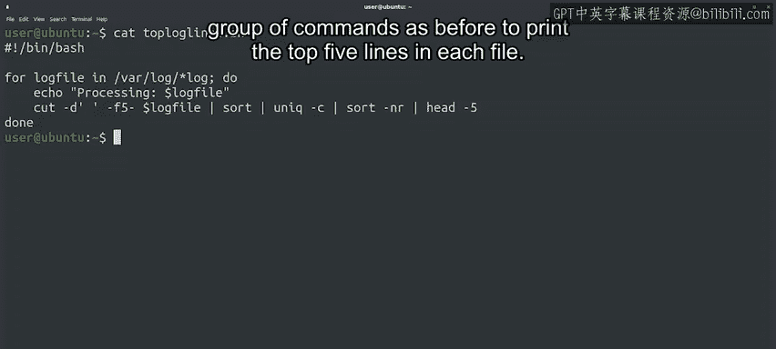

# 谷歌《用Python进行IT自动化办公1、2课（Python、控制操作系统）｜Google IT Automation with Python》中英字幕 - P154：80_高级命令交互.zh_en - GPT中英字幕课程资源 - BV1gw411E7E1

Over the past few videos， we've learned a lot about how to do things in the Linux command line and in bash scripts。

 We'll now look at a couple interesting applications for all these bash scripting powers that we just learned to put all this new knowledge into action。

 Let's go back to our old friend， the system log file located in Var log Cs log。😊。

The system log file contains a trove of information about what's going on in the system。

 So it's really important to learn how to get information out of it。

 Let's use the command to look at the last 1 lines in the file right now。

The log lines we see follow a similar pattern。First。

 they include the date and time of when the entry was added to the file。

 then the name of the computer， then the name and PID of the process that triggered the event。

 and finally， the actual event that's being logged。Take a second and look at those lines。

 Sa that we had a computer that was under significant load， but we didn't know why。And to find out。

 we wanted to check what events are being logged the most to our cis log。To do that。

 we need to extract the part of the line that has the actual event without the date and time。

 We could use a command called cut to help us with that。

This command lets us take only bits of each line using a field delimiter。 In this example。

 we can split the line using spaces。That would look something like this。In our example。

 we're passing dash D space to cut， to tell it that we want to use a space as a delimiter and dash F5 dash to tell it that we want to print the field number5 and everything that comes after it。

With that， we removed the date and the name of the computer。

 keeping only the process and the event message SNip SN now that we have the information that we care about。

 we can pipe this to the same pipeline of commands that we saw in an earlier video to find out the lines that were repeated the most。

Like this。As you can see， we've chained together a bunch of commands so that we get the most repetitive lines in our cis log file。

There are more files in var log that we might be interested in。

 so we can use a for loop to iterate over each of the log files in var log and get the most repeated lines in each of them。

 I know what you're thinking。This sounds like it's getting a little bit too complex for a one line chain of commands。

We're better off putting this into a bash script， something like this。In this script。

 we process all files in var Lo， by end in log。We then print the name of the file that we're processing and then use the same group of commands as before to print the top five lines in each file ready。

 let's execute it and see this in action。

Nice。Our script shows us the most common lines on each file in var log。

There are a lot of files in there。And with that， we wrap up our introduction to bash scripting。

 amazingazing work。😊，Now that you have scripting skills in both Python and Bsh。

 you might be wondering when to use one versus the other。Well。

 we'll talk about that in our next video。 See you there。

