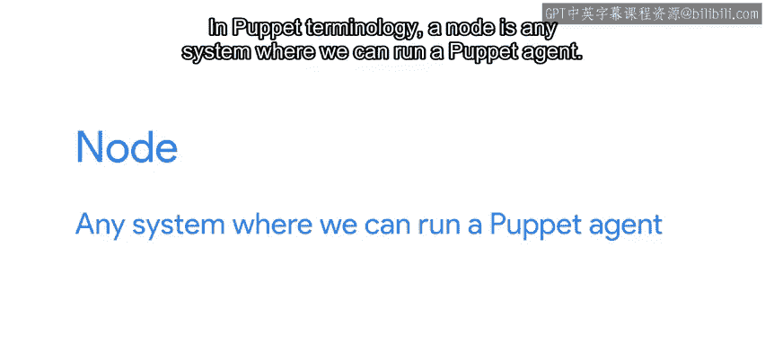
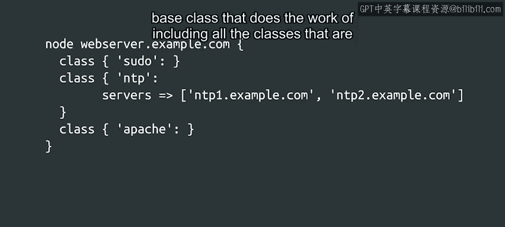

# 谷歌《用Python进行IT自动化办公3、4、5、6课（Git、debug、云端、实践）Google IT Automation with Python》中英字 - P155：38_Puppet 节点.zh_en - GPT中英字幕课程资源 - BV1LW4y1F7XW

When managing fleets of computers。We usually want some rules to apply to every computer and other rules to apply only to a subset of systems。

 Let's say you're managing all your service with Pupp。

You might want to install a basic set of tools on all of them。

 but only install the packages for serving web pagess in your web servers and only install the packages for sending and receiving email in your mail servers。

 there's a bunch of different ways that we can do this in an earlier video we saw how to conditionally apply some rules using facts from the machines。

Another way to apply different rules to different systems is to use separate node definitions。

In puppet terminology， a node is any system where we can run a puppet agent。

 It could be a physical workstation， a server， a virtual machine， or even a network router。

 as long as it has a puppet agent and can apply the given rules。

 so we can set up puppet to give some basic rules to all the nodes。

 but then apply some specific rules to the nodes that we want to be different。

Let's check out an example of how this could look。When setting up puppet。

 we usually have a default node definition that lists the classes that should be included for all the nodes。

For example， it could look something like this。Here， the default node is including two classes。

 the pseudo class， and the NTP class。For the NTP class。

 we're setting an additional servers parameter that lists the servers we can use to get the network time。

As you can see here， when defining a node， you can include a class by just using its name if there's no additional settings。

Or include the class and set additional parameters if necessary。Alright， that's the default node。

 so it will apply to computers in the fleet by default。

What if you want some settings to only apply to some specific notess。

 You can do that by adding more no definitions that list the classes that you want them to include like this。

We can see here that specific nodes in the fleet are identified by their FQDNs or fully qualified domain names。

In this case， we have the no definition for a host called webserver。example。com。For this node。

 we're including the same pseudo and NTP classes as before， and we're adding the Apache class on top。

We're listing the same classes because the classes included in the default node definition are only applied to the nodes that don't have an explicit entry。

 In other words， when a node requests which rules it should apply。

 puppet will look at the node definitions， figure out which one matches the node's FQDN and then give only those rules。

To avoid repeating the inclusion of all the common classes。

 we might define a base class that does the work of including all the classes that are common to all node types。

Now， where's this information stored？The node definitions are typically stored in a file called S dot P P。

 which isn't part of any module。 Instead， it just defines what classes will be included for what nodes。

 This is another step towards helping us organize our code in a way that makes it easier to maintain。

 up next， we'll look into the infrastructure used by puppet to verify if a node really has the name that it claims to have。

