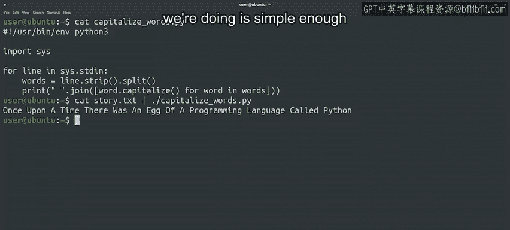
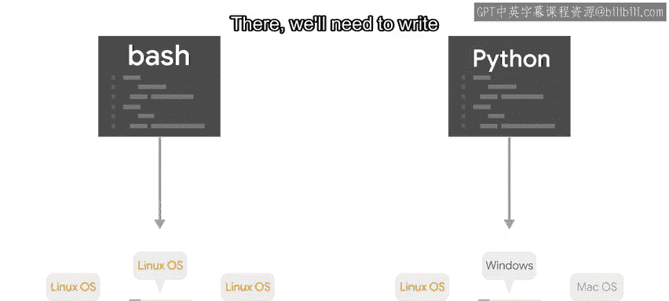

# 谷歌《用Python进行IT自动化办公1、2课（Python、控制操作系统）｜Google IT Automation with Python》中英字幕 - P155：81_选择 Bash 还是 Python.zh_en - GPT中英字幕课程资源 - BV1gw411E7E1

As you can probably tell by now， there's a lot of interesting things that we can do with the system commands。

We've come across a bunch of different commands that can help us operate with files and processes and get more information about the computer。

 process the contents of files， and all sorts of other things。By using Bsh scripts。

 we can very quickly turn a command that operates on just one file into an automated script that handles  a thousand files。

Pretty powerful， right？As we saw with our log file examples。

 there's a bunch of terminal commands that provide text processing functionality。

Plenty of them also support regular expressions， allowing us to do some very advanced processing of the data in our files。

When these commands are linked together in a data processing pipeline。

 they can become a powerful tool for processing text data。

They can give us the information we're looking for quickly without the need to write a full script。

 but you know what they say about great power。We need to be careful not to abuse this because it can quickly become unreadable。

Take a look at this example。Yuck， this command line is using some stuff we saw and some other stuff that we didn't look into。

 like how to do indexing on bash strings to turn the first letter of each word into uppercase。

We can probably agree that this command line is pretty unreadable。

If there happened to be a bug in it， it would be really hard to figure out how to fix it。

When a bash command line starts becoming this complex。

 it's a better idea to write a Python script that handles the data in a more readable and testable way。

A simple script could look like this one。In this example， we take each line of standard input。

 remove the white space， and split it into separate words。

 Then we use a list comprehension to capitalize each of the words and end up joining them back with spaces and printing the output。

Once we have the script， we can execute it as part of a pipeline like this。

So it's a good idea to choose Bsh when we're operating with files and assistant commands。

 as long as what we're doing is simple enough that the script is self explanatory。

As soon as it becomes hard to understand what the script is doing。

 it's better to write it in a more general scripting language like Python。

 Bsh scripts aren't as flexible or robust as having an entire Python language available with its many functions to operate on strings。

 lists and dictionaries。 There is another gotcha when it comes to bash and Linux commands。

 And it's something that we've said before。😊，Their availability depends on the platform that we're using。

Some commands might not be present on certain operating systems。

Writing a bash script can get the job done very quickly on a Linux machine。

 but it won't work on a Windows machine there we'll need to write the same script in PowerSll。

So if the task that you're trying to accomplish is limited to the current server or fleet of servers all running the same operating system。

 a simple bash script can get the job done。But if your code is complex or you need to work across platforms。

 you might be better off using the Python standard library or other external modules that provide the same functionality。

Last thing。There are lots of situations where either a bash script or a Python script might solve the problem just fine。

In those cases， you can choose whichever one you feel more comfortable with。Pick your poison。

 Hopefully， this is all starting to make sense。Whether you choose to write a Bsh script or Python。

 both of these skills are going to serve you well in an IT environment。

