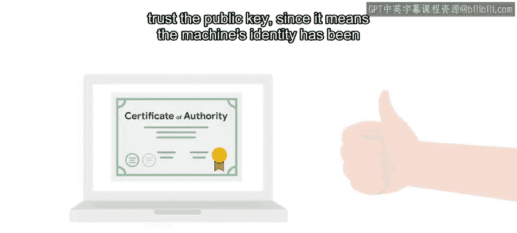

# 谷歌《用Python进行IT自动化办公3、4、5、6课（Git、debug、云端、实践）Google IT Automation with Python》中英字 - P156：39_Puppet 证书基础设施.zh_en - GPT中英字幕课程资源 - BV1LW4y1F7XW

We've called that a few times that in typical puppet deployments。

 all managed machines in the fleet connect to a puppet server。

The clients send their fax to the server， and the server then processes the manifests。

 generates the corresponding catalog， and sends it back to the clients to apply it locally。

In our last video， we mentioned that we can apply different rules to different nodes depending on their names。

The clients send their name to the server when they connect。

But how can the server trust that a client is really who it claims to be？

It's a dangerous world out there。Well， this is a complex subject that touches on some important security concepts。

We'll do a quick rundown here if you're interested in learning more。

 you might want to check out the security course in the Google IT Support Professional certificateate program led by my colleague Gion。

 who explains it in more detail。 Puppet uses public key infrastructure or PKI to establish secure connections between the server and the clients。

There's a bunch of different types of public key technologies the one used by puppet is secure Sockets layerer or SSL。

 This is the same technology used for encrypting transmissions over HTTPS。

 The client use this infrastructure to check the server's identity and the server uses it to check the client's identity and all communication is done over an encrypted channel that uses these identities so it can't be intercepted by other parties。

So how does this work， Each machine involved has a pair of keys related to each other。

 a private key and a public key。 The private key is secret， only known to that specific machine。

The public key is shared with other machines involved。

Machines can then use a standardized process to validate the identity of any other machine。

The sender signs a message using their private key。

 and the receiver validates the signature using the corresponding public key。Okay。

 but how do machines know which public keys to trust？

This is where a certificate authority or CA comes in。

TheCA verifies the identity of the machine and then creates a certificate stating that the public key goes with that machine After that。

 other machines can rely on that certificate to know that they can trust the public key。

 says it means the machine's identity has been verified puppet comes with its own certificate authority。

 which can be used to create certificates for each client so you can use that one。

 or if your company already has a CA that validates the identity of the machines in your fleet。

 you can integrate it with puppet， so you only validate the ident once。

Now， let's assume you're using the Baked Den certificate infrastructure and dive into how this process works。

When a node checks into the puppet master for the first time， it requests the certificate。

The puppet master looks at this request and if it can verify the node's identity。

 it creates a certificate for that node。The system administrator can check the identity manually or use a process that does this automatically using additional information about the machines to verify their identity When the agent node picks up this certificate。

 it knows it can trust the puppet master。And the node can use the certificate from then on to identify itself when requesting a catalog。

You might be wondering， why do we care so much about the identity of the nodes？

There's a bunch of reasons。 First， puppet rules can sometimes include confidential information that you don't want to fall in the wrong hands。

But even if none of the rules hold confidential info。

 you want to be sure that the machine you're setting up as your web server really is your web server and not a rogue machine that just claims to have the same name。

All sorts of things could go wrong if random computers start popping up in your network with the wrong settings。

 if you're creating a test deployment to try out how puppet rules get applied。

 and so you're only managing test machines， you can configure Puppet to automatically sign all requests。

 but you should never do this for real computers being used by real users。

Remember that it's better to be safe than sorry。 So always take the time to authenticate your machines。

 When starting out with puppet， it's common to use the manual signing approach。 In this case。

 when the node connects to the master， it will generate a certificate request。

 which will go into a queue in the puppet master machine。

You'll then need to verify that the machine's identity is correct。

 and the baked in C A will issue the corresponding certificate。 If your fleet is large。

 this manual approach won't really work。Instead， you'll want to write a script that verifies the identity of the machines automatically for you。

One way to do this is by copying a unique piece of information into the machines when they get provisioned。

 and then use this pre shared data as part of their certificate request。That way。

 your script can verify that the machines are who they claim to be without involving any humans。

Great， you now have a broad idea of the infrastructure that puppet uses to identify the nodes when they connect to the master。

Up next， we'll see what the typical puppet setup up using a separate puppet server and client looks like in practice。

