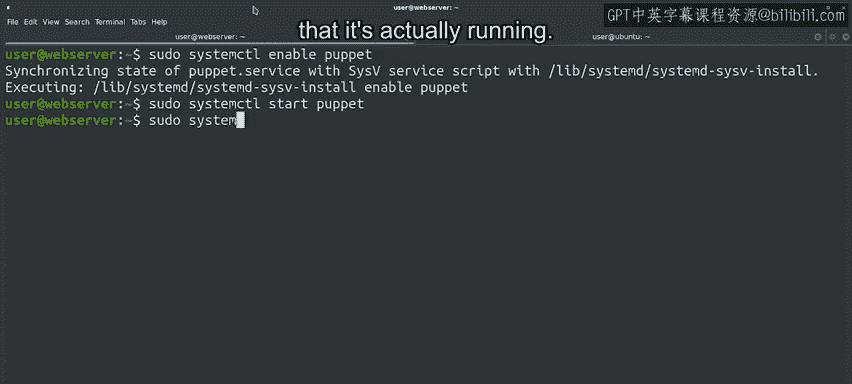

# 谷歌《用Python进行IT自动化办公3、4、5、6课（Git、debug、云端、实践）Google IT Automation with Python》中英字 - P157：40_设置 Puppet 客户端和服务器.zh_en - GPT中英字幕课程资源 - BV1LW4y1F7XW

We're now ready to see a puppet deployment in action。

 we've already installed the puppet master package on this computer， so we'll use it as the master。

Since this is a test deployment to demonstrate Puppet。

 we'll configure it to automatically sign the certificate requests of the nodes we add。But remember。

 if we were deploying this to real computers， we'd have to manually sign the requests or implement a proper validating script。

We'll do this by calling the puppet command with the config parameter and then saying that in this section master。

 we want to set auto sign to true。All right， with that。

 we can connect to the client that we want to manage using puppet。

We'll connect using SSH to a machine called web Server On this machine we'll install the puppet client。

 which is shipped by the puppet package。Nice， we have the puppet agent installed。

Now we need to configure it to talk to the puppet server that we're running on the other machine。

To do that， we'll use puppet Configud like before， but this time we'll tell it that we want to set the server to Uuntu。

example。com。Great， now that we've configured the server。

 we can test the connection to the puppet master by using the puppet agent command。

 passing dash Fas before to get verbose output， and dashash test to do a test run。As usual。

 puppet tells us everything it did。 It first created an SSL key for the machine。

 It then read a bunch of information from the machine and used this to create a certificate request。

 The agent shows us the fingerprint of the certificate requested。 If we were using manual signing。

 We could use this fingerprint to verify that the request and the server matches the one generated on the machine。

 The certificate was then generated on our puppet master。

 We don't see any entries for that because it happened on the other computer。

 but we see that this computer received a certificate and stored it locally。

Once the certificate exchange completed， the agent retrieved all the information from the machine and sent it to the master。

In exchange， it got back a catalog and applied it。 The catalog applied almost immediately because we haven't actually configured any rules to be applied to our clients。

 We should go ahead and do that now。We'll go back to our puppet master and create a couple of no definitions。

As we called out， no definitions are stored in a manifest file called site。pp。

 which is stored at the root of the nodes environment。

We'll talk more about environments in a later video for now。

 we just need to know that our client is trying to access the production environment。

 so the file that we need to create will be located in s Etsy puppet code environmentvironments production Mans。

 and it will be called site。P。In this file， we'll create a couple of no definitions。

 We want to install Apache in our web server， so we'll create a no definition for the web server with the Apache class and no parameters for now。

And we'll also add a default， no definition。We'll keep it empty for now。

 we can add more classes in the future。All right， With that， we have our very basic node definition。

 We can now save this and run the puppet agent on our web server machine again。This time。

 the puppet agent connected to the puppet master and got a catalog that told it to install and configure the Apache package。

 This included setting up a bunch of different services。

Up to now we've been doing manual runs of the puppet agent for testing purposes。

Now that we know it's working fine， we want to keep puppet running automatically that way。

 if we make changes to the configuration， clients will automatically apply those changes without us having to do any manual steps。

So to do that， we'll use the system CTL command， which lets us control the services that are enabled when the machine starts and those that are currently running。

So we'll first tell System CTL to enable the puppet service so that the agent gets started whenever the machine reboots。

And then we'll tell System CTL to start the puppet service so that it starts running。Last up。

 we'll ask System CTL for the status of the puppet service to check that it's actually running。

Awesome， that works。 The puppet agent will keep regularly checking in with the master and ask if there are any changes that need to be applied to the machine。

 And with that， you've seen puppet ina using the server client model。

 We use the configuration we set in the puppet master to manage the installation and configuration of software in our web server。

And we set up the puppet agent in the Web server to keep running so that the configuration stays up to date。

 We've only seen the very basics of how to configure puppet。

 But this can already give you an idea of how powerful configuration management can be。

 Pretty exciting， right。😊，Up next， we've gathered more info on how to do the client server setup and after that。

 a quick quiz to check that everything is still making sense。

