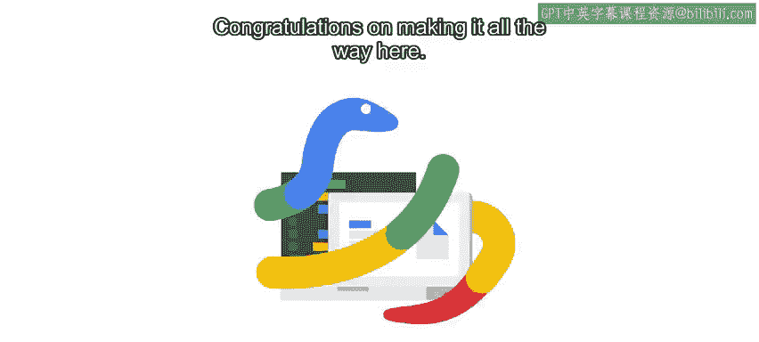

# 谷歌《用Python进行IT自动化办公1、2课（Python、控制操作系统）｜Google IT Automation with Python》中英字幕 - P157：83_最终项目介绍.zh_en - GPT中英字幕课程资源 - BV1gw411E7E1

🎼。う。

Well， here we are。 We're finally at the last module of the course。

 Congratulations on making it all the way here。😊，It's been a long and challenging road。

 and hopefully you're now feeling confident about automating system tasks through Python。 Great work。

😊，Along our journey， we've become much more familiar with lots of tools that Python has to offer。

 We've learned about managing files and directories。

 reading and writing both text files and CSV files， using regular expressions。

 understanding how the system interacts with our programs， executing system commands。

 and writing automated tests to name a few。We've even learned a bit about different scripting language。

 called bash。Wow， that's a healthy course load， and you handle it like a champ。

You should definitely feel proud of yourself for making it this far。

 and now it's time for the crowning jewel of this course。

This project will let you put all of your knowledge together to solve a real world problem that you might encounter in your IT role。

As a refresher， we'll start by reviewing the process of dealing with an automation project。

After that， we'll be ready to dive head first into the project。Are you ready？ Yeah。

 of course you are。 Let's get to it。