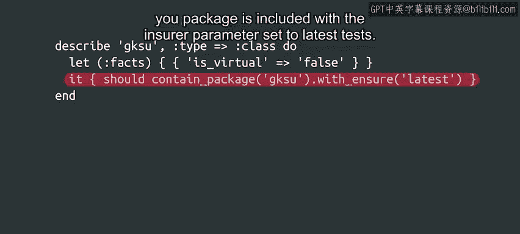

# 谷歌《用Python进行IT自动化办公3、4、5、6课（Git、debug、云端、实践）Google IT Automation with Python》中英字 - P158：41_修改和测试清单.zh_en - GPT中英字幕课程资源 - BV1LW4y1F7XW

As we've called out， when we changed the manifest modifying a setting that's already managed by puppet。

 puppet applies this change to the notes。The puppet agent does whatever is needed to bring the nodes to the new desired state。

So you can make a small change in your manifests and have that modify all the machines in your fleet This is super powerful。

 but with great power comes great responsibility in the next few videos we'll look into how we can test our changes to make sure they do what we want them to do and then apply them onto our fleet without causing trouble。

😊，It's pretty common for IT specialists working on configuration management to test out new rules on their machines by simply forcing the machine to apply the manifest they want to test。

We've done this in some of our examples where we applied the rules locally before applying them to remote machines。

 This approach can backfire， though， say you're trying to use puppet to change the permissions of some files on the nodes。

 locking down some paths that you don't think that your users will need。Now。

 imagine you try out the rules on your computer and discover you made a mistake and locked yourself out。

 oops。So what can you do instead， there's a bunch of things to consider a simple first step is to use the puppet parser validate command that checks that the syntax of the manifests is correct。

On top of that， we can also run the rules using the D dash NoOA parameter。

The name comes from no operations and it makes puppets simulate what it would do without actually doing it。

 you can look at the list of actions that it would take and check that they're exactly what you wanted puppet to do。

But if the change is complex， it's likely that we'll miss something important when looking at the planned actions。

Another option you could use is having test machines that are used only for testing out changes。

You can apply the rules there and after a puppet has run， check that everything's working correctly。

 but again， this is a manual process and we might forget to verify something important How can we automate it？

Kind of like the Python automatic tests that we checked out in an earlier course。

 Pet also lets us test our manifests automatically by using R spec tests。In these tests。

 we can set the facts involved the different values and check that the catalog ends up stating what we wanted it to。

Let's check out an example。Here we're setting the is virtual fact to false。

 and then we ask the test infrastructure to verify that the GKSU package is included with the insure parameter set to latest。

Tests like this one can be a useful way to check that our catalog is written correctly。

And they can be super helpful when our rulers use a lot of facts that interact with each other。

 and we want to check that the result is actually what we intended。

We can write a bunch of these tests and run them automatically whenever there's a change to the rules。

This way， we can be sure that the rules stay valid and know that the new changes didn't break the old rules。

But that just checks that the catalog contains the rules that we said it should contain。

How can we verify that these rules actually have the effects we want。

 like enabling the corporate website or setting up a strict firewall？

We need to apply the rules on the nodes and check that the result is correct。

We can automate this process， too。To do this， we can use a set of test machines where we first apply the catalog and then use scripts to check that the machines are behaving correctly Now let's assume all your tests were successful and the changes is ready to be published。

 How do you push it safely to your whole fleet That's coming up in our next video。

