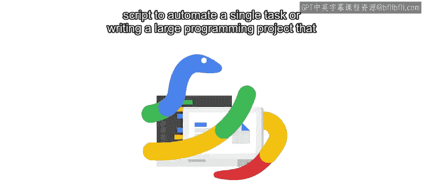
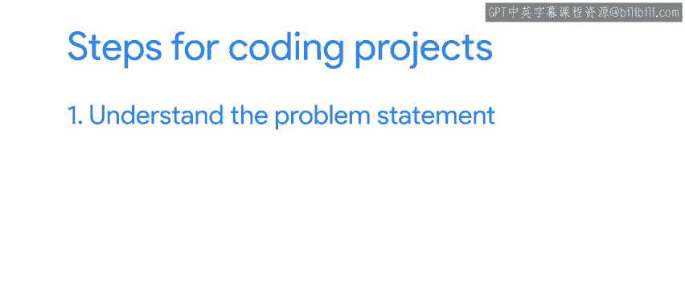
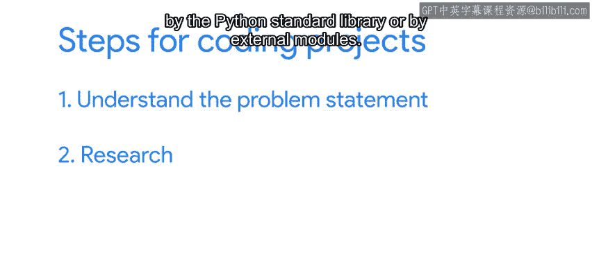
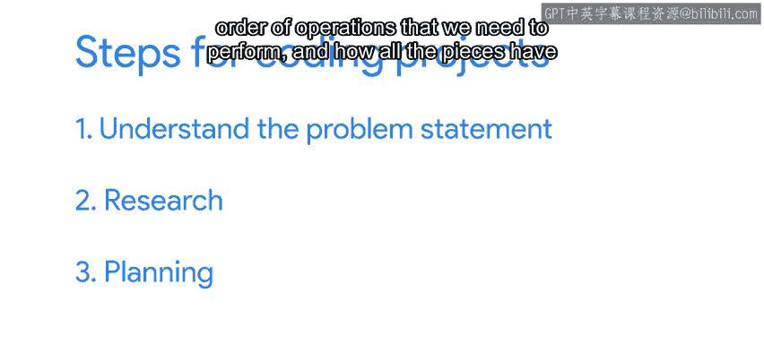
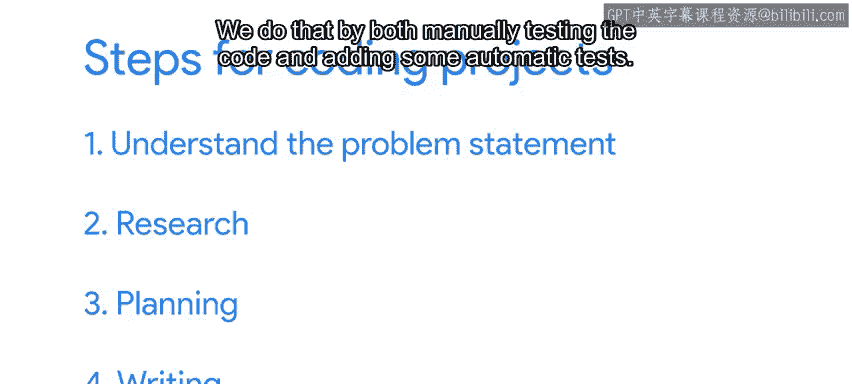

# 谷歌《用Python进行IT自动化办公1、2课（Python、控制操作系统）｜Google IT Automation with Python》中英字幕 - P158：84_从头开始编写脚本.zh_en - GPT中英字幕课程资源 - BV1gw411E7E1

🎼。う。

Whenever you're tackling a project that requires coding like writing a small script to automate a single task or writing a large programming project that handles a lot of information。

 there's a process that we recommend that you follow。

 We looked at this already in the first course of the program。

 but let's go over it once again to have it fresh in our minds。

Things run much smoother when you remember to check all the boxes。

The first step to handle any coding project is to fully understand the problem statement。

This includes spelling out what needs to be done and identifying what the given inputs and desired outputs are for that program that we need to write。

After that， we recommend doing some research。 This means figuring out how we can tackle the problem with the tools provided by the Python Standard Library or by external modules。

😊。

Remember， we want to avoid reinventing the wheel。 No matter how tricky and intricate the challenge appears。

 chances are that others have solved something similar before。 Coing is a bit like Hollywood。

 There are not that many new ideas， mostly reimaginings。

 So it's valuable that we spend some time looking into what resources exist to help us solve our problem。

 This research phase also includes looking at the documentation of the modules。

 classes and functions that we'll need to use and understanding how they should be applied。

A lot of the documentation also includes examples， so it's helpful to absorb those and see how they relate to the code that we need to write。

Once we know what we need to write and what tools we can use to make it work。

 we should do some planning。

This means thinking about what data types are useful for our solution。

 the order of operations that we need to perform， and how all the pieces will come together to form our solution。

 synergy。If the problem is complex， it might help to write down the plan for quick reference。

 either on a piece of paper or in a digital document。

Writing down the plan helps us focus on how we're going to do things and identify any problems our plan might have。

At many companies， it's a common practice to write a design document at this stage。

 detailing the problem statement， the tools that will be used to solve it。

 and the plan of attack towards a solution。And having others comment on your design helps make sure that all the twists have been untangled。

 Finally， once we have a clear plan， we do the actual writing of the script。😊。

This step includes not only writing the code， but also checking that the code does what it's supposed to do。

We do that by both manually testing the code and adding some automatic tests。

Sometimes it's tempting to just jump right into the coding stage about spending any necessary time to fully understand the problem。

 research tools， or plan the solution。But our experience shows that spending a while getting familiar with what we're trying to do and what tools we have available to do it can make a big difference。

Both in how long it takes to do the actual implementation and ultimately how well our solution behaves。

 so practice following this process as you dig into the final course project and then try to apply this to any coding projects that you might tackle in the future Up next。

 we'll reveal the long awaited final project。What could it be。

 We'll keep you in suspense until the next video。