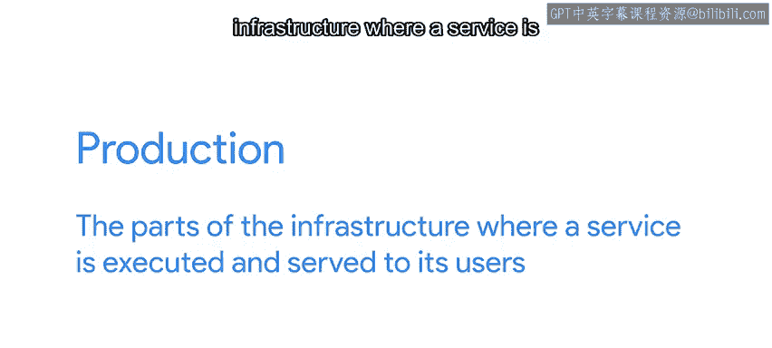

# 谷歌《用Python进行IT自动化办公3、4、5、6课（Git、debug、云端、实践）Google IT Automation with Python》中英字 - P159：42_安全地推出和验证变更.zh_en - GPT中英字幕课程资源 - BV1LW4y1F7XW

Once you've prepared and tested the changes that you want to make， it's time to roll them out。

But not so fast， even if you've tested the change on your computer on a test computer。

 and it worked just fine， it doesn't mean that the change will work correctly on all machines running in production。

First， what do we mean by production？In an infrastructure context。

 production is the parts of the infrastructure where a service is executed and served to its users。

If you host a website， the servers that deliver the website content to the users are the production servers。

Inside your company， the servers that validate users' passwords are the production authentication servers。

 you get the idea。Making changes to the production servers can be tricky because if something goes wrong。

 the service can go down。So how can we roll out changes safely？

The key is to always run them through a test environment first。

 the test environment should have one or more machines running the exact same configuration as the production environment。

 but these machines aren't actually serving any users of the service。This way。

 if there's a problem when deploying the changes， you'll be able to fix it without any actual users seeing it。

 as we briefly touched on in an earlier video， puppet has environments baked in。

Each environment has its own directory with its own set of manifests and modules。

Puppet environments let us fully isolate the configurations that the agents see depending on what environment they're running。

And this isn't just what nodes install which modules。 It's also the whole contents of the modules。

 For example， we can use this to try out a whole new version of the Apache module for the machines in the test environment while still using the old version for the production environments。

You can define as many environments as you need， for example。

 you could have a development environment for IT specialists to try out new puppet rules before they even reach the test environment。

Or say you're developing a very tricky new feature for your system and you don't know when it'll be ready。

 you could have an environment for testing just that specific feature。

Now let's assume that you have a bunch of changes ready to roll out。

 you'll usually push them to the machines in the test environment first and check that everything works well there。

This can include both manual verification and automated checking。Okay。

 say the changes worked fine in the test environment。

 how do you roll them out to the other machines in your fleets？

You might be tempted to just apply the changes to all the machines and be done with it。

But pushing changes to every machine at the same time is usually not a great idea。

 it's always possible that we missed some special case when preparing the change。

 which wasn't part of our test environment and suddenly half our fleet is offline oops。

So instead of pushing the changes to all nodes， we'll usually do it in batches。

There's a bunch of ways you can do this， depending on how your fleet is arranged。

You could have some machines with a fact that marks them as early adopters or canaries。

Sort of like the canaries that coal miners use to detect toxic gases in the mines。

 these nodes detect potential issues before they reach the other computers。

So you could push the changes to the canaries on one day， check that everything's working fine。

 and then deploy them to the rest of the fleet on the next day。That way。

 if there's an issue with the changes that wasn't caught in testing。

 only a subset of the users might see it as soon as you get notified of the problem。

 you can roll it back and avoid it hitting the rest of the fleet。

Now we've been talking about changes without going into detail on what those changes are。

It's a good idea for these changes to be small and self contained that way， if something breaks。

 it's much easier to figure out where the problem was。

Imagine you're trying to push six months worth of changes to your fleet of computers when you push this to the machines in the test environment。

 you discover that they stop responding altogether。

You now need to comb through all the changes that were bundled together to try to find out which one is causing the problem。

Instead， you could aim to roll out your changes every one or two weeks。

This would mean that whenever a problem is detected。

 there's only a small list of changes to go through to figure out the culprit。 Of course。

 there's a lot more to say about testing and releasing changes safely。

 but you don't need to put all the best practices in place to get started you can start small and make improvements as you go as your manifests get more complex。

 you want to improve the automated testing of all the pieces。

 And as the fleet you manage with your configuration management system grows in size。

 you'll want to increase the size of your testing environment， move some nodes to canaries and so on。

Up next， there's a reading with more information on using these testing practices in your projects。

 and then a quick quiz。