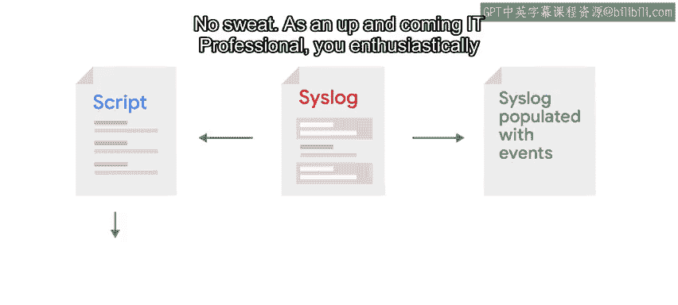
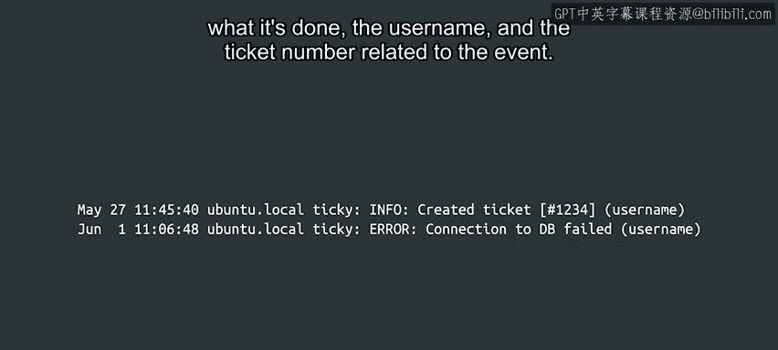

# 谷歌《用Python进行IT自动化办公1、2课（Python、控制操作系统）｜Google IT Automation with Python》中英字幕 - P159：85_项目问题陈述.zh_en - GPT中英字幕课程资源 - BV1gw411E7E1

🎼。う。Imagine a scenario。 One of the servers used by your company runs a service called Ty。

This service is an internal ticketing system used by lots of different teams in the company to manage their work。

The service logs a bunch of events to cis log， both when it runs successfully and when it encounters errors。

 the developers of the service are asking for your help with getting some information out of those logs to better understand how the software is being used and how to improve it。

😊。

No sweat。As an up and coming IT professional， you enthusiastically accept this mission。

So for your final project in this course， you'll write some automation scripts that will process the system log and generate a bunch of reports based on the information extracted from the log files。

The log lines follow a pattern similar to the ones we've seen before。Something like this。

When the service runs correctly， it logs an info message to Cislog， stating what it's done。

 the username， and the ticket number related to the event。If the service encounters a problem。

 it logs an error message to the cis log， indicating what was wrong and the username that triggered the action that caused the problem。

 the developers of the service want two different reports out of this data。

The first one is the ranking of errors generated by the system。

This means a list of all error messages logged and how many times each of them was found not taking into account the users involved。

They should be sorted by the most common error to the least common error。

The second one is a usage statistics for the service。

This means a list of all users that have used the system。

 including how many info messages and how many error messages they've generated。

This report should be sorted by user name。To visualize the data in these reports。

 you want to generate a couple of web pages that will be served by a web server running on the machine。

To do this， you can make use of a script that's already in the system called CSV to Hml dot pi。

 This script converts the data in a CV file into an Hl file containing a table with the data。

Then put the files in the directory that's used by the web server to display the web pages。

 The goal is to have one script that can get all the necessary work done automatically every day without any user interaction。

This script doesn't need to do all the work itself。

It can call on other scripts to do individual tasks and then put the results together。 In fact。

 we recommend splitting the task so that each piece can be written and tested separately。

I imagine that your mind is racing。 Your pulse might have sped up a little bit。

 and your palms are sweating all over the keyboard。 Don't worry， this might sound like a lot of work。

 but once you've understood the problem and done some research and planning。

 everything will start to fall into place。In our next video。

 we'll give you some tips on how to start breaking this task down。 Here we go。

