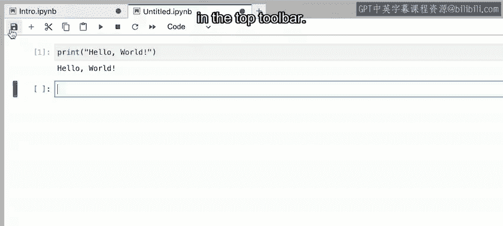
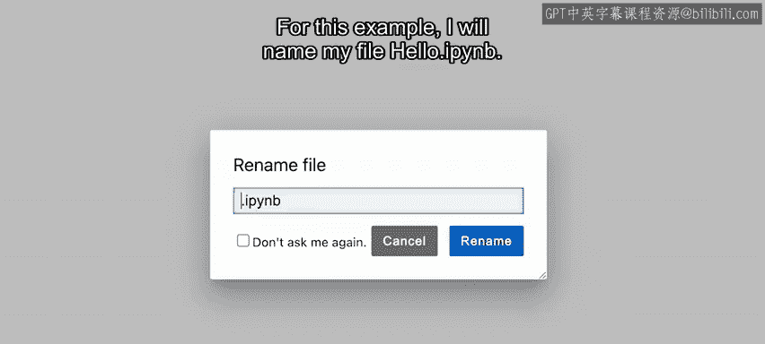
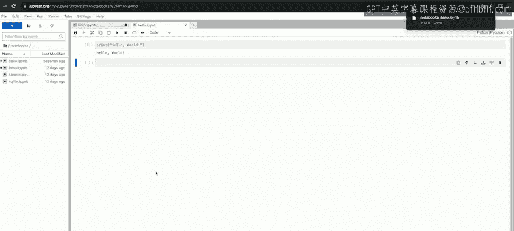
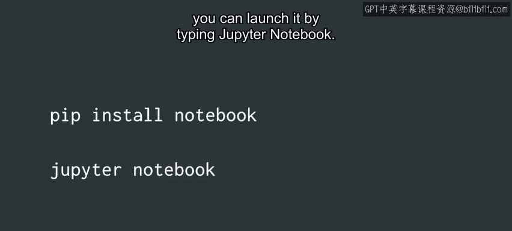

# 谷歌《用Python进行IT自动化办公1、2课（Python、控制操作系统）｜Google IT Automation with Python》中英字幕 - P15：14_使用 JupyterLab 和 Jupyter Notebooks.zh_en - GPT中英字幕课程资源 - BV1gw411E7E1

There are many different environments that you can use to write and run code In this video。

 you'll learn more about Jupiter La and Jupiter notebooks for writing。

 running and debugging Python code。😊，Jupiter Lab and Jupiter Notes are part of an open source project called Project Jupiter and are free to use。

 You can learn more about Project Jupiter@ Jupiter。org。

Jupiter Lab is a web based interface that allows you to use Jupyter notebooks to write。

 run and debug Python code Jupiter Lab provides an online environment that allows you to run your code in the cloud。

😊，Jupiter notebook can be used in the web based interface through Jupyter Lab or on your local machine。

Jupiter notebook allows you to create text based documents that contain live code blocks。

 You can write Python programs and scripts using Jupyter notebooks and see how they execute all in one place。

 It's a great tool for creating and understanding the code you're writing。

 because you can see your input and output all in one spot。😊。

This is what a basic Jupiter notebook looks like Next we will cover how to use Jupiter notebooks。😡。

One of the most popular ways to use Jupiter notebooks is in the cloud based environment。

 You can use this environment by visiting Jupiter。org。Once you're at Jupiter。org。

 you can get started first click try， then select Jupiter Lab。

To create a new notebook in the lab environment， add a new tab and select Python under notebook。

 A new notebook will open up， and you can start writing and running Python code。 Let's give it a try。

😊，You will write your code in the cell with the blue border。 Let's use a print statement。

 type print Hello world in the cell。 Next， we will run the code in the cell to do this。

 we will use the run button located at the top of the toolbar。

 Click on run and your cell will execute。 Your output should be Hello worlds。😊。

You can save your Jupiter notebook by using the save button that's also located in the top toolbar。

 Click save and give your notebook file a name。 For this example。

 I will na my file Hello do IP P Y and B。 Also， if you would like to download your notebook。

 you can do that using the file menu located in the top left hand corner。

You can also use Jupiter Lab and Jupiter notebooks on your local machine。

 You can do this by using the PIP command from the Python terminalmin command line。

To install Jupiter Lab， type Pip， install Jupiter La at the command line。 Once it's installed。

 you can launch it by typing Jupiter Dash La。To install Jupiter notebooks。

 type Pip install notebook at the command line。Once it's installed。

 you can launch it by typing Jupiter Notebook。

Jupiter Lab and Jupiter notebooks are great resources for writing Python code。 To note。

 notebooks can also be shared and saved easily using email， Github and Jupiter Note viewer。

 There are also tons of resources on Jupiter notebooks out there。 So if you need more support。

 the Jupiter website is a great resource to dive deeper into。😊。

In the next video we will go over Coab。 This is a coding tool that is very similar to Jupiter notebooks。

 head over to the next video to learn more。😊。