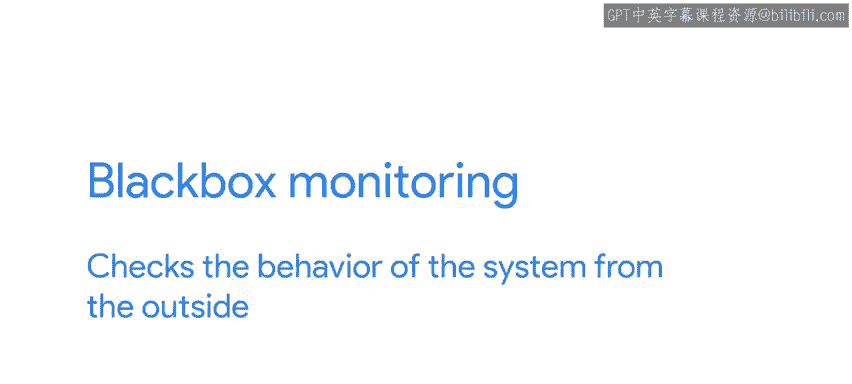

# 谷歌《用Python进行IT自动化办公3、4、5、6课（Git、debug、云端、实践）Google IT Automation with Python》中英字 - P160：43_入门监控.zh_en - GPT中英字幕课程资源 - BV1LW4y1F7XW

As we called out in an earlier video， once we have our service running in the cloud。

 we want to make sure that our service keeps running and not just that。

 we want to make sure it keeps behaving as expected。

 returning the right results quickly and reliably。 the key to ensuring all of this is to set up good monitoring and alerting rules。

In the next few videos， we'll do a rundown of monitoring and alerting concepts and techniques。

 followed by a practical demonstration。 Let's dive in。To understand how our service is performing。

 we need to monitor it， monitoring lets us look into the history and current status of a system。

And how can we know what the status is We'll check out a bunch of different metrics。

 These metrics tell us if the service is behaving as expected or not， while some metrics are generic。

 like how much memory and instances using other metrics are specific to the service we want to monitor。

 say your company is running a website and you want to check if it's working correctly when a web server response to an HTTP request。

 it starts by sending a response code followed by the content of the response。 you might know。

 for example， that a 404 code means that the page wasn't found or that a 500 response means that there was an internal server error。

In general， response codes in the 500 range like 501 or 503 tell us that something bad happened on the server while generating the response。

While response codes in the 400 range means there was a client side problem in the request。

When monitoring your web service， you want to check both the count of response codes and their types to know if everything's okay。

 If you're running an e-commerce site， you'll care about how many purchases were made successfully and how many failed to complete。

If you're running a mail server， you'll want to know how many emails were sent and how many got stuck and so on。

 you'll need to think about the service you want to monitor and figure out the metrics you'll need。

 Now， once we've decided what metrics we care about。 What do we do with them。

 We'll typically store them in the monitoring system。

 There's a bunch of different monitoring systems out there。 Some systems like AW S Cloudwatch。

 Google Stad or Azure metrics are offered directly by the cloud providers。

 other systems like Prometheus， Datadog or Nagios can be used across vendornders。

 there's two ways of getting our metrics into the monitoring system。Some systems use a pull model。

 which means that the monitoring infrastructure periodically queries our service to get the metrics。

 Other monitoring systems use a push model， which means that our service needs to periodically connect to the system to send the metrics。

No matter how we get the metrics into the system， we can create dashboards based on the collected data。

These dashboards show the progression of the metrics over time。

We can look at the history of one specific metric to compare the current state to how it was last week or last month。

Or we can look at the progression of two or more metrics together to check out how the change in one metrics affects another。

Imagine it's Monday morning， and you notice that your service is receiving a lot less traffic than usual。

 You can look at the data from past weeks and see if you always get less traffic on Monday mornings or if there's something broken。

 causing your service to be unresponsive。Or if you see that in the past couple days。

 the memory used by your instances has been going up。

 you can check if this growth follows a similar increase in another metric like the amount of requests received or the amount of data being transmitted。

This can help you decide if there's been a memory leap that needs to be fixed。

 or if it's just an expected consequence of a growth in popularity。

Pro tip you only want to store the metrics that you care about since storing all of these metrics in the system takes space and storage space costs money。

When we collect metrics from inside a system， like how much storage space the service is currently using or how long it takes to process a request。

 this is called white box monitoring， white box monitoring checks the behavior of the system from the inside。

We know the information we want to track， and we're in charge of making it possible to track。

For example， if we want to track how many queries we're making to the database。

 we might need to add a variable to count this on the flip side。

 black box monitoring checks the behavior of the system from the outside。

 This is typically done by making a request to the service and then checking that the actual response matches the expected response。

 We can use this to do a very simple check to know if the service is up and to verify if the service is responding from outside your network。

 or we could use it to see how long it takes for a client in a different part of the world to get a response from the system。

Okay， monitoring is really cool， but who wants to stare at dashboards all day trying to figure out if something's wrong？

Fortunately， we don't have to instead we can set up alerting rules to let us know if something's wrong。

This is a critical part of ensuring a reliable system。

 and we're going to learn how to do it in the next video。

