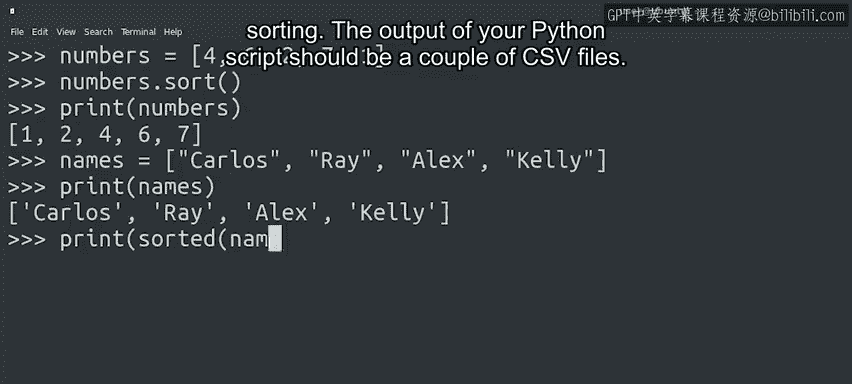

# 谷歌《用Python进行IT自动化办公1、2课（Python、控制操作系统）｜Google IT Automation with Python》中英字幕 - P160：86_研究和计划指导.zh_en - GPT中英字幕课程资源 - BV1gw411E7E1

🎼。う。

We've now gone over the problem statement of our final project。At first sight。

 it might sound pretty complex。But let's break it down into smaller。

 more digestible pieces and discuss how we can move into the next steps to do the necessary research and planning。

We've said that we want to find some specific log lines in the cis log file。

We strongly recommend that you use regular expressions to find them。

It'll be easier to extract the information you want that way to figure out the right regular expression。

 you can use a website like Greggx 101。com， which can help you test your expression and understand what's going on with it。

Once you have a pattern that you think can work， try it out in a Python interpreter to verify that it matches the right lines and captures the right information After extracting the information。

 youll need to count how many errors are of the same type and how many info and error messages there are for a given user。

Can you think of what data structure might help you with that？If you're thinking dictionaries。

 then you're on the right track。You'll want to use a couple different dictionaries。

 one to count error messages， and another to count per user usage。

You'll then need to sort the data in the dictionaries by different criteria。

We looked at sorting in the introduction to Python course。

Feel free to rewatch that video and reread the Python documentation on sorting the output of your Python script should be a couple of CSV files。

 each of them containing the names of the columns and the data and the order that needs to be presented。

Once those files are generated， you'll need to call the CSV to HTML。

pi script to create HTML files based on the CSV data。

You'll have access to look at how the script works， but the key is to pass two parameters to it。

 the name of the CSV file to read， and the name of the HTML file to generate you could do this last step from either a Python script or a batchsh script。

Since the script will be only calling commands and moving files， we recommend doing it in bash。

Keep it short and sweet。We recommend that you research。

 plan and even write the pieces of code all before starting the actual lab。 Good luck。 You've got it。

😊。