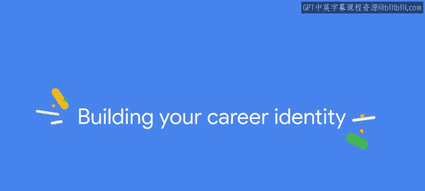
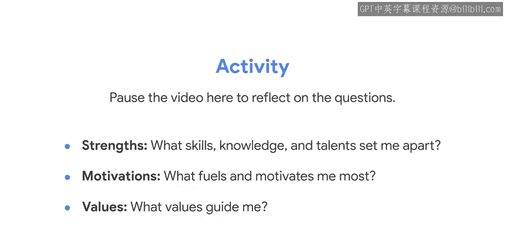
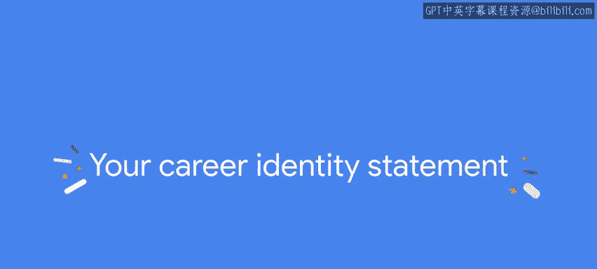
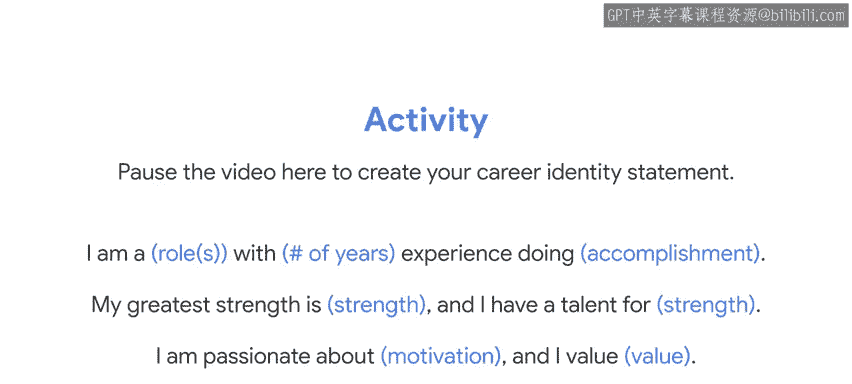

# 谷歌《用Python进行IT自动化办公1、2课（Python、控制操作系统）｜Google IT Automation with Python》中英字幕 - P161：87_你的职业身份是什么.zh_en - GPT中英字幕课程资源 - BV1gw411E7E1

Hi there。 I'm Miriam， and I work at Google。 We're so glad you're here and that you've chosen a Google career certificate to move towards your goals。

 One important step to help you meet those goals is building your career identity。 But first。

 what exactly is career identity。😊，You can think of it as your north star。

It encompasses who you are and what you have to offer professionally and guides you as you navigate towards your goals and vision。

Today， we'll share activities to help you explore your career identity and write your own career identity statement。

 Let's dive in。😊，Your career identity is the unique value that you bring to the workforce based on who you are and what you have to offer now。

 and in the future， it's informed by all of your life and work experiences and shaped by your strengths。

 motivations and values。 It's also something you cultivate based on your direction and goals。😊。

And here's why It's important。The more you know about who you are。

 what makes you thrive and where you want to go， the better equipped you are to choose a path that aligns with your strengths。

 values and goals。 Plus， employers and colleagues will have a better understanding of what you have to offer。

 And it's good for you。Research shows that having a strong career identity leads to positive outcomes。

 such as improved job performance， greater commitment to a meaningful career and even enhanced well being in health。

 Remember， no matter what your life and work experiences are， we all have value to offer。😊。

Let me start by sharing a little bit about myself and how I first started to develop my career identity。

I've worked at Google for more than 10 years， but I discovered facets of my career identity in my first role here as an email customer support representative。

 helping business owners solve problems。 I quickly realized how much I enjoyed working with sales。

 engineering and product management teams to solve those problems。

 I also discovered that I had a talent for distilling complex ideas into simple written language for the customers I supported。

 Fast forward to today。😊，I work in digital marketing。

 and my job still depends on communication and collaboration。 S that bring me joy over the years。

 I've moved from one project to another， Change jobs and worked for different companies。

 But these truths about what is core to me and what I value have always remained the same。😊。

Makes sense。One of the best ways to explore your career identity is to write your own career identity statement。

We'll start by breaking it down into three key components that will act as the building blocks for creating your own career identity statement。

 your strengths。Your motivations。Your values。Let's talk about each of these three components in more detail。

First up， your strengths。Your strengths are tasks and activities that you do well。

 They are the skills， knowledge and talents you've gained throughout your life and work experiences。

😊，For example， maybe you're very detail oriented or you're great at building relationships。

Maybe you're amazing at repairing cars， or maybe you've developed skills like patience。

 empathy and problem solving as a result of caring for a family member。

 According to Marcus Buckingham， an expert on strength and leadership at work。

 A strength is an activity that strengthens you for something to be a strength。

 You must be good at it。 But it also should make you feel stronger， more capable and energized。

 For me， writing has always been a strength。 I read Charlotte Brantte's novel， Jane Eyre at age 9。

 And I fell in love with writing。😊，I was like， that girl is me。 And I want to write books like this。

 I then invested a lot of time in developing this skill throughout my life。

 And it's one that has always energized me makingking it a core pillar of my career identity from strengths will move to the next key component。

 Your motivations。😊，Your motivation stem from your passions and your purpose。

 knowing what fuels you is so important， because that's what keeps you going。 Like I mentioned。

 I am passionate about story telling with the English language。

 I can lose myself for hours in writing， but I don't just enjoy telling stories。

 I am also motivated to help others to express their own truths through authentic story telling。

 It's a defining aspect of who I am。 And thus， my career identity。😊。

So now we've covered strengths and motivations。 Lastly， let's discuss the third key component。

 your values。Your values reflect what's most important to you。

They guide your repro to decision making， developing relationships， and overcoming challenges。

You may not always be aware of your values， but they are always with you。

 even if they shift over time。 These are things like integrity， responsibility and kindness。

 Some of my core values are efficiency and service to others。I don't like messes。 when I see a mess。

 I see people suffering。 My mind goes to， how can I help clean this up。

 How can I make this more efficient， In my first job。

 I realized that no one was documenting how to use the products Google was developing。

 So I decided to build a knowledge base of common questions and answers that my team could use to not have to start from scratch each time。

Now that we understand the key components， let's work on building your own career identity。

To start， all you need to do is get curious。Begin by asking yourself these three questions about your strengths。

 motivations and values。What skills， knowledge and talents set me apart。

What fuels and motivates me most。What values guide me？It might be helpful to pause the video here。

 Gr a piece of paper or journal and spend 10 minutes reflecting on these questions。

 There's no need to overthink it。 Just write what comes to mind。

You can always refine or expand your answers later。

Once you've answered these questions， there's more you can do to dig into your career identity。

For example， assessments can help you learn more about your unique skills， strengths。

 preferences and values。 Many of these assessments are available online and consist of a series of short multiple choice questions focused on you and immediately produce your personalized results。

😊，If after this， you still want to explore more， you can interview a handful of your peers。

They could be current or former colleagues， classmates， or even family and friends。

 Choose people who know you well and who you trust to be honest and thoughtful。

Ask them questions such as， how would you describe me to some one else。What stands out about me？

How do I inspire you？Remember， there are plenty of other ways to learn about yourself。

 But once you've reached a point where you're comfortable and confident that you understand your strengths。

 motivations and values， you can bring them together in a career identity statement。

It should be three or four sentences that go beyond just listing your qualifications。

You want to also reveal your passions and purpose。Here's a basic template to help you get started。

I am a roles with number of years， experience， doing accomplishment。😊。

My greatest strength is strength， and I have a talent for strength。I am passionate about motivation。

 and I value value。 Here's mine。 As an example。 I am a content strategist and product marketer with over 10 years of experience helping businesses use new technologies to drive success。

 My greatest strength is collaborating and driving efficiencies across teams。

 and I have a talent for crafting stories and creating marketing programs to successfully launch technology products。

 I am passionate about empowering brands to find and use solutions that work for them。

 and helping builders of new technologies develop even better， more effective products。

 and most importantly， I value having fun and being collaborative。

 inclusive and authentic while I do it。😊，Now is another good time to pause the video。

And grab that piece of paper or journal to start working on your career identity statement。

Remember， your statement is a work in progress。 You should revisit and refine it as you gain new experience and insights about yourself。

 Like after you complete a Google career certificate， for example。

 So now that you've written your career identity statement。 What should you do with it。

 W your career identity statement is a powerful way to add clarity and energy to all the other career development tools you carry with you。

 you can incorporate parts of it into your resume， LinkedIn profile。

 cover letters and elevator pitch。😊，This will help you clearly and consistently communicate what's important to you and help you stand out from others in the same field。

 It can also guide you to be more intentional and purposeful when searching for a job or choosing a career path。

😊，Exploring and creating a strong career identity for yourself is a journey that takes time and effort。

 But trust me， it's worth it。The more you know about yourself and what you want。

 the better choices you'll make for your career。 And as you continue to grow and strengthen your career identity。

 your North star will shine even brighter。Moving you towards your goals。

 Here's to the next step in your amazing journey。😊。

