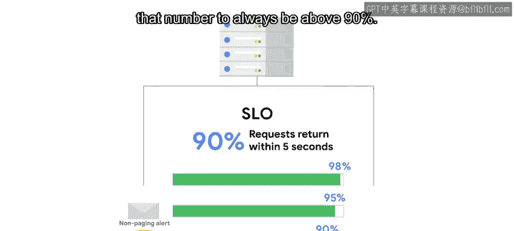

# 谷歌《用Python进行IT自动化办公3、4、5、6课（Git、debug、云端、实践）Google IT Automation with Python》中英字 - P162：45_服务级目标.zh_en - GPT中英字幕课程资源 - BV1LW4y1F7XW

We all know that some IT systems are more critical than others。Let's be real。

 if you try to play a computer game that you haven't opened in a year and it doesn't work。

 you probably won't care as much as if you're trying to make a bank transfer and your bank's website is down。

Sometimes a piece of infrastructure can be down， and the overall system still works with degraded performance。

 For example， if the caching server that makes your web application go faster is down。

 the app can still function， even if it's running slower。

 No system is ever available 100% of the time。 It's just not possible。

 but depending on how critical the service is， it can have different service level objectives or SLs。

 SLs are pre establishedlish performance goals for a specific service。

Setting these objectives helps manage the expectations of the service users。

And the targets also guide the work of those responsible for keeping the service running。

SLOs need to be measurable， which means that there should be metrics that track how the service is performing and let you check if it's meeting the objectives or not。

 Many SLOs are expressed as how much time a service will behave as expected。For example。

 a service might promise to be available 99% of the time。

Heads up when dealing with metrics and availability。

 we need to do a little math to understand what those numbers mean in practice。 But don't worry。

 it's all pretty straightforward。 If our service has an Slo of 99% availability。

 it means it can be down up to 1% of the time。 If we measure this over a year。

 the service can be down for a total of 3。65 days during the year and still have 99% availability。

Availability targets like this one are commonly named by their number of9s。

 Our 99% example would be a 2，9 service。99。9% availability is a 39 service，99。

999% availability is a 59 service。Five9 services promise a total downtime of up to five minutes in a year。

5 nines is super high availability， reserved only for the most critical systems。

 a 39 service aiming for a maximum of eight hours of downtime per year is fine for a lot of IT systems。

Now， you might be wondering， why not just make everything a 59 service。 It's a good question。

The answer is because it's really expensive and usually not necessary。

If your service isn't super critical and it's okay for it to be down briefly once in a while。

 having two or three nines of availability might be enough。

You can keep the service running with a small team。5。

9 services usually require a much larger team of engineers to maintain it。

 Any service can have a bunch of different service level objectives like these that tell its users what to expect from it。

 Some services like those that we pay for， also have more strict promises in the form of service level agreements or S Ls。

 A service level agreement is a commitment between a provider and a client。

Breaking these promises might have serious consequences。 Service level objectives， though。

 are more like a soft target。 It's what the maintaining team aims for。

 but the target might be missed in some situations。 As we called out。

 having explicit SLs or SLs is useful for both the users of that service and the team that keeps the service running。

If you're using a cloud service， you can decide how much you're going to entrust your infrastructure to it based on the SLAs that the provider publishes。

If， on the other hand， you're part of the team that maintains a service。

 you can use the SLOs and SLAs of your service to decide which alerts to create and how urgent they should be。

 sayy you have a service with an SLO that says that at least 90% of the requests should return within5 seconds。

😡，To know if your service is behaving correctly， you need to measure how many of the total requests are returning within those five seconds。

And you want that number to always be above 90%。

So you might set up a non-paging alert to notify you if less than 95% return within5 seconds and a paging alert if less than 90% return promptly。

 if you're in charge of a website， you'll typically measure the rate of responses with 500 return codes to check if your service is behaving correctly。

If your SLO is 99% of successful requests， you can set up a nonpaging alert if the rate of errors is above 0。

5% and a paging alert if it reaches 1%。In an earlier video。

 we called out that services usually break because something changed。

That's also often the case when looking at what makes services go out of SL。

 If your service was working fine and meeting all of its SLs and then started misbehaving。

 it's likely this was caused by a recent change。 That's why some teams use the concepts of error budgets to handle their services。

Say you're running a service that has three nines of availability。

 This means the service can be down 43 minutes per month。This is your error budget。

 you can tolerate up to 43 minutes of downtime。So you keep track of the total time the service was down during the month。

If it starts to get close to those 43 minutes， you might decide to stop pushing any new features and focus on resolving the problems that keep causing the downtime。

Now， all this talk of nines availability and downtime can have your head spinning if you've never done this before。

 and that's totally normal if it's your first time setting objectives for your service。

 start by setting achievable goals that you can measure。

Track how the service behaves for a while and see what causes the service to deviate from the targets。

Once you have a better idea of the whole service's behavior， you can set more aggressive goals。

Up next， we'll go back to our VMs running in the cloud and demonstrate how we can monitor them using the tools offered by the provider。

