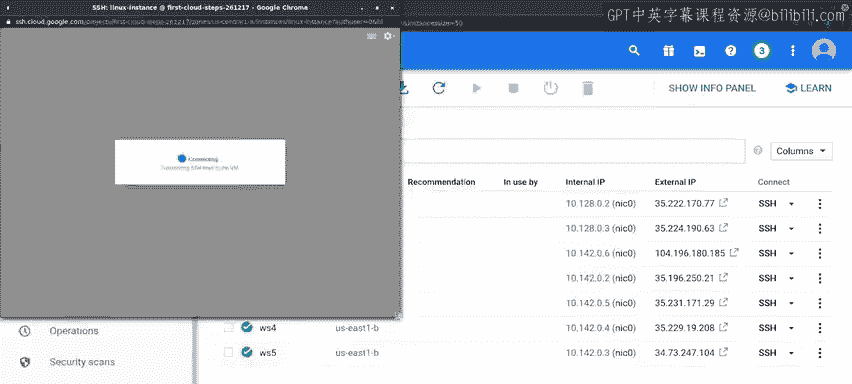
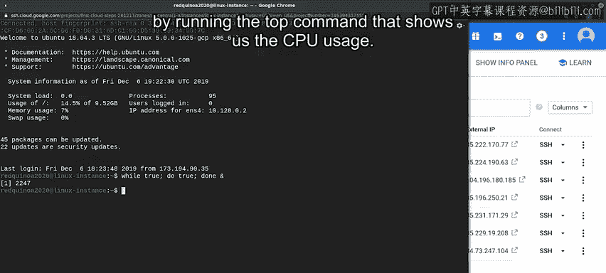
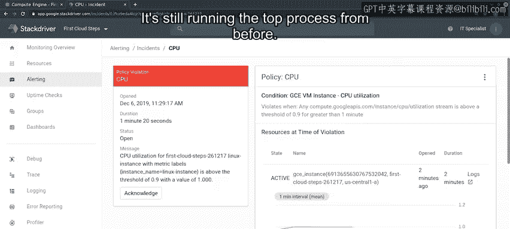

# 谷歌《用Python进行IT自动化办公3、4、5、6课（Git、debug、云端、实践）Google IT Automation with Python》中英字 - P163：46_GCP 中的基本监控.zh_en - GPT中英字幕课程资源 - BV1LW4y1F7XW

So far， we've seen how to create virtual machines in the Google Cloud console。

 We've kept these virtual machines running， and now we want to see how we can use the tools provided by the cloud vendor to monitor them and create alerts based on them。

For this demonstration， we'll use the monitoring tool called StaDriver。

 which is part of the overall offering。 When you first activate this system。

 it takes a while until it starts collecting all the metrics from all the machines。

 So we've activated it in advance。When we first open the monitoring console。

 we see an overview of the system。 At the moment， this is looking pretty empty。

 but we could configure this dashboard to show the charts that we consider the most useful。

Let's go into the instances dashboard。We see here the list of our instances。

 and we can click on each of them to see the monitoring information that T driver has collected about them。

The monitoring system gives us a very simple overview of each of the instances with three basic metrics。

 CPU usage， disko and network traffic。Depending on what service we want to run on a VM。

 we can customize these dashboards to show different metrics。

And if the metrics that come baked in aren't enough。

 you can create your own metrics and also add them here。 Now。

 we want to check out how to set up an alert to notify us if something isn't behaving correctly。

To do this will create a new alerting policy。To set up a new alert。

 we have to configure the condition that triggers the alert。After we've done that。

 we can also configure how we want to be notified of the issue and add any documentation that we want the notification to include。

 Let's start by configuring the condition。As we called out。

 alerting conditions are related to specific metrics。

 We want to be notified when the metric indicates that there is a problem with an instance。

 For this example， we're going to configure an alert that triggers if an instance's CPU utilization is more than 90%。

We'll start by selecting that we want to monitor GCE VM instances。

 which are the instances that we currently have running， and then select the CPUU utilization metric。

After selecting the metric， we see the graph of the collected values for all the current running instances。

We can optionally add extra filters and groups for the data for this condition。For example。

 we could choose to only look at some of the instances selecting by their zone， region， or name。

This can be useful if you want to have separate alerts for instances used for production and those used for testing or development。

On top of that， we can also choose an aggregator for the data。

These aggregators are useful when the metrics that you're collecting are about the overall system and not just one instance。

For example， if you're checking the number of error responses that your system generated。

 you want to sum all the errors across instances， depending on how we filter。

 group and aggregate the data， will end up with a bunch of different time series。

 We'll use these values to decide if we should trigger the alert or not。

 The next step is selecting how many of the different time series need to violate the condition for the alert to trigger。

 We can trigger the alert when one some or all of the different time series， violate the condition。

For this example， we'll configure our alert to trigger if any instance is using more than 90% of the CPU。

 so let's select any time series violates。And now we'll say that we want our alert to trigger if the value is above 90% for one minute。

All right， we've set the condition。Now we can select how we want to get the notification when the alert triggers。

 Currently， the only type of notification that we can use is email to use the other channel types available。

 we need to configure them in our profile。For this example。

 email will do using emails can be just fine when you're getting started with alerting。

 but eventually you'll want to configure additional methods。All right。

 we've configured our alert to send emails。 Now we can add extra documentation to our alert。

This documentation is intended to help the person that's responding to the alert understand what they need to do to fix the problem。

Including good documentation here can be super important when you've got a bunch of different people working together in a team and not everyone knows everything。

Alerts that include good documentation are much easier to tend to and help get the service back to a healthy state faster。

 For our example， we'll add a message saying that whoever is taking care of this alert should check the instance with top。

Finally， we'll need to give a name to our alerting policy， we'll call it CPUU and then save it。Waho。

 now we've set up our alert。Now we can sit back and relax。

 knowing that if anything goes wrong will be the first to know for the final part of this demo。

 we want to show what happens when the alert triggers to do that。

 we'll start a process in one of our instances that uses all of the available CPU by creating an infinite loop。

 so we'll go back to the main console， SSH into the VM called Linux dashash instance。

 and then create a while loop that never ends。

Now， our loop is running and using all of the available CPU。

 We can check this by running the top command that shows us the CPU usage。

We see that there's a bash command that's using almost 100% of the available CPU。

 Our experiment is working。Now， remember that we said that we wanted the condition to be true for a minute before the alert triggers。

 it won't trigger just yet。It's common practice to use time windows of1。

5 or even 10 minutes when dealing with the alerting。

We don't want to get an alert for a small spike that lasted only a few seconds and then went away。

We want to get alerted when there's an actual problem that requires our attention。

The size of the time window we choose depends on the metric we're checking。

 the length of the expected spikes and a bunch of other factors。

It's pretty normal to have to tweak how long we want the condition to be true as we try our alert out。

 If you're getting notified too often about conditions that go away on their own without you having to do anything。

 you might choose to make the time window larger on the flip side。

 If you're getting notified too late about conditions that need attention。

 you might choose to make the time window smaller。All right， we've let enough time pass。

 let's check out what's up with our alert。We see that there's an open incident。

 which is a way of grouping problems。The alert summary gives us a bunch of info about what's going on。

 we can click on the CPU link to get more information。

This page shows us the metric that triggered the alert for the incident。

 It shows the threshold for triggering the alert and the current value of the metric。

It also shows us the documentation that we entered and lets us create annotations。

We can use these annotations to track the work that we do during an incident。All right。

 let's stop the process that's using all of our instances CPU。

 It's still running the top process from before。

Let's exit with Q。 Now， the infinite loop is currently running in the background of our console。

We can make it run in the foreground by typing FG and then cancel it by pressing C C。Okay。

 now we've stopped the process。 Let's check with top that it's no longer using all of our CPU Great。

 the bash process isn't taking all of the CPU time anymore。 In another minute。

 the alert that we saw earlier will stop triggering nice。And with that。

 we've demonstrated how we can monitor a bunch of instances running in the cloud。

We've created an alert based on metrics and verified that the alert triggers。 Of course。

 there's a lot more that we can do with these tools。

 We'll give you pointers to more information in the reading coming up。 And after that。

 there's another quick quiz to check that everything's making sense。

