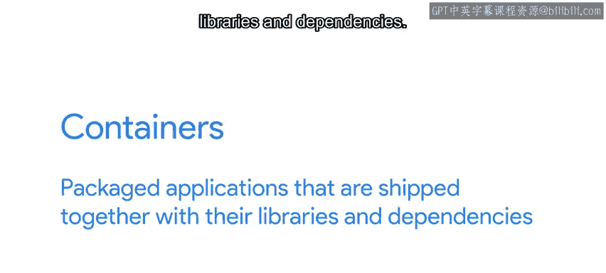

# 谷歌《用Python进行IT自动化办公3、4、5、6课（Git、debug、云端、实践）Google IT Automation with Python》中英字 - P165：48_确定故障来源.zh_en - GPT中英字幕课程资源 - BV1LW4y1F7XW

As we've called out a few times， when we host our services in the cloud。

 we need to give up part of the control over the infrastructure that we're using。

This might be especially noticeable when we're trying to find the root cause of a problem in our service。

 and we don't know if the failure is caused by an error on our side or on the provider's side。

So what can we do in that case， problems on the providers side tend to be isolated to geographical regions。

If you're seeing weird problems and you have no idea what could be going on。

 you can try bringing up your service in a different region and checking if the failure happens there。

 too。 if it works fine there， it's likely that there's an issue with the cloud infrastructure and you should bring it up with your provider。

 if it fails in the other regions， too， it's likely that it's a problem with your system。

 Similarlyly， if you're seeing problems related to resource usage。

 You can try running the same system in a different machine type and checking how it behaves there。

This could help out， for example， if your service takes too much time to process incoming requests。

By changing your service to more powerful machines， you might improve the overall performance。

 Another option that we've mentioned a bunch is doing rollbacks for the pieces that have recently changed。

Having all your infrastructure stored as code in a version control system will let you access the history of the changes to each component in the system。

When setting up your service， you should make sure that you can deploy and roll back each individual piece。

 Imagine you get an alert saying that the web servers in your application are using a lot more memory than they used to。

 You don't know why but you know that a new version was deployed a couple of days ago by rolling back to the previous version。

 you can verify if that change was at fault or not。If the servers work fine after the rollback。

 you can investigate the specific changes and try to figure out why they're using so much more memory。

If the servers are still using a lot of memory after the rollback， it means something else is up。

In an earlier video， we touched briefly upon one popular option when running things on the cloud called containers。

 Contains are packaged applications that are shipped together with their libraries and dependencies。

Each application is executed in a separate container。

 completely independent of any other applications running on the same machine。 Now。

 one of the neat characteristics of containerized applications is that you can deploy the same container to your local workstation to a server running on premise or to cloud infrastructure provided by different vendors。

This can be really helpful when trying to understand if the failure is in the code or the infrastructure。

 You simply deploy the container somewhere else and check if it behaves the same way。

 When using containers， the typical architecture is to have a lot of small containers that take care of different parts of the service。

This means that the overall system can get really complex， and when something breaks。

 it can be hard to identify where the problem is coming from。

 The key to solving problems in the container world is to make sure you have good logs coming in from all of the parts of the system。

And that you can bring up test instances of each of the applications to try things out when necessary Up next。

 we'll talk about some of the tools that we can use in the cloud to recover from outages。😡。

