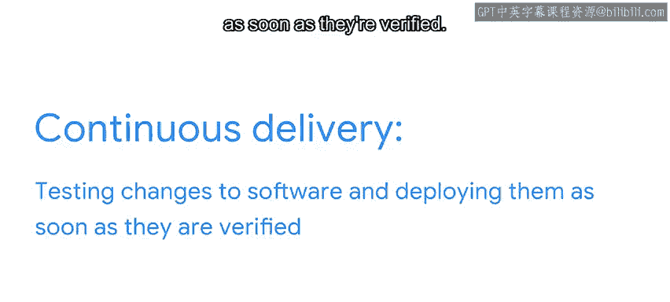

# 谷歌《用Python进行IT自动化办公3、4、5、6课（Git、debug、云端、实践）Google IT Automation with Python》中英字 - P167：50_什么是 DevOps.zh_en - GPT中英字幕课程资源 - BV1LW4y1F7XW

Welcome back。Let me ask you what goes together like peanut butter and jelly。In this video。

 the answer is Devops。Deevops is a way of working that combines software development。

 dev and I T operations， ops to shorten the system's development life cycle and provide continuous delivery with high software quality。

Deops allows us to collaboratively create software that's robust。

 deliver it at high velocity and support it in an integrated way。😊。

You don't just wake up one morning with an idea and write a software application like the Microsoft Office Su。

First of all， it's way too much code doing too many things for a single programmer to put together。

Second and most important， there's more to a software application like office than the code programmers right。

 The code is simply the foundation。The application needs to perform multiple functions and often interface with other software。

 which means there needs to be collaboration within the software itself。

And it has to run consistently on users computers or on web servers， or both。

Software development is an involved process that includes a variety of people with different responsibilities and skills。

That process is called the softwareftware Development lifecycle。

Deevops is short for development and operations。 It describes the steps of the software development life cycle that go beyond writing the code。

Back in the day， different programmers had what they needed to work together and develop the software。

 Once the software was finished， I T operations would create test parameters and test the application to make sure that it performed as expected。

Then they would burn it to a C D， send it to a duplication house。

 package it with a manual and deploy it to online and brick and mortar computer stores for users to purchase。

Updates and new versions went through the same process， and had to be purchased as well。But。

 times change。Today's software development life cycle happens much faster and lasts much longer。

DeevOs practices take this into account。There are many pieces to the Devopps methodology。

 but two important aspects are。Continuous integration， C， I and continuous delivery， C， D。

Making Devops a necessary component to an effective C ICD pipeline。

 We'll talk more about that pipeline later on。 Let's take a closer look at Devops aspects。

Continuous integration means programmers are always working to make applications better。

 meaning updates and improvements are constantly being added to the software。

And continuous delivery means that any changes to the software are tested and then deployed to users and servers as soon as they're verified。

Although Devops practices are fairly new， I T departments and software engineering teams are embracing them as a necessary part of their infrastructure for C ICD pipelines。

 and Devops roles in I are additional opportunities for programmers like you。

 Since a lot of Devops requires programme。Before we wrap it up。

 let's quickly review the key points of DevOs beginning with the software development life cycle。

We defined it as a complicated process that includes a variety of people。

 responsibilities and skills。And Devops， development and operations describes the steps of the software development lifecycl beyond writing the code。

Two important aspects of Devops are continuous integration when adding updates and improvements to software happens constantly。

Followed by continuous delivery， which is testing changes to software and deploying them as soon as they're verified。

Deefops practices provide faster software delivery， improved collaboration and increased reliability。

 all of which are key to succeeding in the rapidly evolving world of software applications。😊。

Up next， you can read about the relationship between continuous integration， delivery and deployment。

 I'll see you soon。