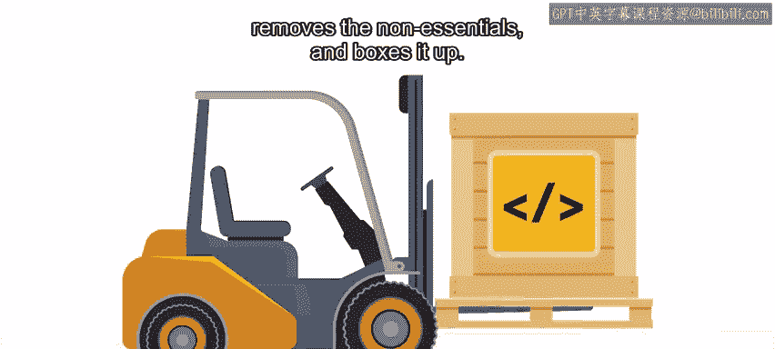
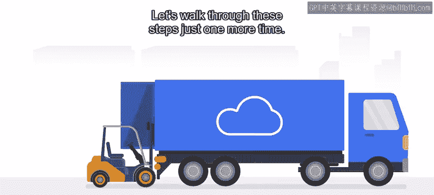

# 谷歌《用Python进行IT自动化办公3、4、5、6课（Git、debug、云端、实践）Google IT Automation with Python》中英字 - P168：51_从编码到云端.zh_en - GPT中英字幕课程资源 - BV1LW4y1F7XW

Welcome back。 In the last video， we introduced Devs and covered that it's a set of practices。

 philosophies and tools that informs the software development life cycle after a programmer writes the initial code。

😊，Deops emphasizes collaboration between operations and development teams。

 The first stage of that process is something we'll call from coding to the cloud because it traces the software application's journey from initial coding to its deployment on the cloud。

That's what this video is all about。Well cover the second stage of the process from staging to production in a later video。

Preparing code for the cloud is a mix of DevOs and programmer responsibilities。But who does what。

 when can be hard to pin down since there are no universally agreed upon software engineering best practices。

The specific actions may differ depending on the platforms you' are developing for。

 your cloud provider or your company's operating protocols。 Fortunately。

 the big picture of the process is basically the same。One， the programmer completes the code。😡，Two。

 someone， typically the programmer， containerizes the code。Three。

 then the Devops team receives the container， usually through Docker or Kubernetes。Four。

 DevOs delivers it to its destination on the cloud。Think of it like a warehouse。

 The programmer writes the code， removes the non essentials， and boxes it up。

The Devops team moves the box to the loading dock and loads it onto the cloud's truck to be delivered to the cloud servers。

Let's walk through these steps just one more time in step1。

 the programmer completes the software on a local machine。

In step 2， all of the sensitive information has to be removed。

Each local machine has its own security and passwords。

 API keys and other sensitive information stored in plain text within source code。

It's best practice to never include these in the first place。

 but always double check that these items have been removed before you create a container。

Cloud providers offer secret services that allow you to call any necessary sensitive information as a variable when the application runs on the cloud。

Step 2 is either done by the inhouse programmer or a staff engineer after they receive a freelance programmer's code。

For step 3， the DevOs team receives the container and artifacts。

Then step4 deploys them to the cloud using the appropriate security credentials。

Taking a software application from code to the cloud is a relatively straightforward process that promises to make the C ICD pipeline even faster。

 especially considering the trend towards serverless technologies。😊，So let's walk through it again。😡。

One more time， from coding to the cloud is a strategic approach from the viewpoint of an I professional doing Devops。

 It traces software from coding to cloud deployments。Once the software is in the cloud。

 it has to be staged and then deployed。 We'll talk about that a little later。 I'll see you then。

