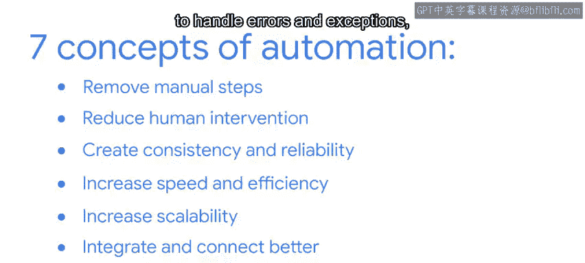

# 谷歌《用Python进行IT自动化办公3、4、5、6课（Git、debug、云端、实践）Google IT Automation with Python》中英字 - P169：52_自动化.zh_en - GPT中英字幕课程资源 - BV1LW4y1F7XW

Hello again。In the far distant past， the software development life cycle ended once the software was released and delivered to the store that sold it to end users。

 Then the developers would begin again。As an end user， you not only had to buy the software。

 you had to buy the next iteration as well， and 2。0 and the next and so on。Nowadays。

 software development is constantly faster。Updates and new iterations occur frequently。

 and they're delivered just as frequently to users who are always connected to their computers。

 tablets and phones。In other words， the software development life cycle doesn't stop just because the software is released。

 Development keeps going forward。 Iteration by iteration through continuous integration。

 C I and continuous deployment or delivery， C， D。😊，This C ICD pipeline always has tasks in motion。

 and each new line of code that has to be integrated also has to be reviewed， tested and pushed out。

It has to be replicated and deployed on cloud servers across the world。😡，As you know。

 the software development life cycle is a complicated and resource intensive process。

 C ICD only intensifies that Every discrete task requires code， monitoring and processing。

 particularly for C I。Automation is a programming function that enables continuous and often repetitive routines to scale。

 catch errors and reduce the need for human intervention。

It reduces errors by programmatically focusing on and running each task。

 effectively isolating them from other tasks and from human error。

 Automation is an iterative approach to Devops to automate。

 you identify the necessary step in the process and create code with the right functions and loops to run it the same way every time The essential part of any C I automation setup up includes a version control system build server and automated testing framework。

For example， say you just finished an update。 You save the new version to the build server。

 which recognizes the new version。Once it does， the server automatically tests the new code communication capabilities。

There are seven key concepts of automation for continuous integration。

The first is removing manual steps。It works just like it sounds。

 replacing repetitive time consuming human efforts with automated processes。

The second concept is reducing the need for human intervention。Once it's set up。

 an automated task or system operates independently， freeing up IT to work on other things。

The next concept is consistency and reliability。Automation removes potential human errors。

 so tasks run consistently。Next is speed and efficiency。

Automation eliminates human limitations and distractions， so tasks run faster and smoother。Then。

 comes scalability。Automated tasks are easier to scale because they can be replicated。

They don't need to be reconfigured to handle a greater load。

 Automated tasks can be integrated with and connect to existing systems， tools and workflows。Finally。

 automated systems can be designed to handle errors and exceptions。

Either by engaging recovery systems or by logging and flagging a human operator via an alert。

To sum up， automation is a programming function that enables continuous routines to be scaled。

 catch errors， and reduce the need for human intervention。To automate。

 you identify the appropriate step in the process and create code with the right functions and loops so it runs the same way every time。

Automating repetitive tasks and removing manual tasks is key to continuous integration。

It improves code quality， reduces integration issues， and enables faster release cycles。

Automation is a necessity for a smooth CICD pipeline。

 which is a vital component of the software development lifecycle。Remember。

 automation makes it easier for both DevOs and programmers to work together to create software and updates。

 and next up we'll cover more on CICD。😡。