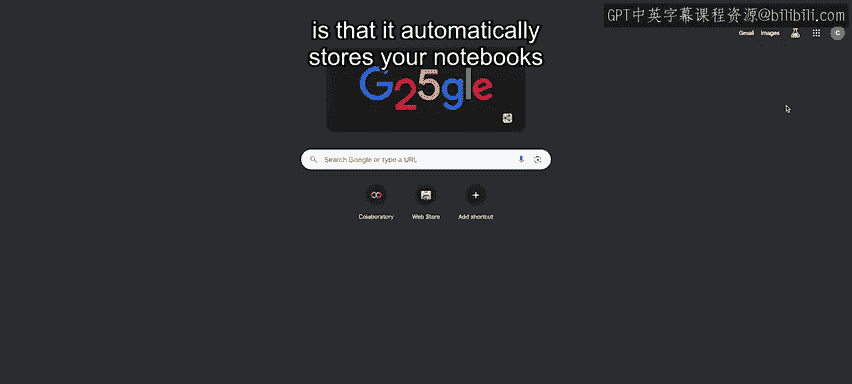
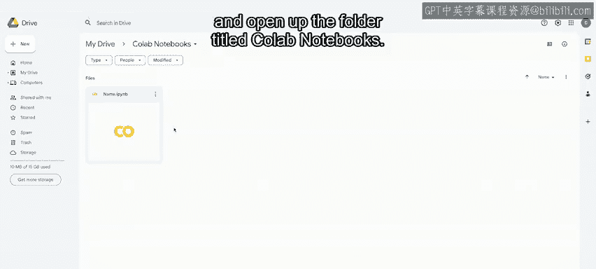

# 谷歌《用Python进行IT自动化办公1、2课（Python、控制操作系统）｜Google IT Automation with Python》中英字幕 - P16：15_使用 Colab.zh_en - GPT中英字幕课程资源 - BV1gw411E7E1

Recently， we covered how to use Jupiter notebooks In this video， we will go over collab notebooks。

Collab notebooks are Jupiter notebooks that are hosted by Google's Collaboratory in Collab。

 you can write and run Python code。In this video， you will learn more about how to use Collab and its features。

Collab is a webbased platform that allows you to write and run Python code really quickly in Google Drive It's free and ready to use with zero configuration required you can simply visit collab。

sandbox。google。com or search Googleglecollab to get started。

Collab provides all of the functionality that Python offers。

 the cells within collab can include code， text and images。

 the code cells include executable code and rich text， which makes it easy to write and run code。

Collab also makes it easy to include markdown on your notebooks。

 This is a great feature for sharing notebooks because you can add headings， paragraphs， lists。

 mathematical formulas and more。😊，You can install Python packages using the PIP command within the code cell。

Collab notebooks can easily be shared with other collaborators too。Now let's go over how to use Coab。

First， open Google Coabab again， you can do this by visiting coabab。sbox。google。com。

Go to file and click on new notebook。Now you can begin writing your Python code。In the code cell。

 let's write a print statement that outputs your name。To run your code and see its execution。

 use the run button to the left of the code cell。You can also give your coding project a name At the top。

 you can change untitled dot I， P， Y， and B to something like name dot I P， Y， N B。

 This will make it easier to find your code in the future。

The great thing about Coab is that it automatically stores your notebooks in Google Drive。

To find your notebooks， you can simply visit your Google Drive。

 type in Collab notebooks in the search bar and open up the folder titled Collabab Notes Here you will see all of the notebooks you've created。

And that's how you use coab。 pretty simple， right， I'm sure by now you're getting the hang of using these code editors。

 Let's move on to our final one VS code。 I'll see you in the next video。

