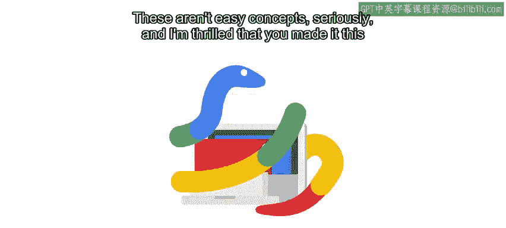

# 谷歌《用Python进行IT自动化办公3、4、5、6课（Git、debug、云端、实践）Google IT Automation with Python》中英字 - P16：15_模块 1 总结 - 版本控制介绍.zh_en - GPT中英字幕课程资源 - BV1LW4y1F7XW

🎼。う。

Congrats， you made it to the end of the module。These are't easy concept seriously。

 and I'm thrilled that you made it this far。 over the past videos。

 we looked into what version control is and why we even need it。

 We discussed how version control systems can enable collaboration across thousands of people and also how it can be a great tool for people working on their own or in very small teams。

😊，We then jumped in the Git。 We've discussed the basic Git concepts and looked at the typical Git workflow。

 By now， you've taken your first steps with Git。The workflow we've looked at so far is very simple。

 but it's already useful for helping you keep track of your changes。As you expand your git knowledge。

 you'll discover many more things you'll be able to do with it。

We've said this before and we'll no doubt say it again。The best way to learn anything worth knowing。

Is through practice， practice and more practice。That's why you're going to practice all this new knowledge by following the Gi workflow on your own for the graded assessment。

For the greatest assessments in this course， we'll use the Quick Lab's online learning platform。

 which is powered by the Google Cloud console。This platform lets you experience real world scenarios where you're the one in charge of getting things done。

To interact with the labs， you have to connect to virtual machines running in the cloud。

Each lab will present a different activity to be done with Git and you'll get the chance to practice your new skills The exercise that you'll need to do for this assessment will be very similar to the examples we've covered here。

You'll have to initialize a repository， add content to it。

 and then commit that content so that it can be tracked It's not magic。

Beginning comfortable with this process will prove really valuable in the upcoming modules。

So now is the time to commit to reviewing all the examples and getting these new concepts committed to memory and me。

I'm committing to seeing you in the next module， catch you there。

