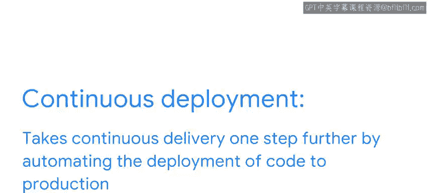

# 谷歌《用Python进行IT自动化办公3、4、5、6课（Git、debug、云端、实践）Google IT Automation with Python》中英字 - P170：53_持续交付和持续部署.zh_en - GPT中英字幕课程资源 - BV1LW4y1F7XW

Hello again。We've covered continuous integration， the CI part of the CICD pipeline。

Now we're going to cover the CD part， continuous delivery and continuous deployments。

You can compare continuous delivery and continuous deployment to an assembly line。

Imagine you are a car manufacturer and you want to build a new car as quickly as possible。

Using an assembly line approach， you can divide the car manufacturing process into a series of steps。

Each step is performed by a different worker， and the car is passed from step to step。

 until it's complete。This allows you to produce cars very quickly and efficiently。

Continuous delivery and continuous deployment are like assembly lines for software deployments。

With continuous delivery， you automate the build， test and packaging processes for your new software。

This allows you to release new features and bug fixes to your customers quickly and efficiently。

Continuous deployment takes continuous delivery one step further by automating the deployment of code production。

With continuous deployment， you can release new features and bug fixes to your customers as soon as they're ready without any manual intervention。

This also reduces lead time， which is the time between when development is finished and when the user gets the update。

 continuous delivery and continuous deployment are two software development practices that help teams deliver software more frequently and reliably。

😊，Continuous delivery is a software development practice that automates the build。

 test and deployment process for software。Every change to the code is built。

 tested and packaged for deployments。This means that a team can release a new version of their software at any time with the push of a button。

Continuous delivery is a good choice for teams that need to release software frequently and reliably。

Continuous delivery is a combination of automated infrastructure and cloud resources that make sure updates are delivered to the appropriate users' computers and cloud servers。

Now， let's go over how continuous delivery works。A developer makes a change to code。

Then the code is automatically built and tested。If the code passes all tests。

 it's package for deployments， the code is then deployed to the staging environment for additional testing。

 followed by the production environment。Lastly， the new version of the software is available to users。

This process is repeated for every change to the code。

This means that a team can release a new version of their software at any time with the push of a button。

Continuous deployment is an extension of continuous delivery， which automates the build。

 test and packaging process for software。Continuous deployment takes continuous delivery one step further by automating the deployment of code to production。

This means that teams can release new features and bug fixes to their customers as soon as they're ready。

Continuous deployment is a good choice for teams that are experienced with C ICD and that need to release software very frequently。

😊。

It can help teams to automate the entire release process and to get new features and bug fixes to their users or customers as quickly as possible。

Now that was a lot to cover。 Let's go through it quickly just one more time。

Continuous delivery is defined as the practice of automating the delivery pipeline to ensure software can be released to production at any time。

It's the process of releasing software updates， patches， and new versions anytime the code changes。

With continuous deployment， there is no manual approval step。

Once a change has passed all of the tests， it's automatically deployed to production。

Continuous delivery and continuous deployment can help software development teams to release new features and bug fixes to their customers more quickly and efficiently。

😊，This can help teams to stay ahead and meet the needs of their users and customers more quickly。

