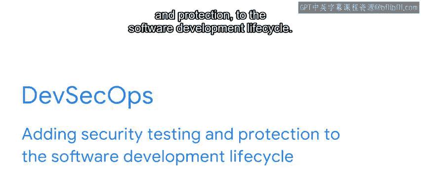
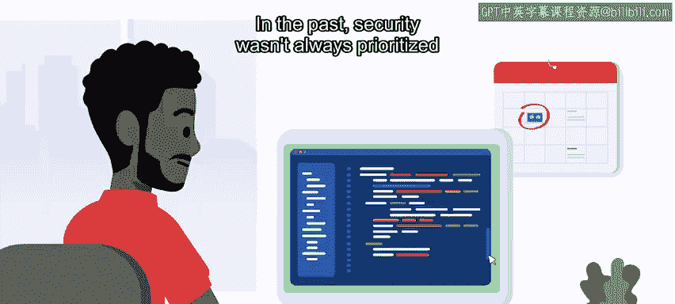
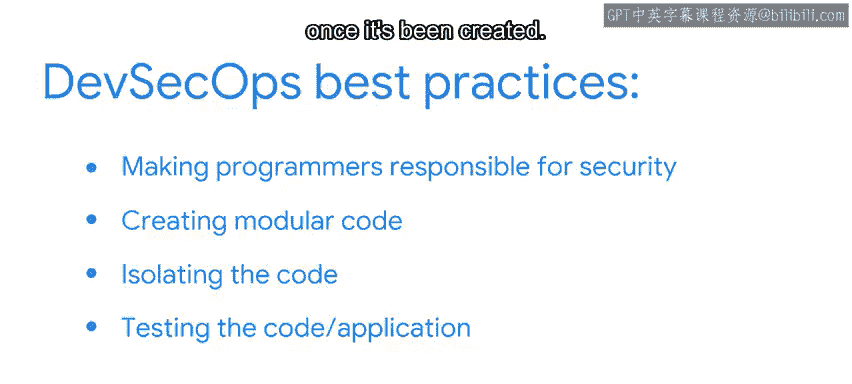

# 谷歌《用Python进行IT自动化办公3、4、5、6课（Git、debug、云端、实践）Google IT Automation with Python》中英字 - P171：54_DevSecOps.zh_en - GPT中英字幕课程资源 - BV1LW4y1F7XW

Hello， again。In another video， we talked about development operations， also known as DevOs。

 and described it as a way software development and IT departments can collaborate together。

In this video， we're going to talk about another IT function， dev Sops。

 and how it fits into the CICD pipeline。But first， let's define just what Dev Sops is。

Deevsops is basically adding security testing and protection to the software development life cycle。

 It combines development， security and operations and applies them to the C ICD pipeline。

 starting early in the process。

So why is it used， the short answer is speed and efficiency。

The longer answer is that software development in C ICD moves so fast。

 it has to rely on automation for certain processes。

 such as security testing and continuous deployment。This can introduce security risks。In the past。

 security wasn't always prioritized as it is to day。

 You typically developed the software and secured it later。

 You've probably seen enough security failures and breaches make the news to realize like the software developers did that security after the fact doesn't work very well。

Deev Sops is a process for introducing security measures and testing early in the software development process。

 This is often called shift left security。As a Python programmer。

 devsops will affect how you develop and deliver your code in addition to cleaning it before packaging it up in a Docker file。

Deevsops also shifts most of the initial burden for security onto the programmers developing the software。

 You'll be asked to develop and write smaller， More modular code that security tested using security scanning tools like static application security tests or S A S T。

The code itself is more isolated as well， which limits access to external databases and other resources using trusted。

 supported libraries that are also regularly tested for unsafe code。

 Then once the application is assembled， itss web tested using a scanner like dynamic application security tests or DA S T。

Deev Sops individuals are， in effect， cyber security champions working with programmers and I T professionals as a large collaborative in promoting a security focused culture。

Their role is to add and test security anywhere in the process where they see a need and verifying that the code and resulting application is secure throughout continuous development。

The bottom line is that DevevSecOs bakes in security practices as the code throughout the development process to make sure the applications are secured by design。

This is also the case inversioning， updates and throughout the continuous integration。

 continuous delivery process。 to summarize the process。 Remember。

 Devevs ops is the process of adding security testing and protection to the software development life cycle。

 Ba it in right up front。 best practices for Devs ops include making programmers responsible for security。

 C smaller modular code that security tested。😊，Isolating the code as it's being developed to limit access to external databases and other resources。

And testing the code and the application once it's been created。

DeevSOs's key purpose is to integrate security practices throughout the software development lifecycle。

 from code development in a collaborative environment to automation and continuous security testing。

It's the place where speed and security meet in their journey through the software development lifecycle。

