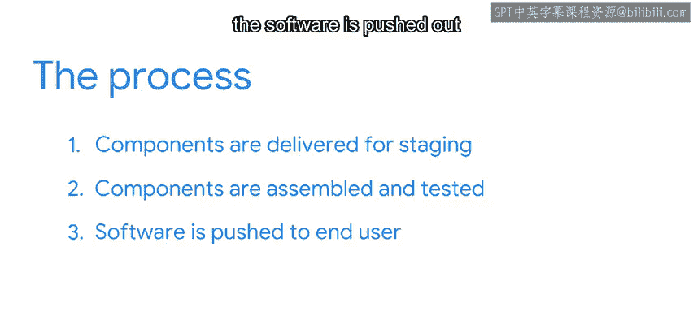

# 谷歌《用Python进行IT自动化办公3、4、5、6课（Git、debug、云端、实践）Google IT Automation with Python》中英字 - P172：55_从暂存环境到生产环境.zh_en - GPT中英字幕课程资源 - BV1LW4y1F7XW

Welcome back。We spoke before about a process called from coding to the cloud process that traces the beginning of the software development life cycle and includes programmers writing their code。

 removing sensitive information and containerizing the code for Devops to deliver to the cloud。

 After that comes the rest of the process from staging to production。

Which is what this video is all about。But before we get into it too deeply， let's define a few terms。

 Staging is the process of getting software ready for production。Like from coding to the cloud。

 staging is an I T strategic Devops approach rather than a programming one。

Where we specify the build steps and tests in the staging environment。

 all of the components of the software are being assembled and tested。

 often including some end user alpha and beta testing。When software is in this environment。

 we typically say that it's in development。The other term we want to define is production。

Production means the software， whether it's an application， a new version or a patch or an update。

 is used in real life， which is called the production environment。

 Production is where the software is actually being pushed out to the end users from a cloud server。

Based on the extensive testing that was done during staging。

 the software development team is confident that the software will run safely and securely in the production environment。

 meaning it won't crash or bleak information。Think of the staging2 production process as a fulfillment and warehouse distribution center In staging。

 the software is received from the developers and the Devops team。

 typically in separate containers such as Docker files。These containers are received in the cloud。

 checked in， tested and assembled。Next， the completed application is tested in house and using outside beta testers to see if it runs the same way the developers designed it to。

 If not， the Devops team may have to revise parts of the code and resubmit it and staging restarts。

 as if it was a new project。 This part of the staging environment is very similar to the actual production environment in terms of testing resources。

 software configuration and data monitoring。The testing simulates how the end user will operate the software。

The testing environments are set up， so there aren't any obvious errors or surprises。

The big difference here is that before the code and dependencies used in staging are released to the outside world。

 It's important to make sure the proprietary code like API keys aren't present and any debugging tools are turned off。

 So as not to negatively affect performance or allow potential security risks。 Now。

 going back to our example。 When the software is ready for the end user。

 it moves to production or it's loaded into a pallet wrapped with cellophane cling wrap to protect it。

 and the pallet is loaded under the truck。 again， from staging to production is an I T strategy for C ICD。

 meaning it supports the programmer's work， but doesn't involve them any longer unless there's a problem。

 Before we conclude this video。 let's briefly walk through the process one more time。

At the end of the from coding to the cloud process。

 all the components of the software were delivered to the appropriate cloud server for staging。

In the staging environments， all of the components of the software are being assembled and tested。

 Its in development for C ICD。Finally， in the production environment。

 the software is pushed out to the end users from a cloud server。

From staging to production is part of every application。

 update and version in the software development lifecycl within the CICD pipeline。

The process allows applications to be created and updated more quickly in order to meet the demands of end users。

And as technology evolves and improves， the staging to production process will only move faster。

