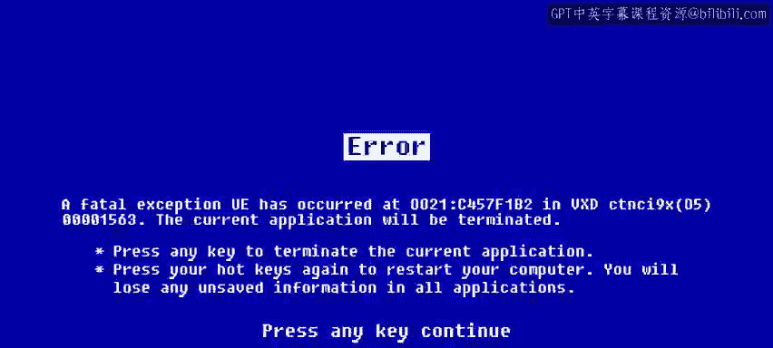

# 谷歌《用Python进行IT自动化办公3、4、5、6课（Git、debug、云端、实践）Google IT Automation with Python》中英字 - P174：0_外场素材.zh_en - GPT中英字幕课程资源 - BV1LW4y1F7XW

🎼。

🎼，Hey， my name is Roger Martinez and I'm a system L We saw how reducing scope in isolating problems can lead us to the root cause of problems that run slowly。

🎼か？🎼嗯。These coder reviews point out things that we might not have。🎼So cold。

While you're doing your hair， Python will give you Wow what what is it about teaching Bthon it makes me break out these cheese of jokes stupid hang next to each other Up next we'll check out more strategies that you can use to get there to the root cause of your colonial。

Python gives you incredible curls， great shine， holy crap， look at all we've covered just kidding。

