# 谷歌《用Python进行IT自动化办公1、2课（Python、控制操作系统）｜Google IT Automation with Python》中英字幕 - P17：16_使用 VS Code.zh_en - GPT中英字幕课程资源 - BV1gw411E7E1

Now that you're familiar with a few different coding tools， let's take a look at VS code。

VS code is an open source code editor that includes developer tooling。

 It's similar to Jupiter notebooks and coabab， but it includes more features。

VS code provides built and support with Intelence code completion and interactive debugger and other build and scripting tools。

V S code has a simple layout that makes it easy to learn and use。

 Its intuitive features make it a great choice for coding in Python。😊，To use VS code for Python。

 you will need to have Python 3， VS code and the VS code Python extension installed in this video。

 we're going to show you how to do that。You can use VS code on Windows。

 Mac and Linux operating systems for this video， we'll be using the Linux operating system。

 If you're using another operating system， we have provided a reading on using VS code with the other operating systems that you could take a look at later on。

😊，Now， let's get started。We'll start by opening a terminal window。 type the following command。

 Python 3， dash， dash version。

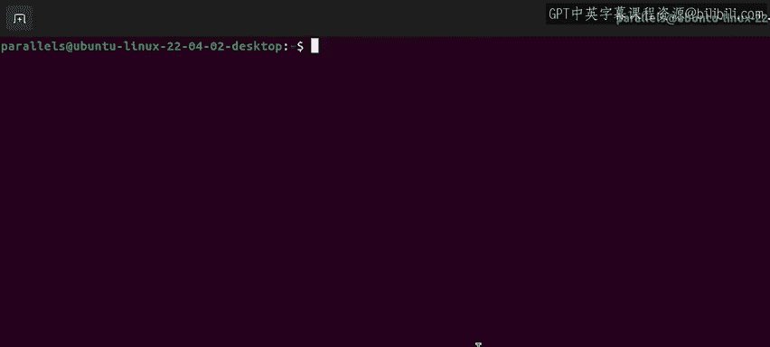

If Python 3 is installed， the output will show the Python version that is installed on your computer。

 An example of what that output would look like is Python 3 dot 10 dot 12。

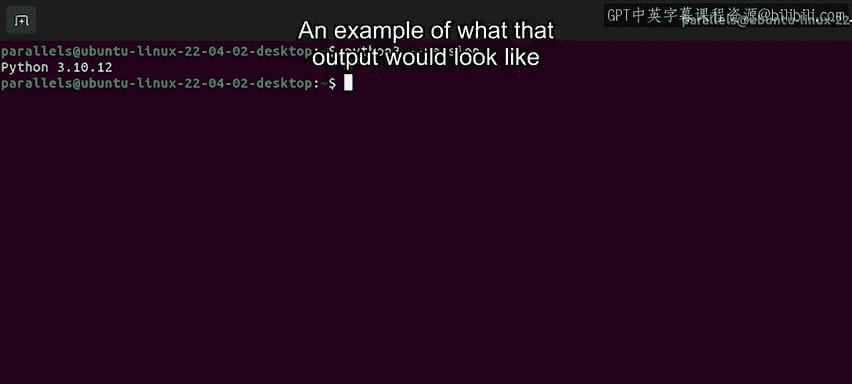

If it is not installed， the output will return command not found。

 This means you will need to start by installing Python 3。To do this。

 go to your terminal at the command line。 you will type pseudo apt install Python 3 and press enter。

 It will prompt you to enter your password。Enter your password and it will begin installing。

As Python 3 is installing， it may prompt you to continue by asking do you want to continue， yes s no。

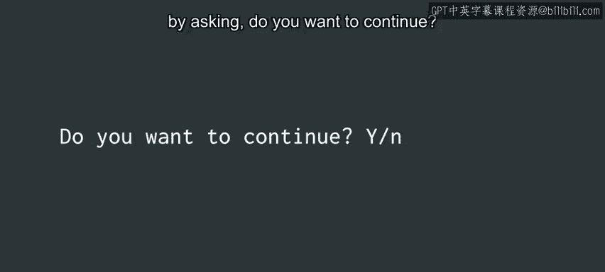

Select yes， and press enter。Now， Python 3 is installed and ready to go。 Let's move on to VS code。

You can download VS code at code。visualstudio。com forward slash download。

Here we're going to download the version that is compatible with Linux。

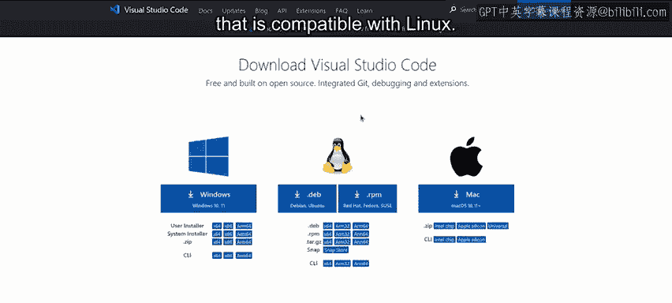

Let's select the dot Deb version of V S code。 We will give it a second， to finish downloading。

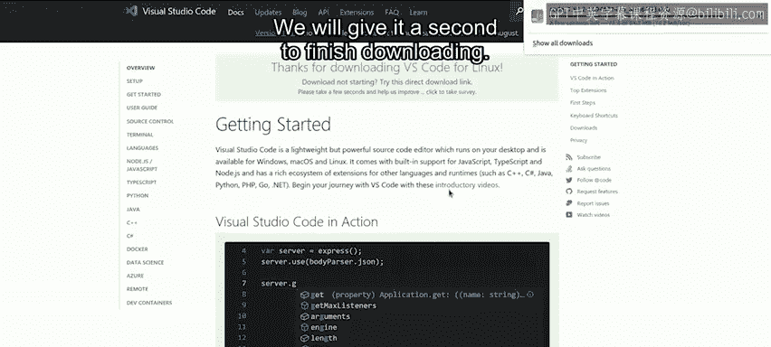

Next， we're going to go back to the terminal。 We will navigate to the downloads folder。

 We will do this by typing C downloads forward slash。Then we'll use the L S command。

 This will list the Deian file we just downloaded。The name of the file you just downloaded will appear。

😡。

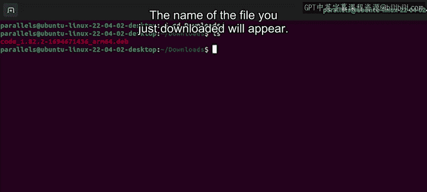

Next， you will types DPKG I， and the name of the file listed。

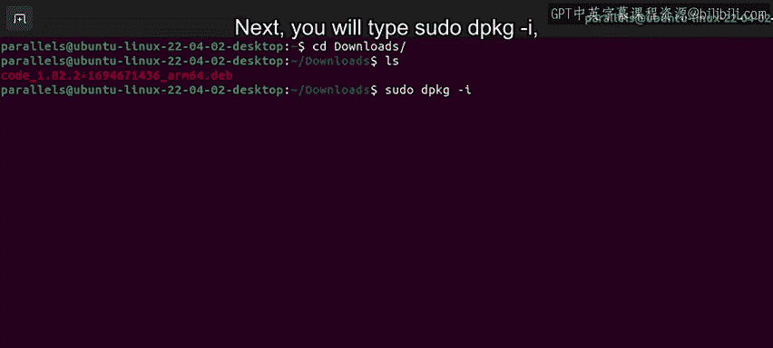

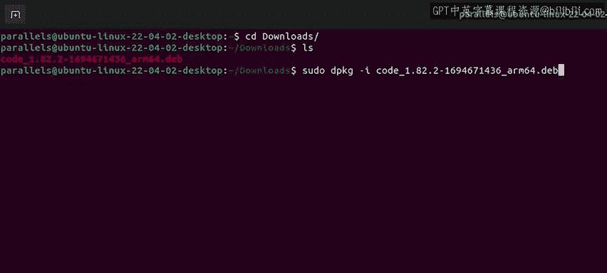

Once that command is executed， Viual Studio code is installed。To open up Viual Studio code。

 we type code at the command line。And Vi Studio code will open right up for us。

The final step is setting up Python and V S code To do this， we will browse for extensions。

To view extensions in VS code， we will type control shift X。

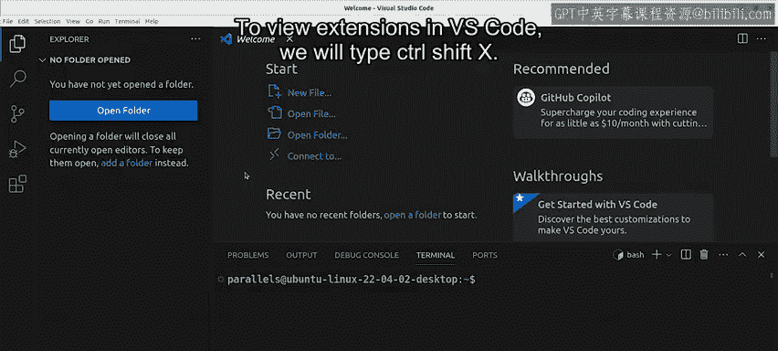

This will show you a list of the most popular VS code extensions on the VS code Market。

 You can search for Python using the search bar， and click install。😊，Once it's done installing。

 it will give you the option to get started with Python development。

We'll jump right in by selecting createreate Python file， this will open up the code editor。

Let's test it out with a simple statement。 We're going to type print。

 Hello world into the new workspace。Next， click on Run to run the code。

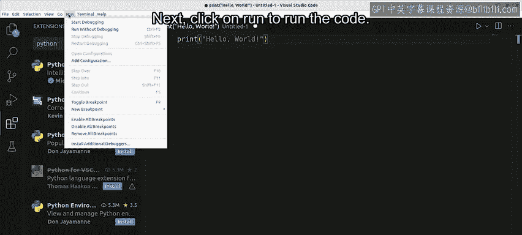

You will be prompted to name and save your file， give your Python file a name and click Save。

In this example， we will give our file the name， Helloworld do Py。

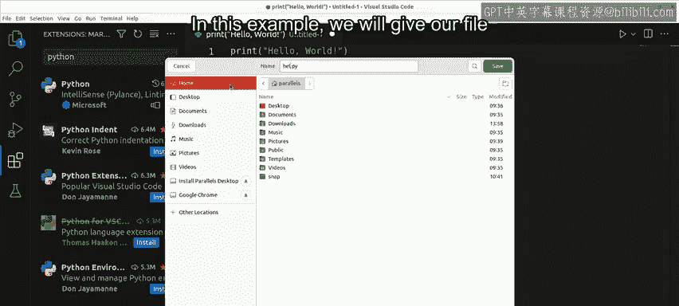

Your code will run and you will see its output here。

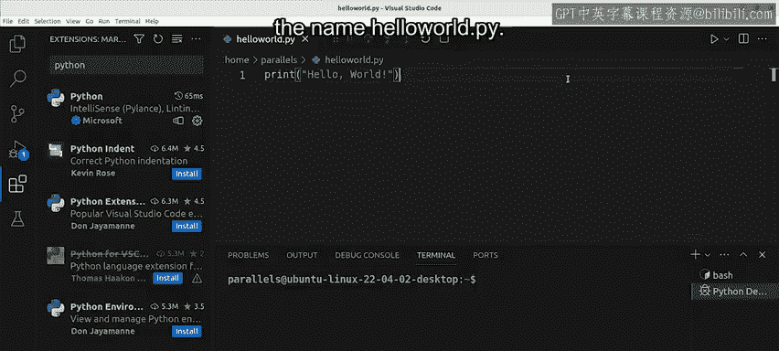

Great job。Now， to summarize， VS code is an extremely robust source code editor。

 it uses Intelense technology， which provides syntax highlighting and autocompte for coding。

V S code allows you to debug right in the editor with its interactive console。 Overall。

 V S code is extremely interactive and customizable。

 There's also a large library of extensions that are easily integrated。😊，Great job。

 That was a lot to cover。 Feel free to review these videos as many times as you need to。

 And remember， one of the best ways to figure out which tools work best for you are to explore all the features they have to offer and practice using them。

😊。

