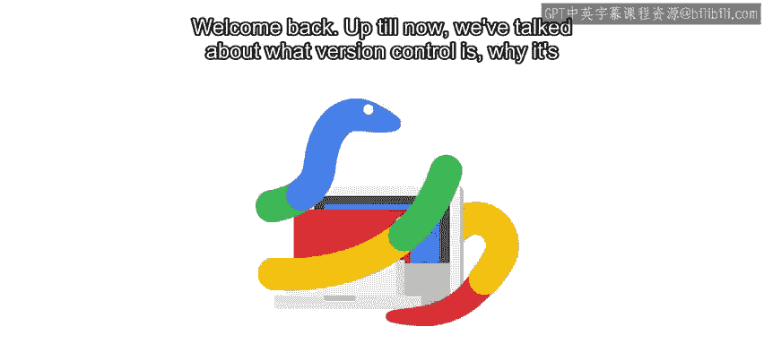

# 谷歌《用Python进行IT自动化办公3、4、5、6课（Git、debug、云端、实践）Google IT Automation with Python》中英字 - P17：16_模块 2 在本地使用 Git 介绍.zh_en - GPT中英字幕课程资源 - BV1LW4y1F7XW

🎼。う。

Welcome back Up till now， we've talked about what version control is， why it's necessary。

 and how we might benefit from it in diverse context。

We also started learning some basic gi commands and procedures Nice job。

Over the course of the next videos， we'll go into much more detail about what we can do with Git。

These are Git's greatest hits。 We'll start by learning some handy shortcuts and looking into how we can get more info out of our version control system。

Then we'll experience the true power of Git by seeing how we can undo some of our changes the ability to revert previous changes is one of the most useful aspects of version control systems。

Depending on what needs to be undone， there's a bunch of different techniques that we can use and get。

We can discard the changes made to a file， fix a commit that was incorrect。

 and even roll back our project to an older snapshot。

We'll look into all these techniques and dive into when to use each of them。Finally。

 we'll check out yet another important concept。Branches。

We can use branches to work on an experimental feature without affecting the main code of our project。

 support separate versions of a program that can't be merged together and much more。

We'll dive into what branches are， when and how to use them and how to deal with merge conflicts admitteditly。

 some of these concepts can get pretty tricky。So we really recommend that you follow along on your computer。

 experiment with the commands that we show， and try things on your own until you feel comfortable with these techniques。

Remember that you can always go back and review any earlier videos if something isn't totally clear。

If after all this you still feel stuck， be sure to use the discussion forums to ask for help as well。

So you're ready to learn more about advanced features and Git， let's get to it。

