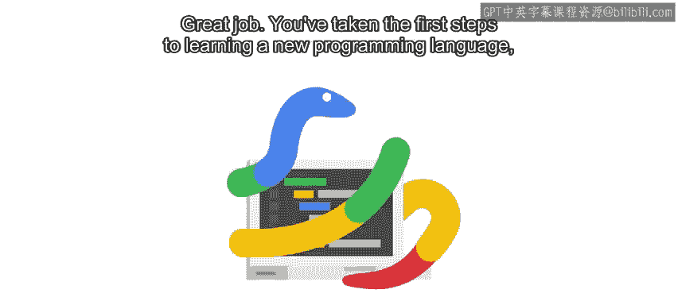
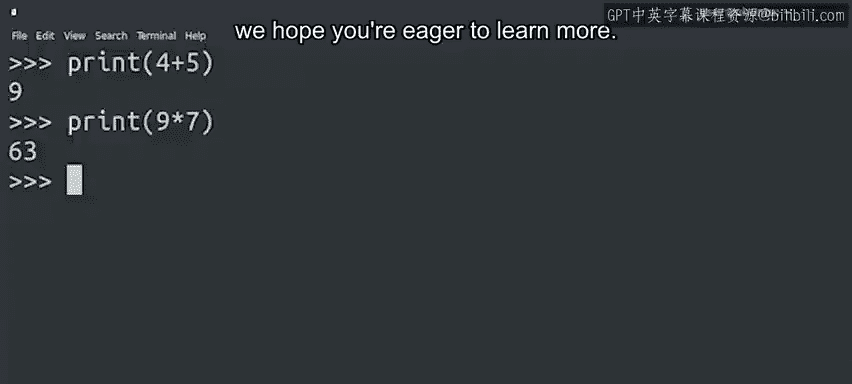

# 谷歌《用Python进行IT自动化办公1、2课（Python、控制操作系统）｜Google IT Automation with Python》中英字幕 - P18：17_初步总结.zh_en - GPT中英字幕课程资源 - BV1gw411E7E1

🎼Yeah。

Congrats， you made it to the end of the first module。 Great job。

 You've taken the first steps to learning a new programming language and growing your I T skill set。

 Getting there shows real determination and a will to learn。

 We've covered a lot of topics and many might be new to you If you've never learned about programming before。

 You've discovered what scripting is What the syntax and semantics of a programming language are all about and how they relate to automation。

 We've got to grips with small blocks of Python code。

 talked about why Python is relevant to I T and explored what other programming languages are available。

 We've had our first approach to how to input data and write a script that puts this data to use。

 And we've seen how you can use Python to perform typical math calculations。

 Not bad for your first Python steps， right， This is just the beginning of an exciting journey learning to code。

 And we hope you're eager to learn more。😊。

Coming up， get ready for your first graded assessment。

 These assessments help you check whether you've understood all the concepts and that you're ready to move on to the next stage。

 Now， don't worry， if at any point， you're not sure about a question。

 you can always review the videos and readings to remind yourself of the answer。

 Remember that everybody learns at different speeds。 So take your time。

 Really get familiar with the concepts。 And once you feel ready。

 the assessment is there waiting for you。 I'll see you back here once you've mailed it。😊。

