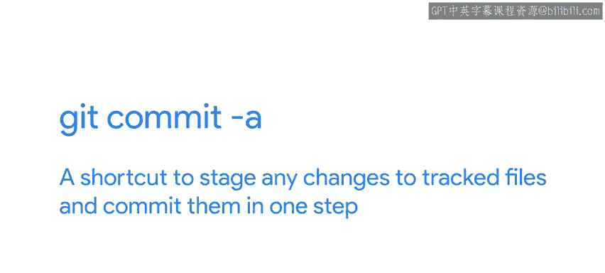
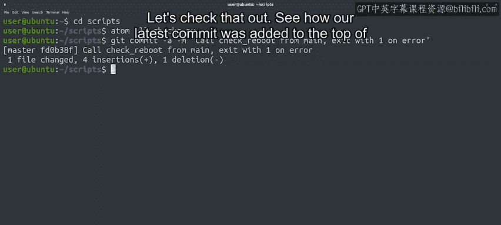
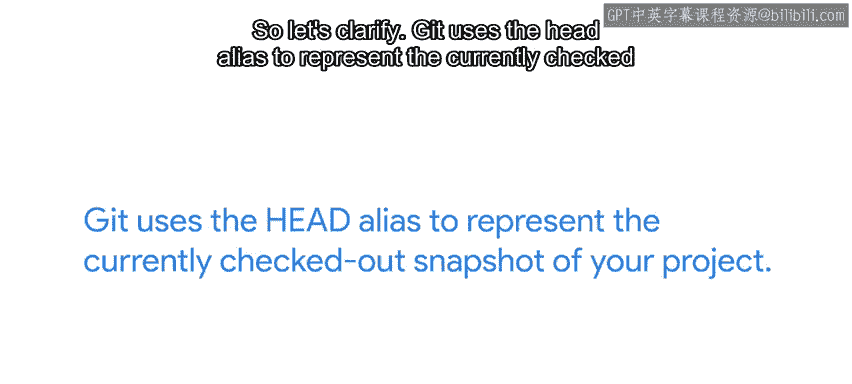

# 谷歌《用Python进行IT自动化办公3、4、5、6课（Git、debug、云端、实践）Google IT Automation with Python》中英字 - P18：17_跳过暂存区域.zh_en - GPT中英字幕课程资源 - BV1LW4y1F7XW

When we covered the basic Git workflow， we called out that the process is usually to make changes。

 stage them， and then commit them。The separate step between staging and committing allows us to stage several changes in one commit。

But if we already know that the current changes are the ones that we want to commit。

 we can skip the staging step and go directly to the commit。 No dress rehearsals。

 We do this by using the dash a flag to the git commit command。

This flag automatically stages every file that's tracked and modified before doing the commit。

 letting us skip the Git add step。At first， you might think that Git commitit A is just a shortcut for Git add followed by Git commit。

But that's not exactly true。Git commitit dash A doesn't work on new files。

Because those are un tracked。Instead， git commitit A is a shortcut to stage any changes to track files and commit them in one step。

If the modified file has never been committed to the repo。

 we'll still need to use Git add to track it first。

Let's make a change to our example script from an earlier video and try out this new flag。

We'll now modify our main function and make it call the check reboot function that we wrote before。

If a reboot is pending， we'll print a message and then exit our program with an exit status of one。

And since we're using the cis module， we'll need to import it。All right。

 now that we've made the change， we're ready to try out the new dash a flag。

We'll also use the dash M flag to add the commit message directly this time we'll say that we're calling check underscore reboot and exiting with one on the error condition。

Success these shortcuts are useful when making small changes that we know will want to commit directly without keeping them in the staging area and having to write long and complex descriptions。

Keep in mind that when you use the dashM shortcut， you can only write short messages and can't use the best practices regarding commit descriptions that we talked about earlier。

So it's best reserved for truly small changes that don't require extra context or explanation。

Short and sweet。Heads up When you use the dash a sharpcut， you skip the staging area。

 meaning you can't add any other changes before creating the commit。

So you need to be sure that you've already included everything you want to include in that commit。

In the end， using a shortcut like dash A is just like using the regular commit workflow。

 the commit will show up in the log， along with the message just as usual。Let's check that out。

See how our latest commit was added to the top of the list of commits and notice how the head indicator has now moved to the latest commit。

 You might be wondering， what is this head and where is it heading。We'll keep coming across it。

 so let's clarify。Gitt uses the head alias to represent the currently checked out snapshot of your project。

This lets you know what the contents of your working directory should be。In this case。

 the current snapshot is the latest commit in the project。We'll soon learn about branches。

 and in that case， head can be a commit in a different branch of the project。

We could even use Git to go back in time and have head represent an old commit from before the latest changes were applied。

In all cases， head is used to indicate what the currently checked out snapshot is。

 This is how git marks your place in the project。 Think about it as a bookmark that you can use to keep track of where you are。

Even if you have multiple books to read， the bookmark allows you to pick up right where you left off。

When you run Git commands like DF， branch， or status。

 Git will use the headbookmark as a basis for whatever operation it's performing。

We'll see head used when we learn how to undo things and perform rollbacks。

 and we'll talk more about branches in later videos。 As a shortcut。

 it's generally easy to think of head as a pointer to the current branch。

 although it can be more powerful than that。Up next。

 we'll dig into how we can get more information about our changes。

 both before and after we commit them。Nice。