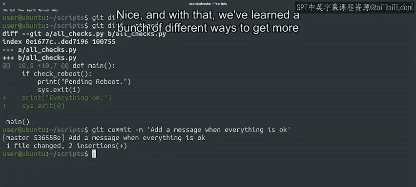

# 谷歌《用Python进行IT自动化办公3、4、5、6课（Git、debug、云端、实践）Google IT Automation with Python》中英字 - P19：18_获取更多有关更改的信息.zh_en - GPT中英字幕课程资源 - BV1LW4y1F7XW

We've seen how GitLo shows us the list of commits made in the current Git repository。By default。

 it prints the commit message， the author and the date of the change。 This is useful。

 but if we're combing through a history of changes in a repo to try and find what caused the latest outage。

 we'll probably also need to look at the actual lines that change in each commit。

To do this with Gitlog， we can use the dash P flag。

 The P comes from patch because using this flag gives us the patch that was created。

 Let's try it out。The format is equivalent to the D dash U output that we saw in an earlier video。

It shows added lines with pluses and remove lines with dashes。

Because the amount of text is now longer than what fits on your screen。

Git automatically uses a paging tool that allows us to scroll using page up， page down。

 and the arrow keys。We still have one commit below the other。

 but now each commit takes up a different amount of space。

 depending on how many lines were added or removed in that commit。Using this option。

 we can quickly see what changes were made to the files in our repository this can be especially useful if we're trying to track down a change that recently broke our tools。

If we don't want to scroll down until we find the commit that we're actually interested in。

 another option is to use the Git show command。 This command takes a commit ID D as a parameter and will display the information about the commit and the associated patch。

We'll talk more about commit IDs in a later video， but for now。

 remember that this is an identifier that we see next to the word commitit in the lock。

Let's check this out by first listing the current commits in the repo and then calling Git show for the second commit in the list。

First， I'm going to exit up by pressing Q。We've shown how we can use Gitlog for listing commits and GitloggP for showing the associated patches。

 Another interesting flag for Gitlog is the dash dash stat flag This will cause Gitlog to show some stats about the changes in the commit like which files were changed and how many lines were added or removed。

Let's try it with our repo。There are a bunch of other options to get log， so we won't cover them all。

 You can always use the reference documentation or the manual pages to find out more。

And as we called out before， you don't need to memorize any of this。

 you'll learn the different commands and flags by using them。

The important thing to remember is that all the information is stored in the repository and you have it at your fingertips when you need it。

You're welcome。Now， what about changes that haven't been committed yet？Until now。

 whenever we've made changes to our files， we've either added them to the staging area with Git add and committed them with Git commitmit or committed them directly using Git commitmit A。

This works fine， but it means we have to know exactly which changes we've made。

Sometimes it can take a while until we're ready to commit。We call these。Commitment issues。

Just kidding。But imagine you've been working on adding a new complex feature to a script and it requires thorough testing。

Before committing it， you need to make sure that it works correctly。

 Check that all the test cases are covered and so on and so on。 So while doing this。

 you find bugs in your code that you need to fix。 It's only natural that by the time you get to the commit step。

 you don't really remember everything you've changed。To help us keep track。

 Git gives us the gett diff command。Let's make a new change to our script and then try this command out。

 We'll add another message to the user to say that everything is okay when the check is successful and then exit with 0 instead of  one。

Okay， we've made the change， let's now save it and check out what Git di shows us。Again。

 this format is equivalent to the di dash U output that we saw in an earlier video。In this case。

 we see that the only change is the extra lines that we've added if our change was bigger and included several files。

 we could pass a file by parameter to see the differences relevant to that specific file instead of all the files at the same time。

Something else we can do to review changes before adding them is to use the dash P flag with the Git add command。

When we use this flag， Git will show us the change being added and ask us if we want to stage it or not。

This way， we can detect if there's any changes that we don't want to commit。Let's try that one out。

We've staged our change and it's now ready to be committed。If we call git diff again。

 it won't show any differences since git diff shows only unstd changes by default。 Instead。

 we can call git diff dash dash staged to see the changes that are staged， but not committed。

With this command， we can see the actual stage changes before we call Git commitmit。

Let's commit these changes now so that they aren't pending anymore。

We'll say that we've added a message when everything is okay。Nice， and with that。

 we've learned a bunch of different ways to get more information about our changes。

We've covered a lot of ground， so take the time to review and practice these commands if they don't make sense yet。

Up next， we'll look into what happens when we want to delete or rename files in our repository。

It's time to do a little housekeeping。