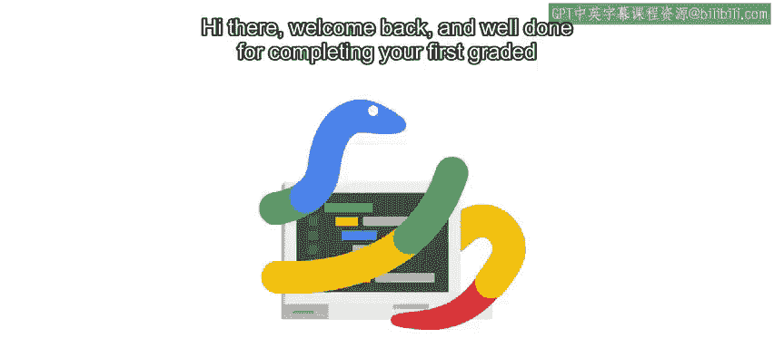

# 谷歌《用Python进行IT自动化办公1、2课（Python、控制操作系统）｜Google IT Automation with Python》中英字幕 - P20：19_Python 基本语法介绍.zh_en - GPT中英字幕课程资源 - BV1gw411E7E1

🎼Yeah。

Hi there。 Welcome back。 And well done for completing your first graded assessment。

 You're doing a great job making it thus far。 Chances are some topics we've covered may have been a little tricky at times。

 especially if you're completely new to programming。

 Don't worry if something wasn't obvious right away。 We went through a lot of new concepts。

 and it might take several passes until you feel comfortable with them。 And that's totally normal。

 We all went through and we were learning how to code。 in the previous module。

 We explored some basic concepts like programming and automation。

 We called out that each programming language has a specific syntax。

 which we need to learn so we can tell the computer what to do。😊。

We then got a sneak preview of some of the things we could do with Python。 Up next。

 We'll dive deeper into some basic building blocks of Python syntax， things like variables。

 expressions， functions and conditional blocks。 At first glance， these pieces may seem pretty simple。

 But when we start to combine them， they become a lot more powerful。

 Understanding a programming languages syntax isn't too different from learning a spoken language。

 For example， the best way to learn Spanish is to visit a Spanish speaking country。

 immerse yourself in the culture。 Listen to the people。

 then figure out how to arrange the words to form a sentence that another speaker can understand The same is true for programming。

 When you immerse yourself in Python programming， you'll learn how to formulate statements of code that the computer can understand。

 This is called syntax。 Okay， so as you go through the next few videos。

 Keep in mind that our main goal is to learn the languages syntax。

 So we'll focus on how to tell our computer what to do。 Not on how to get it to do complicated tasks。

 Like before，😊，Run through some simple exercises to help you see the concepts in action。

And as you pick up the new skills and get to grips with different tools。

 will'll start to write more advanced scripts that tackle more challenging problems。 Again。

 if at any point you feel confused or that something just isn't clear。 Remember。

 you can watch the videos and take the practice quizzes as many times as you need。

 The key to getting good at programming is practice。 Pra and practice。

 you have to keep working your programming muscles in order to get strong。

 just like building muscles in the gym。 Tra hard。 train regularly。

 and you'll be tackling more weighty coding problems in no time。😊，All right。

 ready to jump back in in the next video， we're going to learn all about data types。

Let's get started。