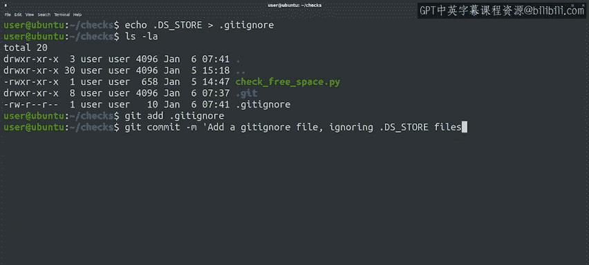

# 谷歌《用Python进行IT自动化办公3、4、5、6课（Git、debug、云端、实践）Google IT Automation with Python》中英字 - P20：19_删除和重命名文件.zh_en - GPT中英字幕课程资源 - BV1LW4y1F7XW

Let's say that you've decided to clean up some old scripts and want to remove them from your repository。

Or you've done some refactoring which makes a particular file obsolete。

You can remove files from your repository with the Git RM command。

 which will stop the file from being tracked by Git and remove it from the Git directory。

Foler removals go through the same general workflow that we've seen。

 so you'll need to write a commit message as to why you've deleted them。

Let's try this out in our checks repository that contains a file we decided we actually don't want。

We'll first look at the contents of the directory with LS， then delete the file with Git RM。

 then check the contents with LS again， and finally check the status with Git status。

So we see that by calling GitRM， the file was deleted from the directory and the change was also staged to be committed in our next commit。

Let's do that now by calling Git commitmit and setting a message indicating that we've deleted the unneeded file。

As usual， we get a bunch of stats when we do the commit。Check out all the deletions it reported。

These are all lines in the file that are no longer there， and it states the file itself was deleted。

What if you have a file that isn't accurately named？This can happen， for example。

 if you start writing a script that you thought would only do one thing and then expands to cover more use cases。

Or conversely， if you named your script thinking that it would be very generic。

 but it ends up being more specific， you can use the Git M V command to rename files in the repository。

 Let's rename our existing script to check freespace do pi and then check what Git status has to say about that。

The status shows us that the file was renamed and clearly displays the old and new names。

As with the previous example， the change is staged but not committed。

 Let's commit it by calling gett commitm once again。

The Git MV command works in a similar way to the MV command on Linux。

 and so can be used for both moving and renaming。If our repository included more directories in it。

 we could use the same GitMB command to move files between directories。

As you can probably tell from our examples， the output of Git status is a super useful tool to help us know what's up with our files。

It shows us which files have tracked or untracked changes and which files were added， modified。

 deleted， or renamed。It's important that the output of these commands stays relevant to what we're doing。

If we have a long list of untraracked files， we might lose an important change in the noise。

If there are files that get automatically generated by our scripts。

Or our operating system generates artifacts that we don't want in our repo。

 We'll want to ignore them so that they don't add noise to the output of Git status To do this。

 we can use the Git ignore file。Inside this file we'll specify rules to tell Git which files to skip for the current repo。

For example。If we're working on an OSX computer， we'll probably want to ignore the dot DS store file。

 which is automatically generated by the operating system。To do this。

 we'll create a dot gett ignore file containing the name of this file。

Remember that the dot prefix in a UniX like file system indicates that the file or directory is hidden。

And won't show up when you do the normal directory listing。

That's why we have to use LSL to see all files。We've added a gett ignore file to our repo。

 but we haven't committed it yet。This file needs to get tracked just like the rest of the files in the repo。

 let's add it now。

Looks great。 We've learned a lot of new commands and techniques related to Git in these past videos。

 If anything isn't clear at this point， now is a good time to experiment on your own and share any challenges in the discussion forums。

😊，Coming up， we've put together a cheat sheet listing all the new commands and options。 After that。

 a quiz to let you practice these concepts。 Now， go on， gi。

