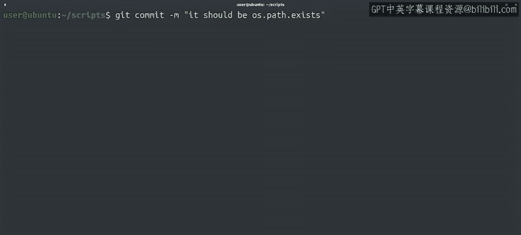

# 谷歌《用Python进行IT自动化办公3、4、5、6课（Git、debug、云端、实践）Google IT Automation with Python》中英字 - P21：20_在提交前撤消更改.zh_en - GPT中英字幕课程资源 - BV1LW4y1F7XW

Being able to revert art changes is one of the most powerful features offered by version control systems。

And there's a bunch of different techniques available depending on which changes we need to undo。

In this video in the next few coming up， we'll talk about the most common ways to revert changes in Git and when to use each approach。

 For example， you might find yourself in a situation where you've made a bunch of changes to a file。

 but decide that you don't want to keep them。You can change a file back to its earlier committed state by using the git checkout command。

 followed by the name of the file you want to revert Spea of。

 let's try this out using our scriptris repository。

 we'll edit our all checks Pi script and remove the check reboot function。

 then save and go back to the command line。Cool， we've made our change。

 Let's try our script and see what happens。Oof。🤢，By deleting that function。

 we've actually broke the script。 Let's see what Git status has to say about this。As expected。

 we see that our file is modified and the changes aren't staged yet。

Check out how Git gives us a couple helpful tips on what to do now。

We can run Git add to stage our changes， or we can run Git checkout to discard them。

If you need help remembering what this command does， think of it this way。

 You're checking out the original file from the latest stored snapshot。 Let's do that Now。

 We'll check out at the original file and then take a look at what Git status has to say about it and finally retry our script。

Oops。Looks like we have a typo。 Let's go back and fix it。Done and done。With that。

 we've demonstrated how we can use Git checkout to revert changes to modified files before they get staged。

This command will restore the file to the latest stored snapshot。

 which can be either committed or staged。 So if you've made additional changes to a file after you've staged it。

 you can restore the file to the earlier stage version。

And if you need to check out individual changes instead of the whole file。

 you can do that using the dashP flag。This will ask you change by change if you want to go back to the previous snapshot or not。

 Okay， that's it for undoing unstd changes。What if you added the changes to the staging area already？

Don't stress if we realize we've added something to the staging area that we didn't actually want to commit。

 we can unstage our changes by using the Git reset command。

Staging changes that we don't actually intend to commit happens all the time。

Especially if we use a command like Git add Star， where a star is a file Gob pattern used in bash that expands to all files。

This command will end up adding any change done in the working tree to the staging area。

And while sometimes that might be what we want， it can also lead to some surprises。

 Let's try it out with an example。 First， we'll pretend we're trying to debug a problem in our script。

And for that， we create a temporary file with the output of our script。

Then we'll add all unstd changes in our working tree using Git Add star， and finally。

 check the status using Git status。We can see that this output file。

 which was supposed to be a temporary file for debugging， has now been staged in our repo。

 but we didn't want to commit it。Conveniently， the Gi status command tells us how to unstage the file right there in the output。

 The example output mentions the head alias。 Remember what that means。That's right。

 It's the current checked out snapshot。 So by running the suggested command。

 we're resetting our changes to whatever is in the current snapshot。 Let's try it out。

the file is once again untracked in our working tree and no longer staged。

You can think of reset as the counterpart to add with add。

 you can well add changes to the staging area with reset， you remove changes from the staging area。

And you can use Git reset P to get Git to ask you which specific changes you want to reset， Gi it。

But wait， let's remember to commit our typo fix。

With that， we've seen how we can revert unstd and stage changes。

 but what if you've already created a commit with the changes that you want to undo。

 Great question that's coming up in the next video。

