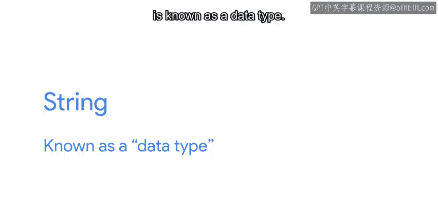
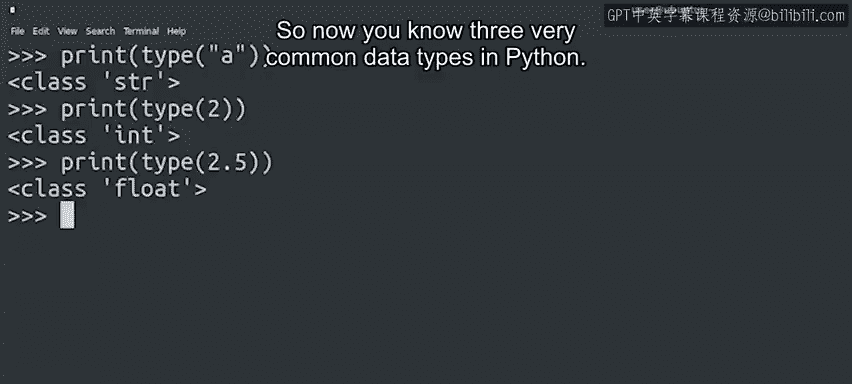

# 谷歌《用Python进行IT自动化办公1、2课（Python、控制操作系统）｜Google IT Automation with Python》中英字幕 - P21：20_数据类型.zh_en - GPT中英字幕课程资源 - BV1gw411E7E1

In earlier videos， we called out that text written between quotes in Python is called a string In programming terminology。

 a string is known as a data type。

Whether it's a mobile game or a script used to automatically create user accounts。

 most programs need to manipulate some kind of data。

 and that data can come in a lot of different forms， or like we call them data types。

 A string is only one kind of data type found in Python。 There's a bunch of others。 like an integer。

 which represents whole numbers without a fraction， like one。 and float。

 which represents real numbers， or， in other words， a number with a fractional part， like 2。5。

 General， your computer doesn't know how to make different data types。 For example。

 adding two integers together， makes perfect sense to computers like this。

Adding together two strings also makes sense。 We just end up with the longer strings that contains the two。

 like so。But your computer doesn't know how to add an integer in a string。

 If you tell it to mix these two different data types。

 your computer isn't going to know what to do and will' raise an error。 Check it out。Oh， no。

 our first error。 But don't panic。 errorsrrors are a common part of programming。

 and you'll probably have to deal with them a lot。 The trick is to think of errors as little clues from your computer to help you improve your programming skills。

Read the errors carefully。 understandstand what they're telling you。

 and then use that new knowledge to help you fix the mistake。 In this example。

 the last line of the error message shows us that we've encountered something called a type error。

 When we get a bit of explanatory text that tells us that the plus sign can't be used between an int type and an SR type。

 which are short names for integer and string。Thinking about what we've already learned about strings。

 integers and mixing data types， can you guess what the error is trying to tell us？

The message unsupported operaan type tells us that we can't add the integer 7 and the string 8 because they're different data types。

But what if you didn't have an instructor to helpful point that out， How would you know。

 you'd need to use your research skills and the resources we called out earlier in the course to do some investigating。

 For example， you could look for information about the error by pasting the type error message into the search bar of your favorite search engine。

 This is a common trick used by almost every one learning to code。

 And even by experienced developers。 You'll usually find that other people on the Internet have reported similar errors and solved them too。

 back to our example， Maybe you're thinking， aren't we adding two numbers here。 looks a bit like it。

 right？ Well， look carefully， and remember that anything wrapped in quotation marks is considered a string in Python。

 So8 is a string here while 7 is an integer to the computer。

 adding 7 plus 8 is just as strange as adding 7 plus a is to us。 and 7 plus a equals no sense at all。

It might be helpful to think about data types in terms of information they can represent。For example。

 the name of a file would be represented as a string data type。

 while the size of that file might be an integer data type。

If you're ever not 100 per cent sure what data type a certain value is。

 Python gives you a handy way to find out You can use the type function to have the computer tell you the type。

 This might come in handy when dealing with code that someone one else wrote。

 and you're not sure what data type it's using。For example。Pretty neat， right？

This tells us that A belongs to STR class， which like we said earlier is short for string。

The number 2 belongs to the int class， which is short for integer and 2。5 belongs to the float class。

 We'll talk more about what we mean by class later in the course。 For now。

 you can just use it as a synonym for data type。

So now you know three very common data types in Python。

 There are plenty of others you'll be using soon， but don't worry about them at the moment As we continue through the course。

 we'll come across more data types and learn how to interact with each of them。 For now。

 just remember mixing your data types will get your computer。 Well， all' mixed up。

 So keep your strings with your strings。 your integers with your integers and your floats with your floats and you shouldn't get in too much of a tangle。

😡。