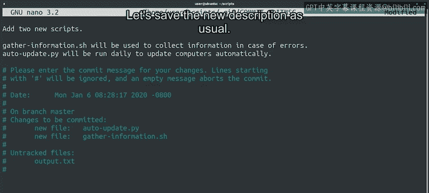

# 谷歌《用Python进行IT自动化办公3、4、5、6课（Git、debug、云端、实践）Google IT Automation with Python》中英字 - P22：21_修改提交.zh_en - GPT中英字幕课程资源 - BV1LW4y1F7XW

In general， we try to make sure our commits include all the right changes and descriptions。

But we're all human， and we make mistakes。It's not uncommon for developers and IT specialists to realize that there is an error in a recent commit。

 which is why it's important to know how to take action and fix it。

Let's say you've just finished committing your latest batch of work。

 but you've forgotten to add a file that belongs to the same change。

You'll want to update the commit to include that change。Or maybe the files were correct。

 but you realize that your commit message just wasn't descriptive enough。

So you want to fix the description to add a link to the bug that you were solving with that commit。

What can you do？We can solve problems like these using the dash dash amend option of the Git commit command When we run Git commit dash dash amend。

 Git will take whatever is currently in our staging area and run the Git commit workflow to overwrite the previous commit。

Let's see this in an example。We'll go to our scripts directory and create two new files using the To command。

 then list the contents of the directory using LS， add our Python script。

 and commit it saying that we've added two files。As you can see。

 the message printed by Git says that only one file was added。

Our commit message said that we added two files， but we forgot to add one of them。 Ouch。 don't panic。

 We can fix it。 We'll start by adding the missing file and then amending our commit。

We called Git commitmit dash dash amend， and an editor opened up showing the commit message and the stats above the commit that we're working with。

The list of added files for this commit now includes both files that we wanted to add。 yay。

 now that the files have been added， we can also improve our initial commit message。

 which was a bit too short。We'll keep the existing description as the first sentence of our commit and then add a line of description about the intended purpose of each file。

Okay， with that， our commit is ready to be amended。 Let's save the new description as usual。

we've amended our previous commit to include both files and a better message。

 You could also just update the message of the previous commit by running the git commit dash dash amend command with no changes in the staging area。

An important heads up， while git dash dash amend is okay for fixing up local commits。

 you shouldn't use it on public commits。Meaning those that have been pushed to a public or shared repository。

This is because using dash amen rewrites the Git history。

 removing the previous commit and replacing it with the amended one。

This can lead to some confusing situations when working with other people and should definitely be avoided。

 So remember。Fixing up a local commit with amend is great。

 and you can push it to a shared repository after youve fixed it。

 but you should avoid amending commits that have already been made public。

If this sounds confusing now， don't worry。We'll mention it again when we talk about collaborating with others through shared repositories。

Okay， we've covered how to fix staged and unstaged changes and how to fix a commit that was incomplete。

Up next， we'll talk about what to do if you come across a bad commit that needs to be completely reverted。

