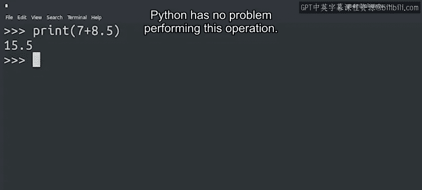
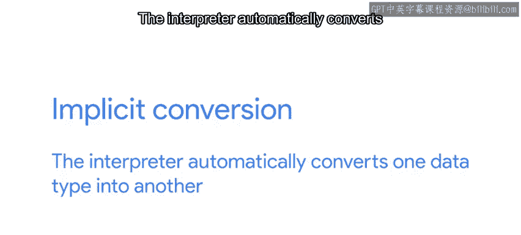
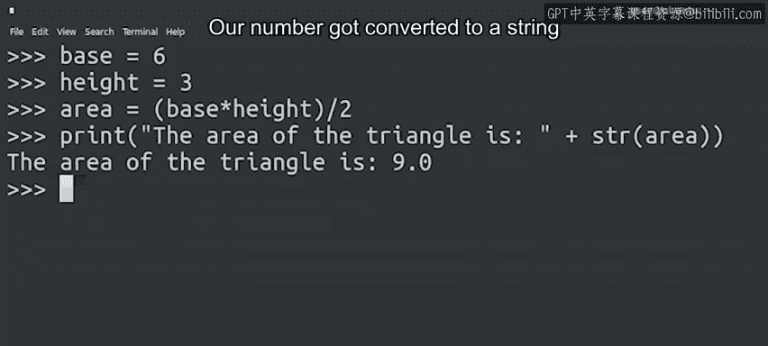

# 谷歌《用Python进行IT自动化办公1、2课（Python、控制操作系统）｜Google IT Automation with Python》中英字幕 - P22：21_表达式、数字和类型转换.zh_en - GPT中英字幕课程资源 - BV1gw411E7E1

In an earlier video， we saw how we can't use the plus operator between an integer and a string because they're different data types。

 But what happens when we try to operate with an integer in a float instead， Let's find out。W。

 air free， Python has no problem performing this operation。

But what's up with that aren't integer and a float。 two different data types。 They sure are。

 but there's a lot happening under the hood here。 behindhind the scenes。

 the computer is busy automatically converting our integer 7 into a float 7。

 This lets Python then act together the values to return a result that is also afloat。

 We call this process implicit conversion。 The interpreter automatically converts one data type into another。

We've called this out before， but it's worth highlighting again that Python operations aren't just restricted to numbers。

 You can also use the plus operator to add together strings。

 This lets you do things like create sentences from individual words。

 Just don't forget to add spaces to each word。 Otherwise， the computer will run them all together。😊。

So what if you really want to combine a string in a number， Is it possible， It sure is。

 but only with an explicit conversion in Python to convert between one data type and another。

 we call a function with the name of the type we're converting to。 Let's see how this works。Now。

 things are getting a little bit more complex。 Let's take a moment to unpack this to make sure it all makes sense。

 In this script， we're first calculating the area of a triangle。 And when printing it。

 we're adding it to a string to do this。 We need to call the S R function to convert a number into a string。

Let's execute it and check out what happens。Our number got converted to a string and printed together with the message。

Whoo。😮，We've learned a little bit about variables， values， expressions and conversions。 Next up。

 we've got a practice quiz to help you solidify your knowledge。 As always。

 take your time and review the content。 if you need。 You've totally got this。

 I'll see you in the next video， once you're finished。😊。

