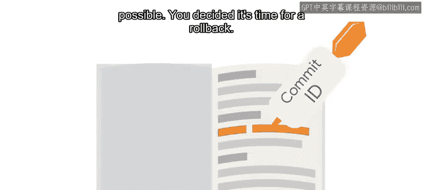
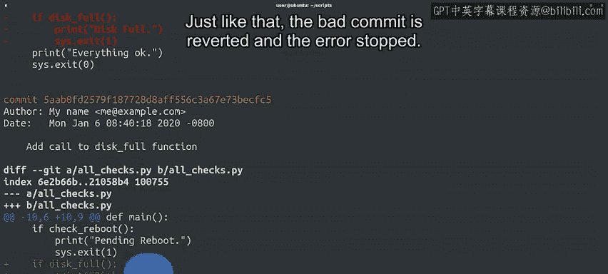

# 谷歌《用Python进行IT自动化办公3、4、5、6课（Git、debug、云端、实践）Google IT Automation with Python》中英字 - P23：22_回滚.zh_en - GPT中英字幕课程资源 - BV1LW4y1F7XW

Fixing your work before you commit is good， but what happens if it's already been snapshoted by Git？

Let's say you host a Git repository on a company server that contains all kinds of useful automation scripts that you and your coworkers use。

One morning before coffee， you make a few changes to one of these scripts and commit the updated files。

A few hours later， you start to receive tickets from users indicating some part of the script is broken。

From the errors they describe， it sounds like the problem is related to your recent changes。呃 oh。

You could look at the code you updated to see if you can spot the bug。

 but more tickets are pouring in and you want to fix the problem as fast as possible。

You've decided it's time for a rollback。

There are a few ways to rollback commits and get。For now。

 we'll focus on using the Git revert command and Git revert doesn't just mean undo。Instead。

 it creates a commit that contains the inverse of all the changes made in the bad commit。

In order to cancel them out， for example， if a particular line was added in the bad commit。

 then in the reverted commit， the same line will be deleted。This way。

 you get the effect of having undone the changes， but the history of the commits in the project remains consistent。

Leaving a record of exactly what happened。So Git revert will create a new commit that is the opposite of everything in the given commit。

We can revert the latest commit by using the head alias that we mentioned before。

 since we can think of head as a pointer to the snapshot of your current commit。

When we pass head to the revert command， we tell Git to rewind that current commit。Makes sense。

To check this out， we'll first add a faulty commit to our example repo。Okay。

 we've added some code to our script。 Let's save and commit this。So now our code is committed。

We didn't even test it， which is a bad idea。 If you're doing this for real。

 and you might have already spotted the problem with our code。

This is where our users start filing tickets and saying that things are broken。

 and so we run our script to see what happens。Oops。We use the function that we forgot to define。Okay。

 it's rollback time。 let's get rid of this faulty code by typing git revert head。

So once we issue the Git revert command， we're presented with the text editor commit interface that we've all seen before。

In this case， we can see that Git has automatically added some text to the commit。

 indicating it's a rollback。 The first slide mentions that it's reverting the commit we just did called add call to disk Full function。

The extra description even includes the identifier of the commit that got reverted。

 while we could use this description as is， it's usually a good idea to add an explanation of why we're doing the rollback。

Remember that the goal of these descriptions is to help our future selves understand why things happened。

 In this case， we'll explain that the reason for the Roback is that the code was calling a function that wasn't defined。

Once we're done entering the description， we can exit and save as usual。

You'll notice the output that we get from the Git revert command looks like the output of the Git commit command。

This is because Git revert creates a commit for us。And since our revert is a normal commit。

 we can see both the commit and the reverted commit in the log。

Let's look at the last two entries in the log using D P and D2 as parameters。As demonstrated before。

 the dash P parameter lets us see the patch created by the commit。

 while the dash 2 parameter limits the output to the last two entries。 So in this log。

 we can see that when we called revert Git created a new commit。

 That's the inverse of the previous one。This removes the lines that we added in the previous commit。

We can see that the original commit shows the lines we added by preceding them with a plus sign。

The same line shows up with a minus sign in the newer commit message。

 indicating that they were removed。Just like that， the bad command is reverted and the errors stop。

in this example， we reverted the latest commit in ourery。

But what if we had to revert a commit that was done before that？

Rev up your time machines because in the next video， we're turning back the clock big time。

