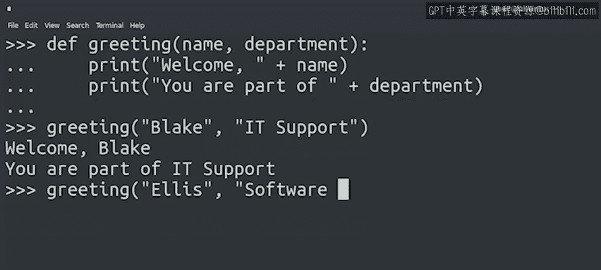

# 谷歌《用Python进行IT自动化办公1、2课（Python、控制操作系统）｜Google IT Automation with Python》中英字幕 - P23：22_定义函数.zh_en - GPT中英字幕课程资源 - BV1gw411E7E1

Woo， you made it through another quiz。 You are doing awesomely。 Keep it up。 So far。

 we've been looking at variables， expressions and operations。

 which are the smallest components of scripts。 Up next， we're going to look at functions。

 which are another crucial programming building block。

 We've come across a few Python functions in our example so far。

 The print function that writes text on the screen。 The type function。

 which tells us the type of a certain value and the S R function。

 which converts a number into a string。 All those functions come as a part of the language。

 And we'll look into a bunch of other built in Python functions throughout this course。

 But now we're going to see how to define our own functions to tell the computer to do things that the languages built in functions don't。

 Let's start with a simple example。😊，In this piece of code， we're defining a function。

 Our function takes a parameter here。 that parameter is name and prints a greeting for that name。

This snippet is small， but it already shows a lot of important points about how we define functions in Python。

 Let's go through this step by step To define a function。 We use the death keyword。

The name of the function is what comes after the keyword。 In this example。

 the function's name is greeting。 So to call the function later in the script。

 we'll use the word greeting。After the name， we have the parameters of the function。

 which are written between parentheses。In this example。

 we only have one parameter name followed by a colon at the end of the line。After the colon。

 we have the body of the function， that's where we state what we want our function to do。

Note how the body is indented to the right。 This is a key characteristic of Python。

 and will come across it a bunch for now， just keep in mind that the body of the function must be to the right of the definition。

 In this example， the body contains just one line that calls the print function。 Look simple， right。

But creating functions can actually be super powerful。

 The body of a function can have as many lines as we want it to and do all sorts of fun stuff。

 We'll find out exactly what in later videos。 But for now。

 let's execute our function and see what happens。😊，That's nice， but it's not too interesting yet。

 Let's make it do a little more。Our function now receives two parameters instead of one name and department。

 And it writes two separate messages。 Again， notice the indentation。

 We can add as many lines as we' like you to the body of the function。

 but each line must be indented the same number of spaces to the right。In this example。

 we're using four spaces， we could use two or8 or any other number as long as they're all consistent。

Let's try calling our new and improved greeting function。

Nice， that's more useful。 And we're only just scratching the surface of what we can do with functions。

😊，Remember that these are just simple examples， but a function can do a lot more than just print messages in this course and throughout the upcoming courses。

 we'll explore a bunch of other tasks that we can do with Python and usually we'll write them inside functions。

😊，How are you feeling so far。These new concepts are coming fast and furious。 Now。

 Are you starting to get to grips with it all， If so， A。 And if some things are still a little fuzzy。

 now is a great moment to go back and review everything we've covered up till now。

 Once you're feeling good， meet me on over in the next video。😡。

