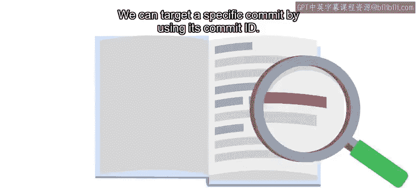
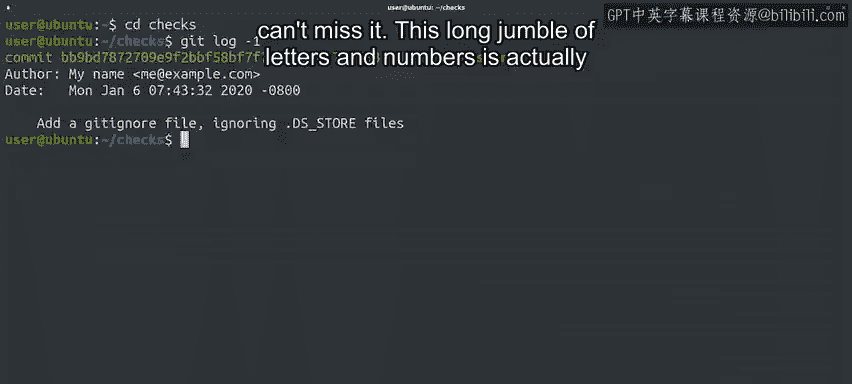
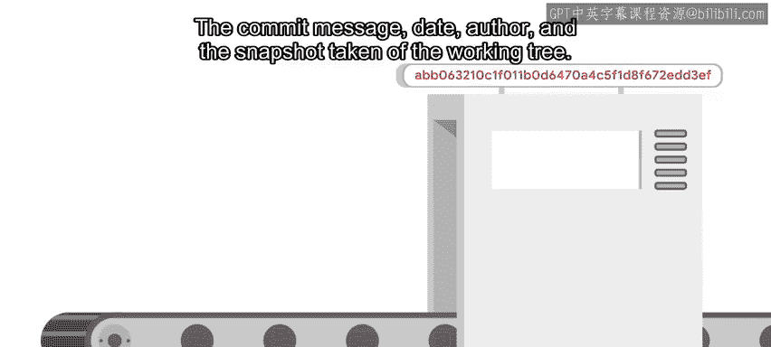
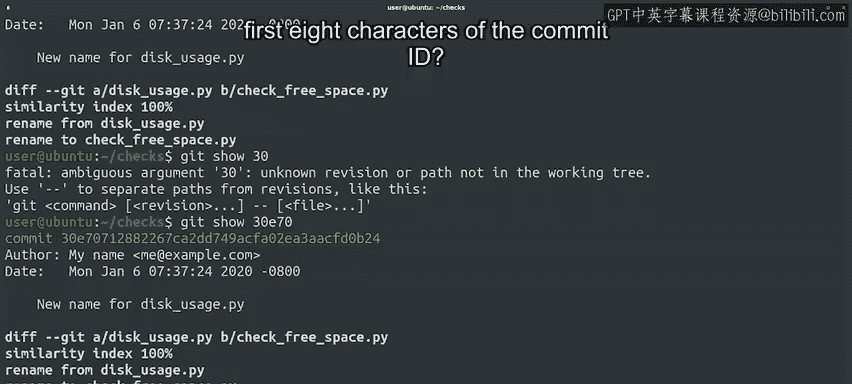

# 谷歌《用Python进行IT自动化办公3、4、5、6课（Git、debug、云端、实践）Google IT Automation with Python》中英字 - P24：23_识别提交.zh_en - GPT中英字幕课程资源 - BV1LW4y1F7XW

So far， we've used the head alias to specify the most recently checked out commit in our Git history。

In our bad snapshot example， the error also happened to be in the most recently created commit。

 but errors can sometimes take a while to be detected。

 and so we might need to revert other commits farther back in time。

We can target a specific commit by using its commit ID。

We've seen commit I a few times already。 They show up when we're running the git log command。

 and we also saw the commit I D of the reverted commit。 In our last example。

 commitit Is are those complicated looking strings that appear after the word commit in the log messages。

 Let's have a look at the latest log entry in our checks repo。

The commit ID is the 40 character long string after the word commitit。You really can't miss it。

This long jumble of letters and numbers is actually something called a hash。

Which is calculated using an algorithm called Shah1。Essential。

 what this algorithm does is take a bunch of data as input and produce a 40 character string from the data as the output。

In the case of Git， the input is all information related to the commit。

 and the 40 character string is the commit ID。Cryptographic algorithms like Shah1 can be really complex。

 so we won't go too deep into what this means。 If you're interested。

 you'll find links to more information in the next reading。Still， you might be wondering。

 why on earth would you use a long jumble of letters as an ID for a commit instead of incrementing an introder like one。

 two， three， etcter。To answer that， let's take a quick look at the reason why Gi uses a hash instead of a counter and how that hash is computed。

Although Sh1 is a part of the class of cryptographic hash functions。

 Git doesn't really use these hashes for security， instead they're used to guarantee the consistency of our repository。

Having consistent data means that we get exactly what we expect to quote Gis creator Linus Torvalds。

 you can verify the data you get back out is the exact same data you put in。

This is really useful in distributed systems like Git。

 because everyone has their own repository and is transmitting their own pieces of data。

Computing the hash keeps data consistent because it's calculated from all the information that makes up a commit。

The commit message， date， author and the snapshot taken of the working tree。

 The chance of two different commits producing the same hash commonly referred to as a collision is extremely small。

 so small， it wouldn't happen by chance。

It takes a lot of processing power to cause this to happen on purpose。

If you use a hash to guarantee consistency， you can't change anything in the Git commit without the Shah1 hash changing2。

Remember her discussion about fixing commits with the D dash amend command。

Each time we amend a commit， the commit ID will change。

 this is why it's important not to use dash am on commits that have been made public。

The data integrity offered by the commit Id means that if a bad disk or network link corrupts some data in your repository or worse。

 if someone intentionally corrupts some data， Git can use the hash to spot that corruption。 Aha。

 It will say the data you've got isn't the data you expected。 Something went wrong。Thank you。

 Detective Git。 You've saved the day once again。Okay， enough backstory。

 how can you use commit I to specify a particular commit to work with like during a rollback？

Let's look at the last two entries in our repo using the Git log2 command。

Say we realize that we actually liked the previous name of our script。

 and so we want to revert this commit where we renamed it。First。

 let's look at that specific commit using GitS， which we mentioned in an earlier video。

We've copied and pasted the commit ID that we wanted to display and that works。Alternatively。

 we could provide just the first few characters identifying the commit to the command and Git will be smart enough to guess which commit ID starts with those characters。

As long as there's only one matching possibility， let's try this out。Two characters is not enough。

 but usually four to eight characters will be plenty。Okay。

 now that we've seen how we can identify the commit that we want to revert。

 let's call the git revert command with this identifier。 As usual。

 this will open an editor where we should add a reason for the rollback。 In this case。

 we'll say that the previous name was actually better。 Hooray， for flip flopping。

As we called up before， when we generate the rollback。

 Git automatically includes the ID of the commit that we're reverting。

This is useful when looking at a repo with a complicated history that includes a lot of commits。Now。

 once we save and exit the commit message， it will actually perform the rollback and generate a new commit with its own I D。

 See how before the name of our commit， the revert command already shows the first eight characters of the commit I D。

 Let's use Git show to look at it。😊。

All right， we've managed to revert a commit that wasn't the most recent one。Well done。

 time travelers。Over the past several videos， we've covered a bunch of ways to undo things and get。

 whether for unstage changes， stage changes， amending commits or rolling back changes。

 if anything still seems unclear， now is a great time to practice these commands on your local computer。

 try things out and come up with more examples of use cases you want to test。😊，Up next。

 we've spun up a handy cheat sheet summarizing all the content we just covered when you're ready。

 move on to the next quiz and put all this new knowledge into practice。

We've been learning a lot of complex things over the past few videos。

 so once you're done with that quiz， you should reward yourself for getting through this technical detail with a break。

You earned it， grab a coffee， tea or snack and let the concept settle for a bit。

I'll meet you over the next video。