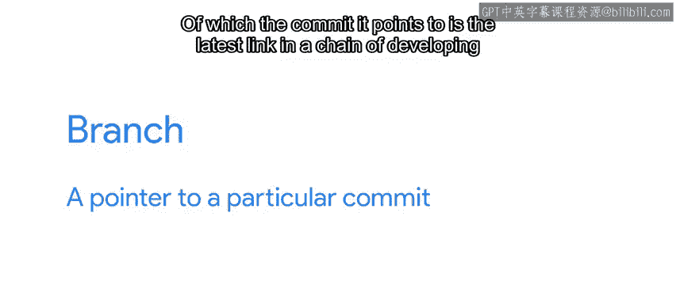
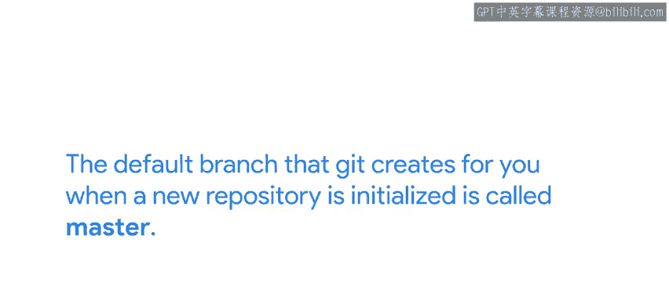
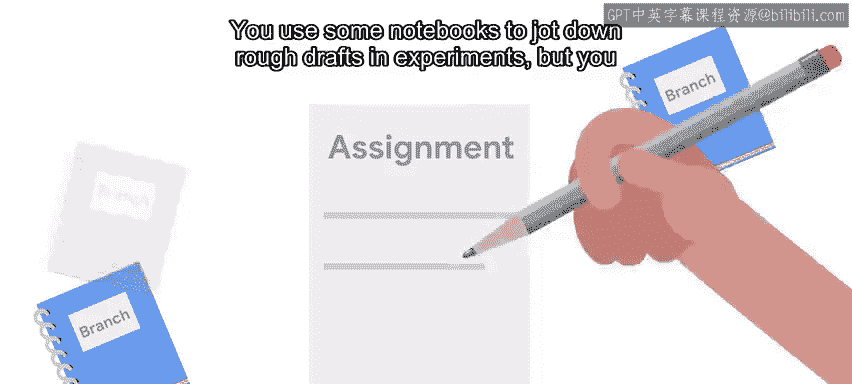
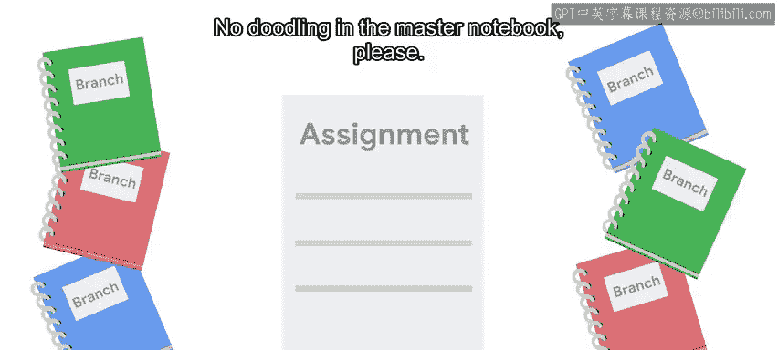
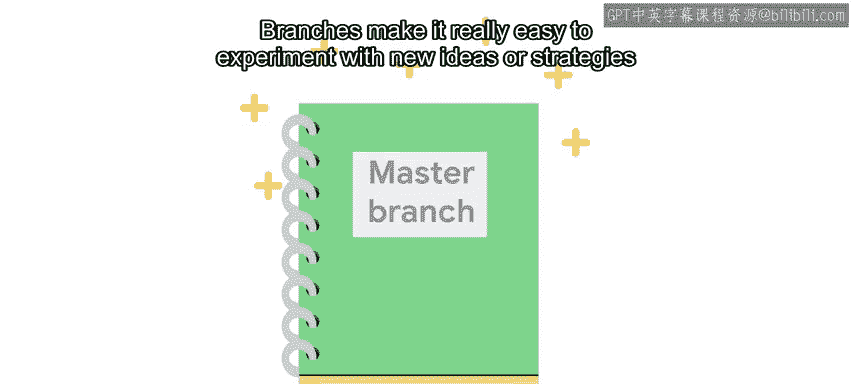
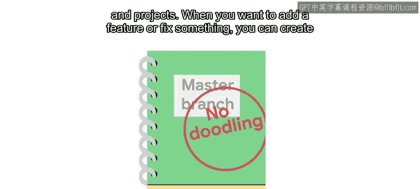
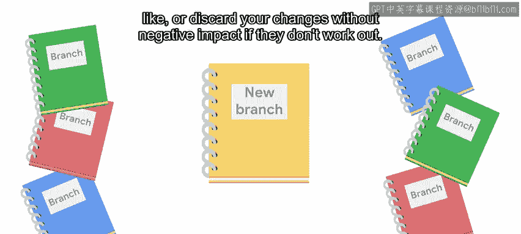
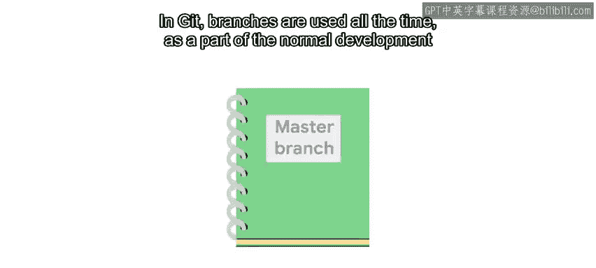

# 谷歌《用Python进行IT自动化办公3、4、5、6课（Git、debug、云端、实践）Google IT Automation with Python》中英字 - P25：24_什么是分支.zh_en - GPT中英字幕课程资源 - BV1LW4y1F7XW

🎼。🎼う。

Up until now， we've only briefly mentioned branches you might have seen the text on branch master in commit messages。

 or you might remember that we talked about branches in the context of the head pointer。

Branches are an important part of the Git workflow。

 so we'll branch out and explore them more thoroughly in the coming videos。

So what is a branch and what is it used for and get a branch at the most basic level is just a pointer to a particular commit？

But more importantly， it represents an independent line of development in a project of which the commit it points to is the latest link in a chain of development history。

The default branch that Git creates for you when a new repository is initialized is called master。

All of our examples and development have taken place on this branch so far。

The master branch is commonly used to represent the known good state of a project。

When you want to develop a feature or try something new in your project。

 you can create a separate branch to do your work without worrying about messing up this current working state。

If this seems confusing， maybe an analogy will help。

 You can think of a git project as an assignment your teacher gives you in a class。

 You do all your work on the assignment in a set of notebooks。

 each notebook representing a different branch。

You use some notebooks to jot down rough drafts and experiments， but you keep one notebook。

 the master branch， in a tidy state， and you copy the polished versions of these drafts into it。

No doodling in the master notebook， please。

Branches make it really easy to experiment with new ideas or strategies and projects。

When you want to add a feature or fix something， you can create a new branch and do your development there。

 you can merge back into the master branch when you've got something you like or discard your changes without negative impact if they don't work out。

In Git， branches are used all the time as a part of the normal development workflow。As an example。

 think back to the problematic commit we fixed in an earlier video。

 we added a call to the disk full function but forgot to actually define the function。

So we had to roll it back because our users were seeing errors。Knowing what we know now。

 we could have done that work on a separate branch， maybe called something like add disc full。

In that case， we could have iterated on our code there until it was working correctly without it affecting the master branch。

Only after the code was ready to be deployed， we would merge those changes back into the master branch。

In the next few videos， we'll look into how to create new branches and merge their content into the master branch。

 we'll also go over what to do if you run into any scary merge conflicts。Heads up。

 This is about to get pretty complicated， so make sure that you follow all of our exercises along on your computer and keep practicing。

 coming up with new ways of using branches and merging until you're comfortable with each of the steps we show。

