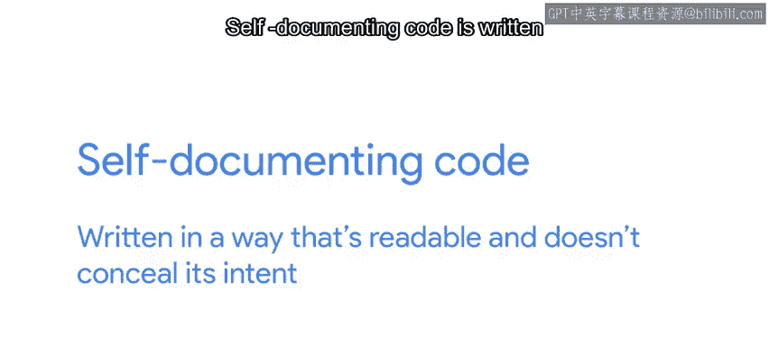
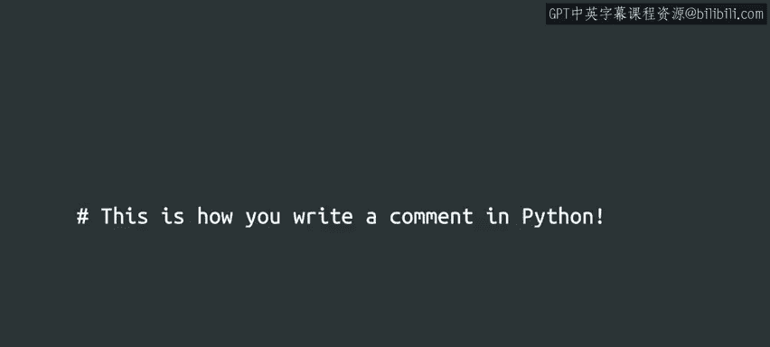

# 谷歌《用Python进行IT自动化办公1、2课（Python、控制操作系统）｜Google IT Automation with Python》中英字幕 - P26：25_代码风格.zh_en - GPT中英字幕课程资源 - BV1gw411E7E1

So far， we've looked into how the Python syntax is used for variables。

 expressions and defining and using functions。 There's a lot more syntax to come。

 But before we dive into that， let's talk a bit about a different side of programming St on the whole。

 having good or bad style when you write code doesn't make much difference between a script succeeding or crashing。

 but it can make a big difference for the people who use it and contribute to it。

 Poor programming style can make life difficult for the I T specialists or system administrators who have to read the script after it's written or make changes to it。

 So it works with a new system。 Bad style can even give the scripts author a headache if it's been a while since they've wrote it。

 Imagine having to rewrite your own code because it's too messy to understand。

 Yikes on the flip side。 Good style can make a script look almost like natural human language。

 It can make the script's intent and construction immediately clear to the reader。😊。

Good style makes life easier for people who have to maintain the code and helps them understand what it does and how it does it。

 It can also reduce errors since it makes updating the code easier and more straightforward。

 And most importantly， good style makes you look cool， right？ So we agree。

 our code should be stylish。 But what makes the style of a piece of code good or bad。

 Although there are no hard and fast rules that apply to every programming language and situation。

 keeping a few principles in mind will go a long way to creating good， Well styled code。 First off。

 you want your code to be as self documenting as possible。

 Se documenting code is written in a way that's readable and doesn't conceal its intent。😊。

This principle can be applied to all aspects of writing code from picking your variable names to writing clear。

 concise expressions。 Take this code snippet， for example。

It's hard to determine the purpose of this code by just looking at it。

 The names of the variables don't give the reader much information。

 And although you can likely work out the result of the calculation。

 there are no clues to what that result might be used for。In programming lingo。

 when we rewrite code to be more self documenting， we call this process refactoring。

So how would it look if we refactored this code？With this refactored code。

 the intent should now be more clear。 the names of the variables and the function reflect their purpose。

 which helps the reader understand the code more quickly。

You should always aim for your code to be self documenting， But even then。

 sometimes you may need to use a particularly tricky bit of code in your script。

 When good naming and clean organization can't make the code clear。

 you can add a bit of explanatory text to the code。 You do this by adding what we call a comment。

In Python， comments are indicated by the hash character。 When your computer sees a hash character。

 it understands that it should ignore everything that comes after that character on that line。

 Check out how this looks。

Using comments， lets you explain why a function does something a certain way。

 It also allows you to leave notes to your future self or other programmers to remind you of what needs to be improved and why。

Obviously， it's much easier to read your own code than someone else's。 But in my job。

 I work on code that was written by lots of different people。

 and everybody designs things a little differently。

 This is why it's so important to comment and document your code。 Well。 more often than not。

 your code will eventually be used by someone other than you。 So be a good neighbor。

 use a style guide to structure your code in a way that's readable by others or by you in six months when you've forgotten why you wrote that code in the first place in upcoming exercises in this course。

 Well use comments to let you know what you need to do with the code。

 And you can always write as many extra comments as you need。 Com up。

 a quiz to consolidate your newly acquired knowledge about functions。 Don't worry， you've got this。😊。

