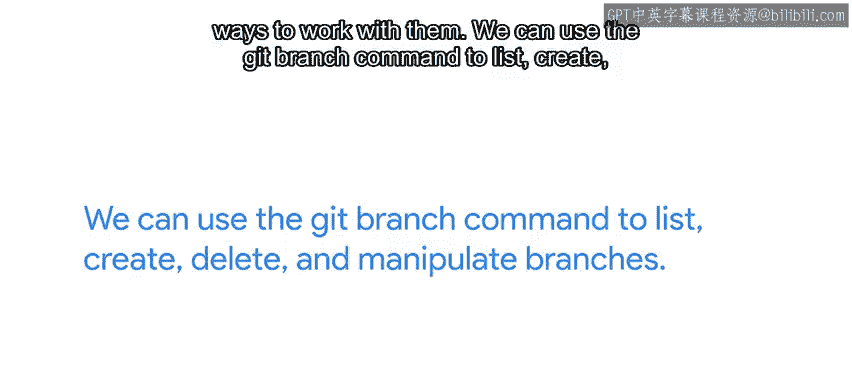
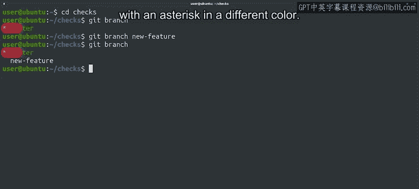
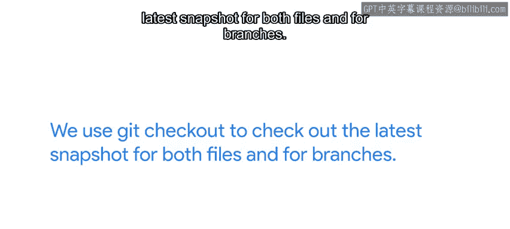
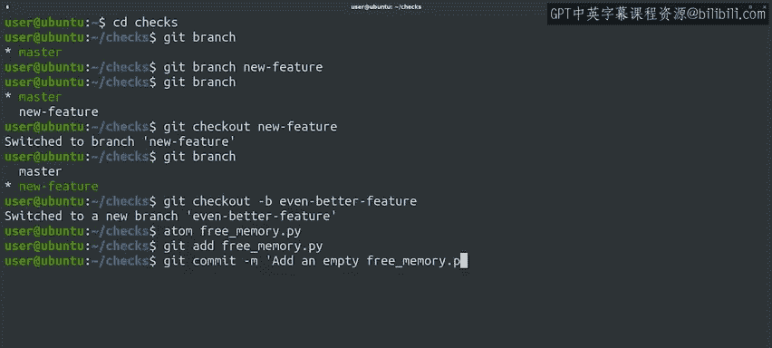

# 谷歌《用Python进行IT自动化办公3、4、5、6课（Git、debug、云端、实践）Google IT Automation with Python》中英字 - P26：25_创建新分支.zh_en - GPT中英字幕课程资源 - BV1LW4y1F7XW

As branches are essential to how work is done in Git。

 there's tons of different ways to work with them。We can use the Git branch command to list， create。

 delete and manipulate branches runningning Git branch by itself will show you a list of all the branches in your repository。

Let's try it out in our checks repo。Our list is looking pretty empty right now， but don't worry。

 creating a branch is a snap。 We do it by calling Git branch with the name of the new branch。

Let's create a new feature branch and then list the branches again with Git branchch。

Our new branch was created based on the value of head。

Remember that this might not necessarily be the master branch。

 The list we get shows that we're still on the master branch。

We can tell because the current branch is indicated in the commands output with an asterisk in a different color。

We'll look into other things that Git branch lets us do with branches later on。

 but right now we want to switch to a new branch。To do that。

 we'll need to use the Git checkout command。 We saw earlier how we can use Git checkout to restore a modified file back to the latest commit。

Checking out branches is similar in that the working tree is updated to match the selected branch。

 including both the files and the Git history。If this seems a bit confusing at first。

 you are not alone。I also found it hard to wrap my head around at first。

But rest assured that it will become clearer after we use these commands for a while。

It might help to remember that we use Git checkout to check out the latest snapshot for both files and for branches。

Al right， let's switch to our new feature branch by calling Git checkout new feature and then listing our branches once again。

Before we were working on the master branch， but now that we've changed to our new branch。

 the star has moved to new feature。Creating a branch and switching to it immediately is a pretty common task。

 So common that Git gives us a useful shortcut to create a new branch and to switch to it in a single command。

 We can use the Git checkout dash B new branch to do this。😊，Take a look。

See how the message says that we've switched to a new branch。

Get created the new branch and switch to it in just one command， super efficient， right？All right。

Now that we have our shiny new branch， let's create a new file in it。

We'll create a new Python 3 file that will include the usual Shiang line。

An empty main function and a call to that function。

This file is empty because it's only the beginning of our work。As it's in a separate branch。

 it's okay for it to not be finished yet。 Let's save our file and commit it to the current branch now。

All right， we've added a commit in this branch， and it's looking better。

 Let's check the last two entries in the log。We see the last two commits in this branch。

 notice how next to the latest commit ID Gi shows that this is where head is pointing to。

 and that the branch is called even better feature。

And next to the previous commit Gi shows that both the master and the new feature branches are pointing to that snapshot of the project In this way。

 we can see that the even better feature branch is ahead of the master branch。With that。

 we've seen how we can create new branches and commit changes to them。

You might say your knowledge of branches has。Gn。Up next。

 we'll learn even more things we can do to operate with branches， so stick around。

