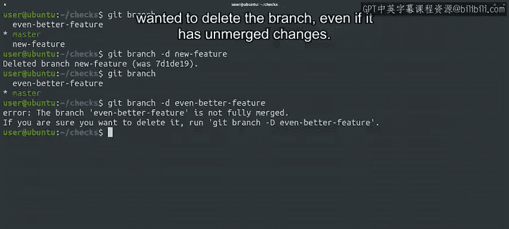

# 谷歌《用Python进行IT自动化办公3、4、5、6课（Git、debug、云端、实践）Google IT Automation with Python》中英字 - P27：26_使用分支.zh_en - GPT中英字幕课程资源 - BV1LW4y1F7XW

In our last video， we created a new branch different than the master branch and added a commit to it let's check out the current status of our Repo by calling Git statusus and LS Stael。

So we see that we're on a clean working tree in the even better feature branch and that the new free memory P file is in our working tree。

 let's now change back to the master branch using Git checkout master and then list the latest two commits there。

When we switch to a different branch using git checkout under the hood。

 git changes where head is pointing。Thanks to this checkout。

 head went from pointing to the latest commit in the even better feature branch to the most recent commit of the master branch。

The commit from even better feature doesn't show up at all。

 and the latest snapshot is the second entry we've seen before。Remember that when we switch branches。

 Git will also change files in our working directory or working tree to whatever Snapshot head is currently pointing at。

Let's look at the current contents of our directory。Whoa， whoa， whoa， free memory pie isn't there。

This demonstrates that when we switch branches and Git。

 the working directory and commit history will be changed to reflect the snapshot of our project in that branch。

When we check out a new branch and commit on it， those changes will be added to the history of that branch。

Since Free Meory Pi was committed on another branch。

 it doesn't show up in the history or working directory of the master branch。

One thing to note after all this back and forth is that each branch is just a pointer to a specific commit in a series of snapshots。

It's very easy to create new branches because there isn't any data that needs to be copied around。

When we switch to another branch， we check out a different commit and get updates both head and the contents of our working directory。

Head floats around with us， it's like a free spirit。What a head trip。Okay。

 we've now seen how to create and switch between branches。

 so what if we want to delete a branch that we don't need anymore？

We can do that by using Git branchD， Let's first list the current branches in our repo and then get rid of the new feature branch by calling Git branchD new feature。

And just like that， our branch was trimmed。We can check with another call to Git branchch that is not there anymore。

If there are changes in the branch we want to delete that haven't been merged back into the master branch。

 Gi will let us know with an error。Hopefully， Git also gives us the command to run if we were sure that we wanted to delete the branch。

 even if it has unmerged changes。

But we won't do that just yet。We actually want to merge those changes back into the repoers。

And how do we do that？It's all coming up in our next video。

