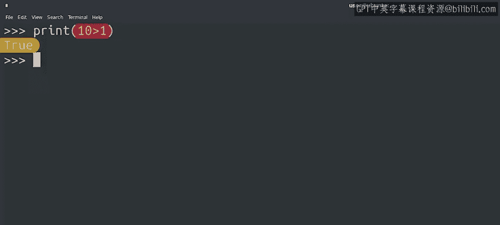
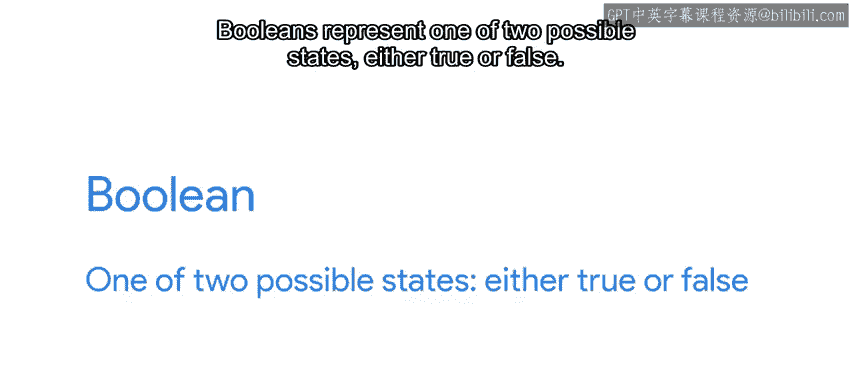
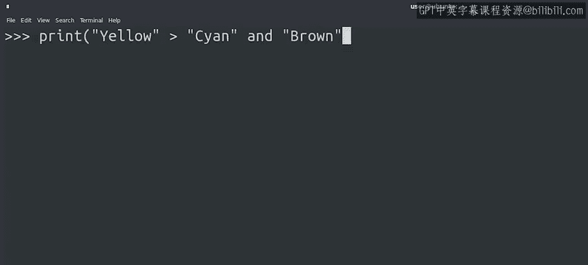
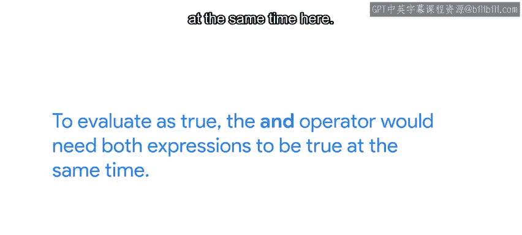
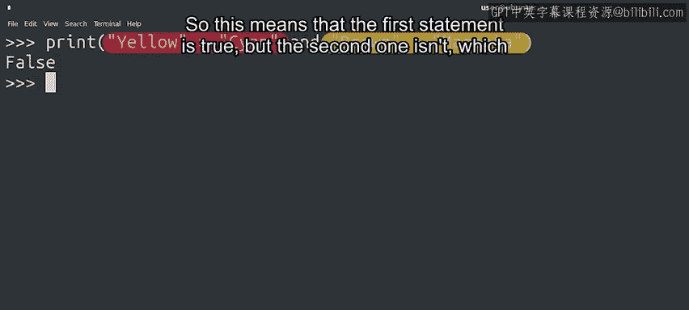
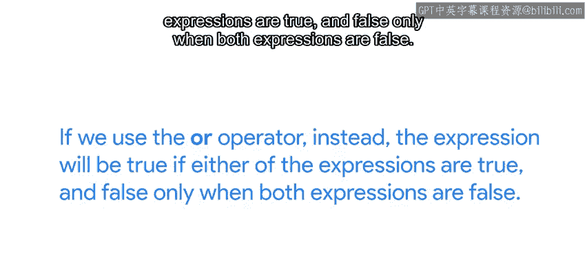
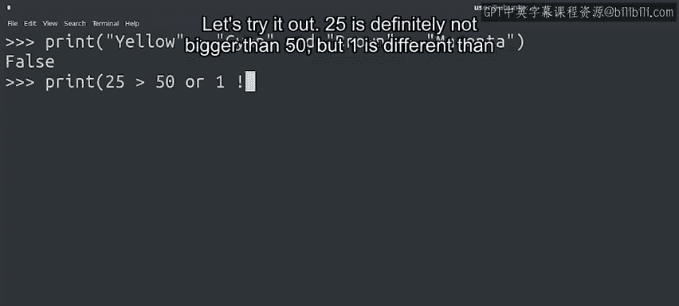
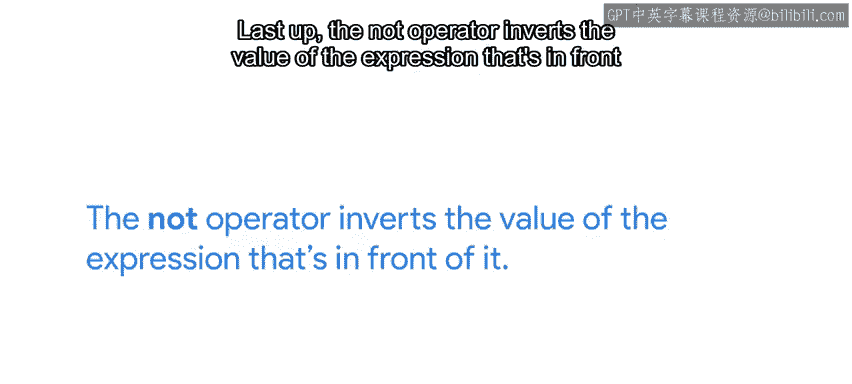
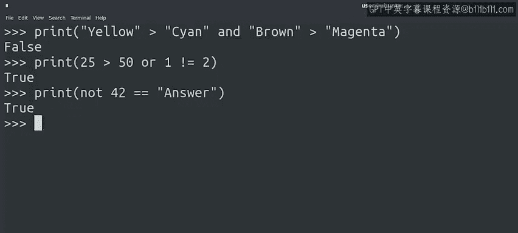

# 谷歌《用Python进行IT自动化办公1、2课（Python、控制操作系统）｜Google IT Automation with Python》中英字幕 - P27：26_比较事物.zh_en - GPT中英字幕课程资源 - BV1gw411E7E1

We've seen a few arithmetic expressions so far like addition， subtraction and division。

 Remember when we turn Python into a calculator， Well， Python can also compare values。

 This lets us check whether something is smaller than equal to or bigger than something else。

 This allows us to take the result of our expressions and use them to make decisions。

 Check out these three examples。 In the first example，10 is greater than one。

 So the value true is printed as a result。😊。

True is a value that belongs to another data type called the Boolean。

 Booleions represent one of two possible states， either true or false。

Every time you compare things in Python， the result is a boolean of the appropriate value。

 In the second example， we can see our very first equality operator。

 which is formed by putting two equal signs together。

 We use this operator to test whether two things are equal to each other。 In this example。

 the string cat is not equal to the string dog。 So the boolean that's printed as false。😊。

In our third example， we're doing the opposite comparison by pairing an exclamation mark and an equal sign。

 we're using the not equals operator， which is the negated form of the equality operator in this particular line of code。

 the operator checks that one isn't equal to two。We called out before that the plus operator doesn't work between integers and strings。

 What do you think will happen if we try to compare an integer in a string。

 Let's find out by seeing if the number one is smaller than the string one。Wamp， wamp， wamp。

 We get a type error。 That's the same error we got before。

 This happens because Python doesn't know how to check if a number is smaller than a string。

And what about the equality operator？In this case， the interpreter has no problem telling us that the integer 1 and the string1 aren't the same。

 So what gives。Basically， although they may seem similar to us because they both contain the same number。

 it's clear to the computer that one is a number and the other is a string。For the computer。

 it's obvious that they are completely different entities。

On top of the comparison and equality operators， Python also has a set of logical operators。

 these operators allow you to connect multiple statements together and perform more complex comparisons。

In Python， the logical operators are the words and or and not。 Let's look at some examples。

To evaluate is true， the and operator would need both expressions to be true at the same time。

Here， we're comparing strings， and the bigger and smaller operators referred to alphabetical order。

Yellow comes after can， but brown doesn't come after magenta。

 So this means that the first statement is true， but the second one isn't。

 which makes the result of the whole expression false。

If we use the ore operator instead， the expression will be true if either of the expressions are true and false only when both expressions are false。

Let's try it out。25 is definitely not bigger than 50。But one is different than two。 So in the end。

 the whole expression is true。

Last up， the not operator inverts the value of the expression that's in front of it。

If the expression is true， it becomes false。 If it's false， it becomes true。 Just like this。

 logical operators are important because they help us write more complex expressions。

 We'll see this in action in the next few videos。 If this is the first time you've come across these operators。

 It might seem like there's a lot to remember。 But don't worry。

 you'll learn most of them very quickly just by practicing。 And in the next reading。

 we have a cheat sheet that lists all the operators available and what each one does。

 It's a handy resource， you're sure to find useful when writing your own scripts。😊。

