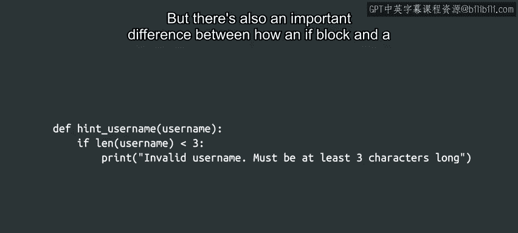
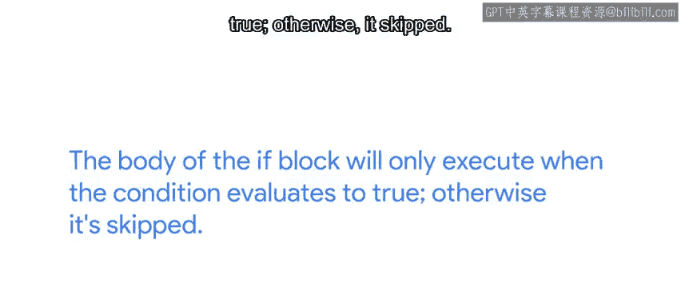

# 谷歌《用Python进行IT自动化办公1、2课（Python、控制操作系统）｜Google IT Automation with Python》中英字幕 - P28：27_使用 if 语句进行分支.zh_en - GPT中英字幕课程资源 - BV1gw411E7E1

Now that we're armed with knowledge of Python's expressions， comparators and variables。

 we can dive right into how to use them in our scripts to perform different actions based on their values。

 The ability of a program to alter its execution sequence is called branching。

And it's a key component in making your scripts useful。

 You probably use the idea of branching a bunch in your everyday life。 For example。

 if it's before noon， you might greet someone by saying good morning instead of good afternoon or good evening。

 If it's raining outside， you might choose to take an umbrella。 If it's cold。

 you probably wear a jacket。

In your scripts， you can instruct your computer to make decisions based on inputs。 too。

 Let's take a look at an I T focused example。 In many companies。

 new employees can choose the username they'll use to access the companys systems。

 and usually the chosen username needs to fit with a given set of guidelines。

 Compies can set different criteria for what a valid username looks like。 For now。

 let's assume that at your company， a valid username has to have at least three characters。

You've been tasked with writing a program that will tell the user if their choice is valid or not to do that。

 you could write a function like this。 This function checks whether the length of the username is smaller than3。

 If it is， the function prints a message saying that the username is invalid。

 Look closely at how the if statement is written。 We write the keyword if followed by the condition that we want to check for。

 and then followed by a colon。 After that comes the body of the if block。

 which is indented further to the right。You may notice that there are some similarities between how an if block and a function are defined。

The key word， either de or if， indicates the start of a special block。 At the end of the first line。

 we use a colon， and then the body of the function or the if block is indented to the right。

But there's also an important difference between how an if block and a function are defined。

 The body of the if block will only execute when the condition evaluates to true。 Otherwise。

 it's skipped。

Of course， you can do a lot more things inside the body of the if block than just printing stuff。

 As we expand our programming abilities， we'll learn how to do things like shortened text that's too long。

 Delete a file if it exists。 Start a service if it's not running and a bunch more。

 If your code is inside a function， you could also choose to return a value depending on whether a certain condition is met。

 Can you imagine how that would look。😊，By now， you know how to define functions and inside those functions。

 you can now make your program do something only when certain conditions are met。

 ready to branch out and make our branches even more interesting with else statements。

 then hop on over to the next video or else you'll miss out。😊。

