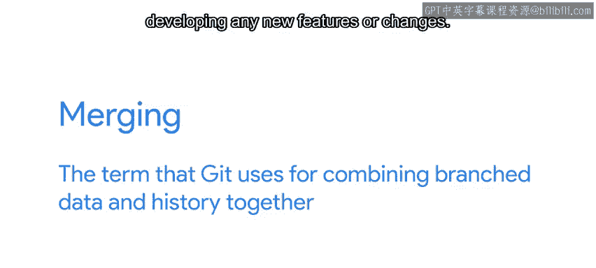
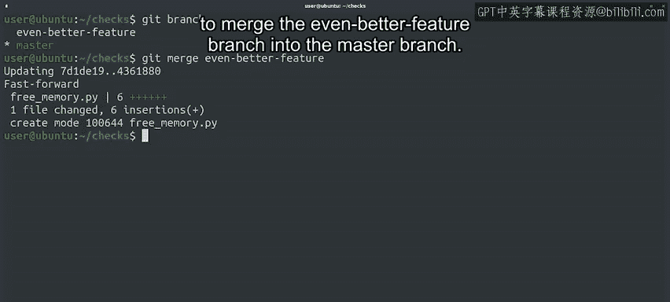
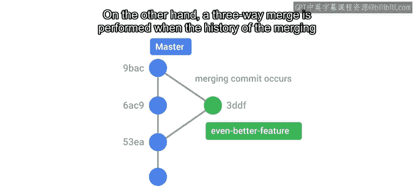

# 谷歌《用Python进行IT自动化办公3、4、5、6课（Git、debug、云端、实践）Google IT Automation with Python》中英字 - P28：27_合并.zh_en - GPT中英字幕课程资源 - BV1LW4y1F7XW

A typical workflow for managing branches in Git is to create a separate branch for developing any new features or changes。

Once the new feature is in good shape， we merge the separate branch back into the main trunk of code。

Merging is the term that Gi uses for combining branch data and history together。

We'll use the Git mergege command， which lets us take the independent snapshots and history of one Git branch and tangangle them into another。

Let's try this out with our example branch from the last video。 First。

 we'll check that we're in master branch。And then we'll call get mergege Even better feature to merge the even better feature branch into the master branch。

Now， we've brought the master branch up to speed， which we can see by looking at the gitlog。

As we're on the master branch， head points at Master。

We can see the even better feature and master branches are now both pointing at the same commit。

Gt uses two different algorithms to perform emerge merge。Fast forward and three way merge。

The merge we just performed is an example of a fast forward me。

 This kind of merge occurs when all the commits in the checked out branch are also in the branch that's being merged。

If this is the case， we can say that the commit history of both branches doesn't diverge。

In these cases， all Git has to do is update the pointers of the branches to the same commit。

 and no actual merging needs to take place。 On the other hand。

 a threeway merge is performed when the history of the merging branches has diverged in some way。

 and there isn't a nice linear path to combine them via fast forwarding。

This happens when a commit is made on one branch after the point when both branches split。

In our case， this could have happened if we made a commit on the master branch after creating the other branches。

When this occurs， Git will tie the branch histories together with a new commit。

And merge the snapshots at the two branch tips with the most recent common ancestor。

 the commit before the divergence。To do this successfully。

 Get tries to figure out how to combine both snapshots。

If the changes were made in different files or in different parts of the same file。

 Git will take both changes and put them together in the result。

 If instead the changes were made on the same part of the same file。

 Git won't know how to merge those changes in the attempt will result in emerge conflict。

 This sounds scary， but don't panic。Getit doesn't quit。We'll solve those conflicts in our next video。

