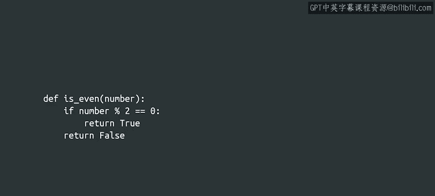
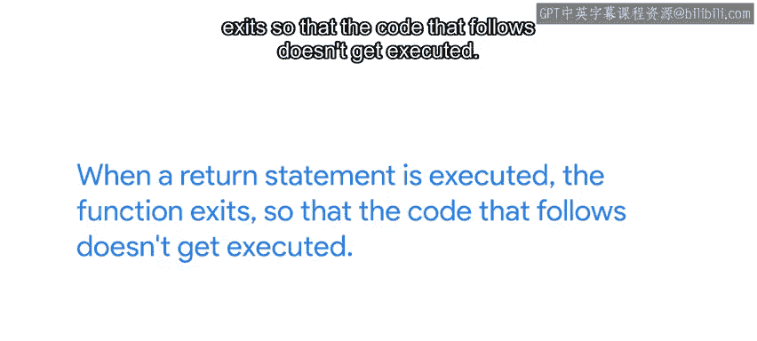
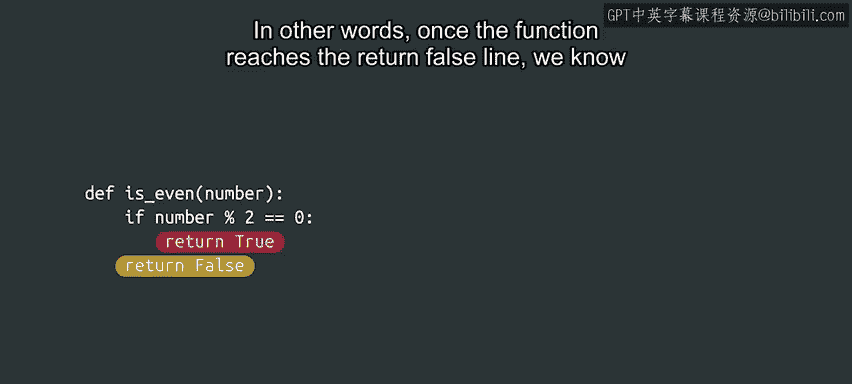

# 谷歌《用Python进行IT自动化办公1、2课（Python、控制操作系统）｜Google IT Automation with Python》中英字幕 - P29：28_else 语句.zh_en - GPT中英字幕课程资源 - BV1gw411E7E1

The if statement is already a pretty useful construct。

 but we can extend it to make it even more powerful。

 Think about the username example from the last video。😊。

What if we also wanted to print a message when the username was valid？Here。

 we've included an else statement to achieve this。 The program can now go in one of two directions。

 depending on the length of the username。If it's not long enough。

 we get a message indicating that the username is invalid。

 but if the program verifies that the username is long enough。

 it will print a message saying it is valid。Pay attention to how the else statement is written。

 It uses the else keyword followed by a colon to indicate the beginning of the else block。Once again。

 the body of the block is further indented to the right。As we've called out before。

 these blocks can contain multiple lines and do more than just print messages。

 They can do calculations， modify values， return values， and a lot more。

 And remember that you can choose to use as many or as few spaces as you want for the indentation。

 But you always need to indent， and you always need to use the same number of spaces。

The L statement is very useful， but we don't always need it。

 Say we want to have a function that checks if a value is even or odd。

 We could do that with a piece of code like this。Here we're using a new operator。

 so let's first explain that the modo operator is represented by the percentage sign and returns the remainder of the integer division between two numbers。

The integer division is an operation between integers that yields two results。

 which are both integers， the quotient and the remainder。

 So if we do an integer division between 5 and 2， the quotient is 2， and the remainder is 1。

 If we do an integer division between 11 and 3。 the quotient is 3， and the remainder is 2。

 Even numbers are all multiples of2， which means the remainder of the integer division between an even number and 2 is always going to be 0 in this function。

 we're using this principle to decide whether a number is even or not。

So how come we have these two return statements， one below the other without an L statement。

 The trick is that when a return statement is executed。

 the function exits so that the code that follows doesn't get executed。

This means that if the number is even， the computer will reach the return true statement and exit the function。

 Anything that comes after that will only be executed if the condition in the if statement was false。

In other words， once the function reaches the return false line。

 we know for sure that the if condition was false， which means the number was odd。

At first， you might feel more comfortable， including the L statement， even if it's not needed。

 And that's totally okay。 It's important to know that both ways of writing this are correct。

 And remember that this technique can only be used when youre returning a value inside the if statement to recap the if statement allows us to branch the execution based on a specific condition being true。

 The L statement lets us set a piece of code to run only when the condition of the if statement was false。

 If you return a value inside an if block， then the code after the block will only be executed If the condition was false。

 all make sense。If all these ifs and  Els are starting to get a little confusing， that's okay。

 There's a lot to soak up here。 And the best way to do that is， yeah， you guessed it。 practice。

 So review the content and practice on your own as much as you need。 Once you're done。

 meet me over in the next video。